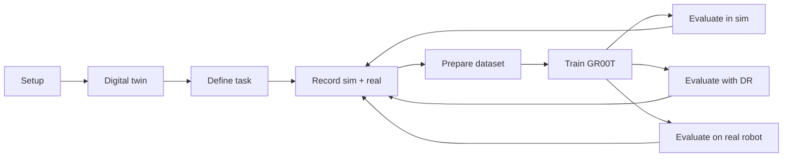

# SO-101 sim-to-real: Isaac Lab, LeRobot and GR00T

This fork of the [NVIDIA SO-101 workshop](https://github.com/isaac-sim/Sim-to-Real-SO-101-Workshop)
extends the original vial-to-rack workflow with a photo-matched **MyRoom** digital
twin and a cube pick-and-place task. Use Isaac Lab for simulation, LeRobot for
teleoperation and datasets, and GR00T for training and policy serving.

Follow the [NVIDIA course](https://docs.nvidia.com/learning/physical-ai/sim-to-real-so-101/latest/index.html)
for the original workshop. This guide documents the code in this fork, including
its current limitations. Measure your own scene; the packaged geometry and
calibration belong to one setup.



## Quick start: record one simulation episode

1. On a fresh **host**, first install the GPU driver, Docker, NVIDIA Container
   Toolkit and X11 prerequisites in [Setup](docs/01-setup.md). Connect an SO-101
   leader. A physical follower is optional for this first simulation recording.
   Clone and build on the **host**:

```bash
mkdir -p ~/sim2real
cd ~/sim2real
git clone https://github.com/iampa1teja/Sim-To-Real.git
cd Sim-To-Real
mkdir -p outputs datasets
touch docker/env
docker build -t teleop-docker -f docker/sim/Dockerfile .
```

2. Run on the **host**, from the repository root. This retains the workshop's
   X11 and volume setup; it opens X access broadly, so use a trusted local
   workstation. See [Setup](docs/01-setup.md) for persistence and extra shells.

```bash
xhost +
docker run --name teleop -it --privileged --gpus all -e "ACCEPT_EULA=Y" --rm --network=host \
  -e "PRIVACY_CONSENT=Y" -e DISPLAY -e XDG_RUNTIME_DIR=/tmp/xdg-runtime-root \
  -v /tmp/.X11-unix:/tmp/.X11-unix:rw \
  -v /dev:/dev -v /run/udev:/run/udev:ro \
  -v "$HOME/.Xauthority:/root/.Xauthority" \
  -v ~/docker/isaac-sim/cache/kit:/isaac-sim/kit/cache:rw \
  -v ~/docker/isaac-sim/cache/ov:/root/.cache/ov:rw \
  -v ~/docker/isaac-sim/cache/pip:/root/.cache/pip:rw \
  -v ~/docker/isaac-sim/cache/glcache:/root/.cache/nvidia/GLCache:rw \
  -v ~/docker/isaac-sim/cache/computecache:/root/.nv/ComputeCache:rw \
  -v ~/docker/isaac-sim/logs:/root/.nvidia-omniverse/logs:rw \
  -v ~/docker/isaac-sim/data:/root/.local/share/ov/data:rw \
  -v ~/docker/isaac-sim/documents:/root/Documents:rw \
  -v ~/.cache/huggingface/lerobot/calibration:/root/.cache/huggingface/lerobot/calibration \
  -v "$(pwd)/docker/env:/root/env" \
  -v "$(pwd):/workspace/Sim-to-Real-SO-101-Workshop" \
  teleop-docker:latest
```

3. In the **teleop container**, run discovery first:

```bash
lerobot-find-port
lerobot-find-cameras opencv
```

4. In the **teleop container**, replace the port placeholder with the discovered
   leader device and follow calibration prompts. Keep the workspace clear during
   calibration. Then record (the dataset triple enables writing):

```bash
setenv TELEOP_PORT '/dev/serial/by-id/<leader-device>'
setenv TELEOP_ID leader_arm_1
lerobot-calibrate --teleop.type=so101_leader --teleop.port="$TELEOP_PORT" --teleop.id="$TELEOP_ID"
pick_place_agent --task Lerobot-So101-Teleop-Pick-Place \
  --repo_id '<hf_user>/pick_place_v1' \
  --repo_root /workspace/Sim-to-Real-SO-101-Workshop/datasets/pick_place_v1 \
  --task_name 'Pick up the blue cube and place it in the white box'
```

5. Open `http://localhost:8765/` in the **host** browser. Move the leader to a
   suitable start pose, **Spawn the cube**, **Start recording**, wait for the
   countdown, demonstrate, then **Save**. Choose **Encode & Exit** on exit.
   [Recording](docs/04-recording.md) explains controls, paired real recording,
   recovery and the empty-dataset relaunch caveat.

## Environment setup form

Use [form.html](source/gui/form.html) to enter arm ports and IDs, camera settings,
calibration paths and optional room/model locations. It matches the recorder's
light/dark interface and previews the shell exports as you edit.

With the recorder running at its default address, open
`http://localhost:8765/form.html`. For setup before launching the recorder, use
[the standalone form instructions](docs/01-setup.md#configure-with-the-browser-form).
Choose **Download env**, merge the values into `docker/env`, then run
`source docker/env` in the host shell that will use them.

**Save draft** keeps the form in this browser; **Restore draft** loads it on a
later visit. Drafts are separate from `docker/env` and do not configure a running
recorder. See [draft behavior and recovery](docs/01-setup.md#local-drafts) for
reset, deletion and browser-storage details.

## GR00T training in Docker

Build the pinned N1.7 training image and verify its runtime:

```bash
./docker/train/build.sh
./docker/train.sh check
```

Prepare and verify a dataset with `./docker/train.sh prepare` and
`./docker/train.sh verify`, then use `./docker/train.sh --preflight_only` before
`./docker/train.sh`. Existing training shell scripts also route through Docker.
Checkpoints default to `/external_storage/models` and survive container removal.
See [Training](docs/05-training.md) for dataset preparation, model downloads and
training settings. Training and serving use their container environments; no
host GR00T checkout or physical-arm rollout client is required.

## MolmoAct2 evaluation

Use the SO-100/101 fine-tuned checkpoint with the corrected wrist frame. Start
the `teleop` container with the display mounts above, then run on the host:

```bash
./scripts/setup_molmoact2.sh --variant so101
./docker/eval.sh pick_place_molmo_so101.yaml --save_videos
```

The SO-101 profile uses a BF16 backbone with the action expert, norms, and RoPE
in FP32 (`policy.options.action_dtype: float32`). It restores the original
checkpoint values before GPU transfer, adding about 1.1 GiB for the expert
compared with all-BF16 storage. Action denormalization also uses FP32 to avoid
rounding absolute joint targets to whole degrees. These preserve numerical
precision; the five-episode smoke test checks the resulting execution and grasps.

The SO-101 profile uses the original front camera as `room` and the gripper
camera as `wrist`. Both `eval.molmo_overhead_camera` and
`policy.options.include_original_room` are disabled. The existing camera poses
and default environment remain unchanged. An added view behind and above the
arm, aligned with the table edge, remains available as an optional comparison;
see [Evaluation](docs/06-evaluation.md).

The profile also opts into experimental pan adaptation fitted from the local
training demonstrations. It consistently rescales pan observations and actions
while preserving the checkpoint weights, statistics and physical calibration.
Its settings and validation results are documented in the evaluation guide.

The SO-101 profile executes the full 30-action chunk at the simulation's 30 Hz control rate,
querying again every simulated second (`action_repeat: 1`). This keeps visual
feedback and gripper timing at the predicted speed. Setting `action_repeat: 5`
holds each target for five ticks and queries every five simulated seconds,
slowing the motion fivefold; use it only for an explicit timing comparison.
Each attempt allows up to 90 simulated seconds (1 min 30 s) and logs simulation and wall
time to success. `--save_videos` saves separate camera MP4 files beside the
results; omit that flag to disable recording. Detailed logs are retained under
`/tmp/so101-eval/`. The fixed benchmark determines the number of attempts.

To watch five attempts in Rerun without saving evaluation reports, heatmaps,
videos, CSVs or run logs:

```bash
./docker/eval.sh pick_place_molmo_so101.yaml --smoke-test
```

Smoke mode overrides saving options and limits even a fixed benchmark to five
attempts. Each attempt keeps the configured timeout (90 simulated seconds for
this Molmo profile); progress and success timing appear in the terminal.

An existing stopped container created without `--rm` can be restarted with
`docker start teleop`. Use the launch block above when creating a new container.
See [Evaluation](docs/06-evaluation.md#host-runner) for output paths, YAML settings,
and viewer troubleshooting.

## Guides

| Guide | Purpose |
| --- | --- |
| [01 Setup](docs/01-setup.md) | Containers, devices, calibration, environment and Git |
| [02 Digital twin](docs/02-digital-twin.md) | Measure and align your own room and cameras |
| [03 Define a task](docs/03-define-a-task.md) | Config layers, scene objects, reset and success logic |
| [04 Recording](docs/04-recording.md) | Recorder flags, GUI, storage, coverage and failed demos |
| [05 Training](docs/05-training.md) | Filtered preparation, verification and GR00T fine-tuning |
| [06 Evaluation](docs/06-evaluation.md) | Recorded starts, DR, results and simulation diagnostics |
| [Troubleshooting](docs/troubleshooting.md) | Symptoms, recovery and known implementation gaps |

## Repository layout

| Path | Contents |
| --- | --- |
| `source/sim_to_real_so101/assets/` | Robot/room USD, measured setup JSON and material helpers |
| `source/sim_to_real_so101/tasks/` | Gym registrations and environment configs |
| `source/sim_to_real_so101/mdp/` | Reset, observation and success functions |
| `source/sim_to_real_so101/scripts/` | Installed console commands |
| `source/sim_to_real_so101/utils/` | Recording, sidecars, geometry and policy adapters |
| `source/gui/` | Recorder browser interface and environment setup form |
| `docker/` | Images, host runner and real-robot scripts |
| `scripts/` | CPU dataset preparation and verification |
| `tests/` | Contract and integration tests |
| `datasets/`, `outputs/` | Local generated data; not versioned |

## Command reference

Console entry points are declared in [pyproject.toml](source/sim_to_real_so101/pyproject.toml).
The table also covers repository host scripts and direct Python utilities.

| Command or script | Role and guide |
| --- | --- |
| `list_envs` | List registered tasks; [Setup](docs/01-setup.md) |
| `zero_agent` | Zero-action visual check; [Task definition](docs/03-define-a-task.md) |
| `random_agent` | Random-action visual check; [Task definition](docs/03-define-a-task.md) |
| `lerobot_agent` | Generic leader teleop/recording; [Recording](docs/04-recording.md) |
| `pick_place_agent` | Cube workflow and browser recorder; [Recording](docs/04-recording.md) |
| `lerobot_eval` | Remote-policy sim evaluation; [Evaluation](docs/06-evaluation.md) |
| `lerobot_push_dataset` | Declared but broken console entry point; module workaround in [Training](docs/05-training.md) |
| `scripts/prepare_pick_place_gr00t.py` | Independent v2.1 training copy; [Training](docs/05-training.md) |
| `scripts/verify_pick_place_training.py` | Checksums and actual reader check; [Training](docs/05-training.md) |
| `docker/real/build.sh` | Host image build for Ada/Blackwell; [Setup](docs/01-setup.md) |
| `docker/eval.sh <config>.yaml` | Host-managed server/client lifecycle from one YAML (`configs/eval/`); [Evaluation](docs/06-evaluation.md) |
| `docker/sim/entrypoint.sh` | Automatic container initialization; [Setup](docs/01-setup.md) |
| `docker/utils.sh` | Sourced `setenv` helper; [Setup](docs/01-setup.md) |
| `source/sim_to_real_so101/scripts/spawn.py` | Generic teleop cube spawn client; [Recording](docs/04-recording.md) |
| `docker/real/scripts/so101_manual_control.py` | Keyboard joint control; [Setup](docs/01-setup.md) |
| `docker/real/scripts/so101_calibration_stats.py` | Build calibration baseline; [Setup](docs/01-setup.md) |
| `docker/real/scripts/so101_check_calibration.py` | File/live calibration checks; [Setup](docs/01-setup.md) |

External LeRobot discovery/calibration commands are covered in [Setup](docs/01-setup.md);
GR00T's launcher and server are covered in [Training](docs/05-training.md) and
[Evaluation](docs/06-evaluation.md). [Docker notes](docker/README.md),
[preparation notes](scripts/README.md)
remain available.

## Troubleshooting at a glance

Missing serial port: rediscover it and check permissions. Wrong camera: check
indices and naming. Black viewport: check X11/GPU access. Stale wrist rendering:
keep Fabric enabled. Resume refusal: preserve the dataset and resolve the exact
schema/timeline error. OOM: lower the training batch and separate simulation from
training. See [Troubleshooting](docs/troubleshooting.md) before deleting data.

## Credits and license

Based on NVIDIA's workshop by Lior Ben Horin, Shane Reetz, Maximilian Ofir and
Zhijin Li (see package metadata), with Isaac Lab and LeRobot contributions.
This fork adds the MyRoom and pick-place workflows. Preserve upstream notices.
The repository is [Apache-2.0](LICENSE); individual files retain applicable
third-party notices, including Isaac Lab BSD-3-Clause attribution.

Course references: [overview](https://docs.nvidia.com/learning/physical-ai/sim-to-real-so-101/latest/index.html),
[datasets and models](https://docs.nvidia.com/learning/physical-ai/sim-to-real-so-101/latest/datasets-and-models.html),
[GR00T](https://docs.nvidia.com/learning/physical-ai/sim-to-real-so-101/latest/10-groot.html),
[sim evaluation](https://docs.nvidia.com/learning/physical-ai/sim-to-real-so-101/latest/11-sim-evaluation.html),
[troubleshooting](https://docs.nvidia.com/learning/physical-ai/sim-to-real-so-101/latest/troubleshooting.html).
