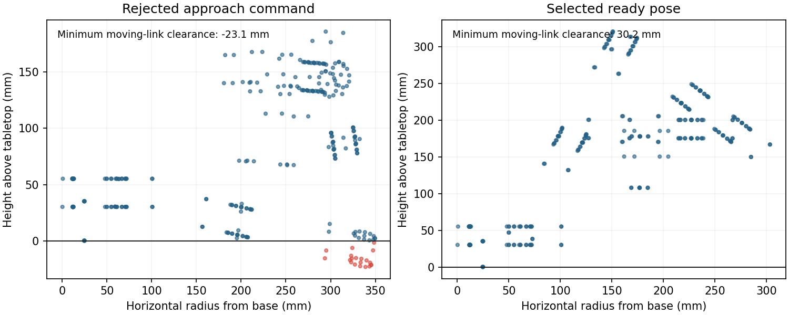
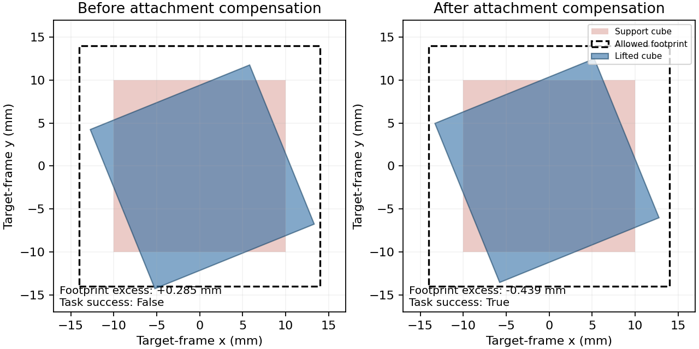

# URDF arm import — implementation and acceptance report

Implemented on `v2` from `48ec9c3` (including `942f291`). No merge and no push. Only `docs/arm-import-spec.md` was copied from `origin/claude/loving-hamilton-r1vzsk`.

## Verified outcomes

| Gate | Result |
| --- | --- |
| Untouched baseline CPU/container suite | 505 passed, 22 subtests |
| Final code in a clean checkout with original scene | 550 passed, 6 live-test skips, 22 subtests |
| Existing owner-edited scene checkout | Two camera calibration assertions already failed before implementation; the edit was preserved |
| Isolated live imports | 5 passed, 2 jaw-only inapplicable cases skipped |
| Static extension check | Passed |
| Default and imported runtime checks | Both passed, including after converter-cache cleanup |
| External package, fresh rebuilt container | One-command import, all final checks passed; source mounted read-only |
| Seven-axis pick-place | Accepted, final-frame task success, 594 steps, seed 101, 8 action axes |
| Seven-axis stack | Accepted, final-frame task success, 363 steps, seed 182482, 8 action axes |
| Dataset readers, feature order, mappings and sidecars | Both accepted datasets pass |

The full-suite skips are the opt-in GPU imports; those imports were also run separately. The two pre-existing camera assertions are `test_fixed_camera_euler_order_matches_original_gf_rotation` and `test_fitted_scene_blocks_match_pre_split_content_hashes`. No production physics, installed SDK code, existing `arms/so101` files, task-success thresholds or recipe values were edited.

## Fixture import reports

| Check | Five-axis jaw | Seven-axis parallel |
| --- | --- | --- |
| spec_action_dimension | pass (6 actions / 6 physical joints) | pass (8 actions / 9 physical joints) |
| conversion_names | pass | pass |
| fk_cross_check | pass (0.000092 mm; 2.25987e-07 rad max, 21 poses) | pass (0.000133 mm; 3.14693e-07 rad max, 21 poses) |
| ready_pose_gravity_hold | pass | pass |
| mimic_tracking | pass (0 max; manual; 2 resets / 100 steps) | pass (6.45943e-05 max; constraint; 2 resets / 100 steps) |
| reach_sweep | pass (100%, 21 cells) | pass (100%, 21 cells) |
| gripper_cube_lift | fail (0.000 mm) — outside required jaw gates | pass (50.183 mm) |
| wrist_camera_frames | pass (0 declared camera frames) | pass (1 declared camera frames) |

Parallel gaps measured 0.000016–90.000049 mm; TCP offset [0.0,0.0,0.0699999999254942] m. Geometry fixtures agree within 1 mm. A derived mount raises the base by 47.784454 mm to fit its collision support above the measured tabletop; the mount remains marked for confirmation.

The jaw fixture passes all required gates 1–5 and 7. Its cube-hold check is reported as failed and is outside its specified acceptance gates. Full reports are in `arms/five_jaw/import-report.json` and `arms/seven_parallel/import-report.json`, including prior failures and native/manual mimic selection.

## Pick and stack waypoint errors

Errors below are measured TCP-to-desired TCP distance at each completed boundary. Execution stops when the task confirms success, so remaining nominal waypoints are not dispatched. Full poses, quaternions, objects and stage flags remain in the linked JSON reports. CSV: [waypoint-errors.csv](arm-import-results/waypoint-errors.csv).

| Run | Waypoint | Event | Step | TCP error (mm) | Orientation error (rad) |
| --- | --- | --- | ---: | ---: | ---: |
| seven-pick | approach | complete | 77 | 3.863130 | 0.014846 |
| seven-pick | descend | complete | 137 | 0.769825 | 0.005649 |
| seven-pick | close | complete | 161 | 0.540579 | 0.004056 |
| seven-pick | lift | complete | 221 | 1.596476 | 0.002174 |
| seven-pick | transport_arc_0 | complete | 236 | 1.692122 | 0.004907 |
| seven-pick | transport_arc_1 | complete | 269 | 2.430398 | 0.018705 |
| seven-pick | transport_arc_2 | complete | 292 | 0.807005 | 0.019248 |
| seven-pick | transport_arc_3 | complete | 316 | 1.126642 | 0.027302 |
| seven-pick | transport_arc_4 | complete | 343 | 3.396502 | 0.009701 |
| seven-pick | transport_arc_5 | complete | 372 | 3.214829 | 0.012074 |
| seven-pick | transport_arc_6 | task_success | 594 | 0.121031 | 0.147085 |
| seven-stack | approach | complete | 77 | 3.879404 | 0.015208 |
| seven-stack | descend | complete | 137 | 0.781710 | 0.005806 |
| seven-stack | close | complete | 161 | 0.684683 | 0.005704 |
| seven-stack | lift | complete | 221 | 0.828561 | 0.001398 |
| seven-stack | transport | complete | 248 | 1.297099 | 0.009227 |
| seven-stack | lower | complete | 338 | 0.489597 | 0.001120 |
| seven-stack | release | complete | 362 | 0.179663 | 0.000514 |
| seven-stack | retreat | task_success | 363 | 50.181461 | 0.000693 |

[Pick report](arm-import-results/seven-pick.json) · [Stack report](arm-import-results/seven-stack.json) · [Dataset validation](arm-import-results/dataset-validation.json)

## Failure analysis and images

The rejected approach branch commanded moving-link geometry 23.1 mm below the tabletop. The importer now selects library IK branches whose representative approach/grasp/lift route clears that table, then validates them live. Newton gains use gravity expressed in the mount frame, sampled grid/broad poses, effective inertia and the stated effort cap. These are generated arm parameters, with no physics changes.



The first stack remained physically stacked but missed the strict footprint containment boundary because of the small cube-to-TCP translation acquired during grasp. Yaw-controlled stack goals now preserve that measured attachment translation; the pickup orientation is retained. The task tolerances and physics were not changed.



Unedited saved renders: [pick success](arm-import-results/images/pick-success.png), [stack success](arm-import-results/images/stack-success.png), [stack before compensation](arm-import-results/images/stack-before-offset-fix.png). Import camera transforms/intrinsics are confirmation fields; saved camera PNGs are evidence of rendering, while task success is verified by physical signals and datasets.

## SO-101 regression

The baseline is isolated `48ec9c3`; checkout selection occurs after `s2r-entrypoint`, which otherwise prepends the main worktree. Early reports affected by that path shadowing were excluded from this comparison.

Production Newton uses `not_guaranteed` determinism. Ordinary isolated runs varied and the historical 391-frame seed-101 pick was not reproduced consistently; one baseline stack process also terminated natively. The fallback comparison enables SDK `run_to_run` scheduling and disables internal MuJoCo sensors in diagnostic configs only. Isaac Lab task/contact sensors remain in use. Production manifests and physics settings remain unchanged.

| Source | Seed | Baseline steps / accepted | Current steps / accepted | Numeric episode comparison | Waypoint trace |
| --- | ---: | --- | --- | --- | --- |
| pick | 101 | 492 / False | 492 / False | identical | identical |
| stack | 182482 | 304 / True | 304 / True | identical | identical |
| mimic | 1984 | 402 / False | 402 / False | identical | identical |

The pick and Mimic baseline failures remain failures; they were not relabeled as successes. The controlled comparison proves equality of the measured baseline/current numeric results, rather than claiming recovery of the historical 391-frame trajectory. Raw paired reports and [numeric comparison](arm-import-results/so-regression-comparison.json) are retained.

## Official SO-101 URDF comparison

Source: [official description at pinned commit a758567](https://github.com/TheRobotStudio/SO-ARM100/blob/a758567c3978dfeefe282ede0500085a48fe8f78/Simulation/SO101/so101_new_calib.urdf), imported as `so101_urdf`. The original `arms/so101` is untouched. Both have six action joints in the same order and all are revolute; no rename was necessary.

| Joint | Imported limits (degrees) | Existing limits (degrees) |
| --- | --- | --- |
| shoulder_pan | [-109.99987525598623,109.99987525598623] | [-112.88476679176092,110.0] |
| shoulder_lift | [-100.00004285756798,100.00004285756798] | [-107.69922143220901,100.93164121173322] |
| elbow_flex | [-96.82986737710912,96.82986737710912] | [-100.0,93.37304708957672] |
| wrist_flex | [-94.99984017946129,94.99984017946129] | [-95.0,104.79882776625453] |
| wrist_roll | [-157.21102461697095,162.78934171036462] | [-180.0,179.912109375] |
| gripper | [-10.000004285756797,100.00004285756798] | [-15.000003814697266,105.43359043821692] |

At 20 shared in-limit poses, declared-TCP distance is mean 278.614053 mm and maximum 587.184179 mm. Base frames, zero conventions and TCP offsets were not aligned or corrected; these are reported differences. [All poses and distances](arm-import-results/official-comparison.json).

The official USD converted and its own URDF-vs-USD FK cross-check passed. A native SDK crash occurred during later processing/live validation. The retained folder/report records exit 139 and every unavailable check as failed; the offline two-USD comparison still completed. This is an open SDK/import validation limitation, not a claim that the official imported arm passed live task acceptance.

## Fallbacks taken

1. Refreshed the stale remote reference before copying the single specification file; no other files came from that branch.
2. Used the simulator container for the full suite because the system Python lacked pytest; isolated host pytest plugin loading and installed xacro/PyYAML/PyArrow needed by focused checks. The Dockerfile/host group include xacro.
3. Used direct container commands or a PTY where the existing `docker exec -it` wrapper rejected non-TTY execution.
4. Corrected installed-library API differences: USD rotation matrices, explicit Newton inverse-dynamics outputs and batched camera Euler extraction. No SDK files were edited.
5. Normalized Isaac Sim 3.0 nested link prims with USD namespace edits, preserving transforms and joint relationships.
6. Replaced a variadic reset wrapper with the explicit EventManager parameter contract.
7. Made native mimic followers passive so independent drives do not fight their converted constraint; manual affine target/state writes remain available when constraints are absent.
8. Added a settling-time stiffness floor for axes with zero sampled gravity torque; rotated offline gravity into the mount frame and included broad poses to avoid underestimating required gains.
9. Fitted the measured base support above the default tabletop, re-selected a collision-clear ready branch after mounting and regenerated its Newton gains.
10. Used alternate library IK seeds, stronger orientation weighting and deterministic multistart sampling for hard workspace cells; every cell records its attempts and residuals.
11. Replaced remaining imported-gripper jaw-mesh assumptions with the measured TCP, preserving the existing jaw path.
12. Ignored meaningless zero axes on fixed URDF frames, encountered in the official description.
13. Added measured attachment translation for yaw-controlled stack goals after the uncorrected cube footprint narrowly failed; no post-pick roll or success-threshold change was added.
14. Added native-worker supervision so SDK termination retains complete failure evidence; compacted sweep records while retaining the closed fingertip clouds.
15. Downloaded the official package with a sparse Git clone after browser retrieval failed. Its native SDK termination was recorded; the retained USD supported the required offline comparison.
16. Corrected checkout path precedence for isolated regressions; used diagnostic deterministic scheduling after ordinary baseline results varied. Historical 391-frame reproduction remains unproven in this environment.
17. Updated stale test doubles for the explicit source-action properties and gave the CLI planning test a unique filename to avoid pytest module-name collision.
18. Removed unreferenced converter intermediates after verifying each flattened USD composes from its own layer; imported runtime and official FK comparison still pass. Imported source bytes are retained verbatim with Git text conversion disabled.

## Open confirmation and TODO fields

Every field is listed in [open-import-fields.csv](arm-import-results/open-import-fields.csv) and [JSON](arm-import-results/open-import-fields.json), including its value, tag and reason. The normal review items are structural base/contact proposals, orientation axes, measured gaps/axes/TCP, ready-forward yaw, camera extrinsics/default optics and assumed hardware encoder values. Prismatic rotary transmission is explicitly TODO and excluded from factory units; real drivers remain TODO. Native-crash and failed-grasp limitations above remain visible in their reports.

| Arm | Field | Tag | Value |
| --- | --- | --- | --- |
| five_jaw | `arm.links.base` | confirm | `"Base_0"` |
| five_jaw | `arm.gripper.contact_bodies` | confirm | `["Jaw_1"]` |
| five_jaw | `arm.gripper.closed_gap_m` | measured; confirm | `0.0` |
| five_jaw | `arm.gripper.open_gap_m` | measured; confirm | `0.031901710637219374` |
| five_jaw | `arm.gripper.closed_position` | measured; confirm | `0.48` |
| five_jaw | `arm.gripper.open_position` | measured; confirm | `0.0` |
| five_jaw | `arm.gripper.closing_axis` | measured; confirm | `[-0.8253356098653111,0.0,-0.5646424807683665]` |
| five_jaw | `arm.gripper.approach_axis` | measured; confirm | `[-0.5646424807683668,0.0,0.8253356098653107]` |
| five_jaw | `arm.ik.orientation_axes` | confirm | `["x","y"]` |
| five_jaw | `arm.ik.position_offset_m` | measured; confirm | `[-0.016235487736943804,0.0,0.06550882400608696]` |
| five_jaw | `arm.initial_state.rotation_euler_degrees` | derived; confirm | `[0.0,0.0,-0.0011887686938327007]` |
| five_jaw | `arm.lerobot.driver` | TODO | `"TODO"` |
| seven_parallel | `arm.links.base` | confirm | `"Base_0"` |
| seven_parallel | `arm.gripper.contact_bodies` | confirm | `["Finger_L","Finger_R"]` |
| seven_parallel | `arm.gripper.closed_gap_m` | measured; confirm | `1.5832483768463135e-08` |
| seven_parallel | `arm.gripper.open_gap_m` | measured; confirm | `0.09000004921108484` |
| seven_parallel | `arm.gripper.closed_position` | measured; confirm | `0.0` |
| seven_parallel | `arm.gripper.open_position` | measured; confirm | `0.045` |
| seven_parallel | `arm.gripper.closing_axis` | measured; confirm | `[1.0,0.0,0.0]` |
| seven_parallel | `arm.gripper.approach_axis` | measured; confirm | `[0.0,0.0,1.0]` |
| seven_parallel | `arm.ik.orientation_axes` | confirm | `["x","y","z"]` |
| seven_parallel | `arm.ik.position_offset_m` | measured; confirm | `[0.0,0.0,0.0699999999254942]` |
| seven_parallel | `arm.cameras."wrist_cam".parent_link` | confirm | `"Tool_0"` |
| seven_parallel | `arm.cameras."wrist_cam".position` | confirm | `[0.5900000000000001,-0.05,0.045]` |
| seven_parallel | `arm.cameras."wrist_cam".euler_degrees` | confirm | `[0.0,0.0,0.0]` |
| seven_parallel | `arm.cameras."wrist_cam".width` | confirm | `640` |
| seven_parallel | `arm.cameras."wrist_cam".height` | confirm | `480` |
| seven_parallel | `arm.cameras."wrist_cam".horizontal_aperture` | confirm | `20.955` |
| seven_parallel | `arm.cameras."wrist_cam".vertical_aperture` | confirm | `15.716249999999999` |
| seven_parallel | `arm.cameras."wrist_cam".focal_length` | confirm | `18.14756233630291` |
| seven_parallel | `arm.initial_state.rotation_euler_degrees` | derived; confirm | `[0.0,0.0,-0.001190091804856169]` |
| seven_parallel | `arm.hardware.motor` | confirm | `"unconfigured"` |
| seven_parallel | `arm.hardware.encoder_counts_per_turn` | confirm | `4096` |
| seven_parallel | `arm.hardware.zero_count` | confirm | `2048` |
| seven_parallel | `arm.hardware.joint_ids` | confirm | `{"Axis_1":"1","Axis_2":"2","Axis_3":"3","Axis_4":"4","Axis_5":"5","Axis_6":"6","Axis_7":"7","Grip_L":"8","Grip_R":"9"}` |
| seven_parallel | `arm.hardware.Grip_L.counts_per_metre` | TODO | `"TODO"` |
| seven_parallel | `arm.hardware.Grip_R.counts_per_metre` | TODO | `"TODO"` |
| seven_parallel | `arm.lerobot.driver` | TODO | `"TODO"` |
| so101_urdf | `arm.links.base` | confirm | `"base_link"` |
| so101_urdf | `arm.joints.0.initial` | TODO | `0.0` |
| so101_urdf | `arm.joints.1.initial` | TODO | `0.0` |
| so101_urdf | `arm.joints.2.initial` | TODO | `0.0` |
| so101_urdf | `arm.joints.3.initial` | TODO | `0.0` |
| so101_urdf | `arm.joints.4.initial` | TODO | `0.0` |
| so101_urdf | `arm.joints.5.initial` | TODO | `0.0` |
| so101_urdf | `arm.gripper.contact_bodies` | confirm | `["moving_jaw_so101_v1_link"]` |
| so101_urdf | `arm.gripper.closed_gap_m` | measured; confirm | `0.0` |
| so101_urdf | `arm.gripper.open_gap_m` | measured; confirm | `0.10337092076163075` |
| so101_urdf | `arm.gripper.closed_position` | measured; confirm | `-0.174533` |
| so101_urdf | `arm.gripper.open_position` | measured; confirm | `1.6493368499999999` |
| so101_urdf | `arm.gripper.closing_axis` | measured; confirm | `[0.7315982212952723,-2.5280384457524878e-06,0.6817360505292372]` |
| so101_urdf | `arm.gripper.approach_axis` | measured; confirm | `[0.680903909114357,0.04939655861971962,-0.7307050338880362]` |
| so101_urdf | `arm.ik.orientation_axes` | confirm | `["x","y"]` |
| so101_urdf | `arm.ik.position_offset_m` | measured; confirm | `[-0.007563229020568307,-0.00012031216608555514,-0.09469287179436361]` |
| so101_urdf | `arm.actuators.joint_0.effort_limit_sim` | TODO | `10.0` |
| so101_urdf | `arm.actuators.joint_0.stiffness` | TODO | `0.0` |
| so101_urdf | `arm.actuators.joint_0.damping` | TODO | `0.0` |
| so101_urdf | `arm.actuators.joint_1.effort_limit_sim` | TODO | `10.0` |
| so101_urdf | `arm.actuators.joint_1.stiffness` | TODO | `0.0` |
| so101_urdf | `arm.actuators.joint_1.damping` | TODO | `0.0` |
| so101_urdf | `arm.actuators.joint_2.effort_limit_sim` | TODO | `10.0` |
| so101_urdf | `arm.actuators.joint_2.stiffness` | TODO | `0.0` |
| so101_urdf | `arm.actuators.joint_2.damping` | TODO | `0.0` |
| so101_urdf | `arm.actuators.joint_3.effort_limit_sim` | TODO | `10.0` |
| so101_urdf | `arm.actuators.joint_3.stiffness` | TODO | `0.0` |
| so101_urdf | `arm.actuators.joint_3.damping` | TODO | `0.0` |
| so101_urdf | `arm.actuators.joint_4.effort_limit_sim` | TODO | `10.0` |
| so101_urdf | `arm.actuators.joint_4.stiffness` | TODO | `0.0` |
| so101_urdf | `arm.actuators.joint_4.damping` | TODO | `0.0` |
| so101_urdf | `arm.actuators.joint_5.effort_limit_sim` | TODO | `10.0` |
| so101_urdf | `arm.actuators.joint_5.stiffness` | TODO | `0.0` |
| so101_urdf | `arm.actuators.joint_5.damping` | TODO | `0.0` |
| so101_urdf | `arm.initial_state.rotation_euler_degrees` | derived; confirm | `[0.0,0.0,-0.011834506898155886]` |
| so101_urdf | `arm.lerobot.driver` | TODO | `"TODO"` |
| five_jaw | `scene.mount.translation_correction_m` | derived; confirm | `[0.0,0.0,0.04778445403731637]` |
| seven_parallel | `scene.mount.translation_correction_m` | derived; confirm | `[0.0,0.0,0.04778445403731681]` |

## Action-order audit

`ArmSpec.joints`, physical limit application, spawn state and passive-coordinate updates retain every declared physical joint. Action-order consumers below use `action_joints` / `action_usd_joint_names`:

- `src/core/arms/spec.py`
- `src/core/arms/mapping.py`
- `src/core/arms/calibration.py`
- `src/core/calibration/telemetry.py`
- `src/core/datasets/alignment.py`
- `src/core/datasets/sources.py`
- `src/core/policy_client/contract.py`
- `src/core/rollout/real_rollout.py`
- `src/sim/datagen/ik.py`
- `src/sim/datagen/scripted.py`
- `src/sim/datagen/rollout.py`
- `src/sim/datagen/mimic.py`
- `src/sim/datagen/calibration_replay.py`
- `src/sim/datagen/dr_replay.py`
- `src/sim/envs/base_env_cfg.py`
- `src/sim/envs/mdp/starts.py`
- `src/sim/eval/sim_real.py`
- `src/sim/eval/stage_tracking.py`
- `src/sim/recording/replay_scene.py`
- `src/sim/check.py`
- `src/cli/check.py`
- `policies/sweep/make_sweep.py`
- `policies/molmoact2/train/prepare_molmo_lora.py`

`arms/_template/arm.toml` documents that non-mimic tables define action order; its utility code had no action iteration requiring a change. `src/core/scenes/anchors.py` resolves source overrides before recomputing followers.

## Changes per file

| File | Change |
| --- | --- |
| `.gitattributes` | Preserve imported source bytes and hashes across checkouts; no Git LFS mesh rules added. |
| `src/core/arms/urdf.py` | Pure URDF, package/xacro expansion, fixed/movable chains, SI units, mimic/control parsing and report FK oracle. |
| `src/core/arms/arm_toml.py` | Typed import choices, generated manifest comments, per-field evidence, hardware TODOs and provenance. |
| `src/core/arms/spec.py` | Mimic/action separation, source gap maps, optional simulation-only driver state, import provenance and explicit anchor-relative rotation. |
| `src/core/arms/mapping.py` | Source-only normalized/raw codecs and limits. |
| `src/core/arms/calibration.py` | Exclude followers from device calibration; simulation-only mapping bypasses hardware placeholders. |
| `src/core/calibration/telemetry.py` | Source-only joint units, roles, bounds and telemetry axes. |
| `src/core/datasets/alignment.py` | Source-only dataset identity and action units. |
| `src/core/datasets/sources.py` | Source-only dataset joint-contract validation. |
| `src/core/policy_client/contract.py` | Source-only policy names, roles and joint types. |
| `src/core/rollout/real_rollout.py` | Source-only roll lookup; no real driver is generated. |
| `src/core/scenes/anchors.py` | Resolve mount source positions then followers; apply declared anchor-relative yaw. |
| `src/core/paths.py` | SDK-free plan_new compatibility entry point. |
| `src/core/tasks/expert.py` | Physical gap waypoints, measured-opening defaults, nearest-face grasp yaw and optional object-centre goals. |
| `src/cli/main.py` | Parse the URDF import flags and preserve dry-run planning. |
| `src/cli/plan.py` | Plan the importer module, existing-container paths and read-only external package mounts. |
| `src/cli/scaffold.py` | Document the unchanged template-copy path and separate importer dispatch. |
| `src/cli/check.py` | Compare policy dimensions against source action axes. |
| `src/sim/arms/__init__.py` | Simulator arm-import package. |
| `src/sim/arms/urdf_import.py` | Source staging, converter/fallback, namespace normalization, collision measurements, camera transforms, Newton gains, placeholders, reports and native-worker supervision. |
| `src/sim/arms/ready_pose.py` | Library IK reach/height grid, margin selection, alternate collision-clear branches and reference forward yaw. |
| `src/sim/arms/clearance.py` | USD collision clouds and Newton FK checks for representative task approaches above the tabletop. |
| `src/sim/arms/validation.py` | Live dimensions, gravity hold, two-reset mimic sweep, multi-start workspace reach, cube lift and camera frames. |
| `src/sim/envs/base_env_cfg.py` | Source-only actions/observations and mimic-aware reset/action terms. |
| `src/sim/envs/mdp/mimic.py` | Affine follower state/target writes and matching live Newton constraint selection with passive followers. |
| `src/sim/envs/mdp/starts.py` | Source reset coordinates followed by passive state synchronization. |
| `src/sim/envs/mdp/placement.py` | Live parallel collision geometry for clear object placement. |
| `src/sim/scene/geometry.py` | Stage-cached body collision points and parallel fingertip bands; retained legacy jaw path. |
| `src/sim/datagen/ik.py` | Source action FK/Jacobian/IK coordinates, with passive Newton coordinates filled from sources. |
| `src/sim/datagen/scripted.py` | Physical gripper commands, selector precedence, source datasets and measured attachment translation for declared object goals. |
| `src/sim/datagen/rollout.py` | Source state/action recording and rollout dimensions. |
| `src/sim/datagen/mimic.py` | Source gripper/action annotations; retained SDK Mimic sequencing. |
| `src/sim/datagen/calibration_replay.py` | Source-only tracking units and errors. |
| `src/sim/datagen/dr_replay.py` | Source-only replay metadata. |
| `src/sim/recording/replay_scene.py` | Replay source states and synchronize followers. |
| `src/sim/eval/sim_real.py` | Source-only simulator/device comparisons. |
| `src/sim/eval/stage_tracking.py` | Represent the gripper by source coordinates, avoiding mimic cancellation. |
| `src/sim/check.py` | Verify all physical joint names while stepping only action coordinates. |
| `policies/sweep/make_sweep.py` | Build sweeps from source action axes. |
| `policies/molmoact2/train/prepare_molmo_lora.py` | Source-only preparation metadata; no training was run. |
| `tasks/pick_place_cube/expert.py` | Physical openings and yaw alignment while retaining pickup orientation. |
| `tasks/pick_place_cube/mdp.py` | Use the measured TCP for imported grippers; preserve the jaw mesh reference. |
| `tasks/stack_two_cubes/expert.py` | Physical openings, yaw alignment and precise object-centre goals for yaw-controlled arms. |
| `tasks/stack_two_cubes/mdp.py` | Measured imported TCP in task signals. |
| `tasks/_template/mdp.py` | Carry the generic imported TCP path into new task templates. |
| `docker/sim/Dockerfile` | Install xacro in rebuilt simulation images. |
| `pyproject.toml` | Add xacro to the host tools group. |
| `configs/datagen/scripted.yaml` | Document metre openings; keep every existing recipe value. |
| `configs/datagen/stack_two_cubes.yaml` | Document metre openings; keep every existing recipe value. |
| `arms/_template/arm.toml` | Document follower/action ordering and optional measured gaps. |
| `CLAUDE.md` | Add the requested import/mimic/gap convention and correct action-order wording. |
| `docs/02-add-an-arm.md` | Lead with URDF import commands, flags, reports and confirmation steps; retain manual setup. |
| `docs/08-data-generation.md` | Document selectors, physical gaps, yaw/attachment behavior and live acceptance commands. |
| `docs/arm-import-spec.md` | Copy only this file from the requested remote branch, unchanged. |
| `tests/cli/test_urdf_planning.py` | CPU contract, SDK adapter or isolated live acceptance coverage for the import path. |
| `tests/core/test_arm_spec.py` | CPU contract, SDK adapter or isolated live acceptance coverage for the import path. |
| `tests/core/test_arm_toml.py` | CPU contract, SDK adapter or isolated live acceptance coverage for the import path. |
| `tests/core/test_stack_expert.py` | CPU contract, SDK adapter or isolated live acceptance coverage for the import path. |
| `tests/core/test_task_expert.py` | CPU contract, SDK adapter or isolated live acceptance coverage for the import path. |
| `tests/core/test_urdf.py` | CPU contract, SDK adapter or isolated live acceptance coverage for the import path. |
| `tests/sim/conftest.py` | CPU contract, SDK adapter or isolated live acceptance coverage for the import path. |
| `tests/sim/test_check.py` | CPU contract, SDK adapter or isolated live acceptance coverage for the import path. |
| `tests/sim/test_datagen_rollout.py` | CPU contract, SDK adapter or isolated live acceptance coverage for the import path. |
| `tests/sim/test_mimic.py` | CPU contract, SDK adapter or isolated live acceptance coverage for the import path. |
| `tests/sim/test_mimic_joints.py` | CPU contract, SDK adapter or isolated live acceptance coverage for the import path. |
| `tests/sim/test_parallel_gripper_geometry.py` | CPU contract, SDK adapter or isolated live acceptance coverage for the import path. |
| `tests/sim/test_urdf_import.py` | CPU contract, SDK adapter or isolated live acceptance coverage for the import path. |

Fixture sources/meshes live under `tests/fixtures/urdf/`; accepted generated folders include source copies, expanded/resolved URDF, USD, manifests, reports, hardware placeholders where applicable, and validation frames under `arms/five_jaw`, `arms/seven_parallel`, and `arms/so101_urdf`. Derived scene mounts are `scenes/rpd_meeting_room/mounts/five_jaw.toml` and `seven_parallel.toml`. The full artifact/file hash manifest is [files.json](arm-import-results/files.json). Meshes are committed normally; existing Git attributes have no LFS mesh rules.

## Commands and artifacts

The [external-package evidence](arm-import-results/external-import.json) records a successful import through the rebuilt image with xacro installed and an input package outside the repository. [Intermediate-cache cleanup](arm-import-results/intermediate-cleanup.json) records only unreferenced files removed from retained arm artifacts. The official comparison was identical after cleanup. [Validation evidence](arm-import-results/validation-summary.json) records final check results and log hashes.

```bash
./s2r new arm seven_parallel --urdf tests/fixtures/urdf/seven_parallel_pkg/robot.urdf.xacro --ee_link Tool_0 --gripper Grip_L --camera Camera_1=wrist_cam
S2R_ARM=seven_parallel ./s2r check
S2R_ARM=seven_parallel ./s2r datagen --config_path configs/datagen/scripted.yaml --destination /workspace/datasets/new_pick
S2R_ARM=seven_parallel ./s2r datagen --config_path configs/datagen/stack_two_cubes.yaml --destination /workspace/datasets/new_stack
```

Use a fresh destination. Re-importing an existing generated folder requires `--force`. Accepted validation datasets for this run were created at `/workspace/datasets/arm_import_seven_pick_4` and `/workspace/datasets/arm_import_seven_stack_5`. After validation, the project `outputs/` contents, its isolated test worktrees, and all datasets were deleted at the explicit request of the owner. Committed JSON, CSV, PNG and validation logs retain the acceptance evidence; raw training datasets are no longer present. [Cleanup verification](arm-import-results/cleanup.json) confirms both directories are empty. No command pushed a branch or ran policy training.
