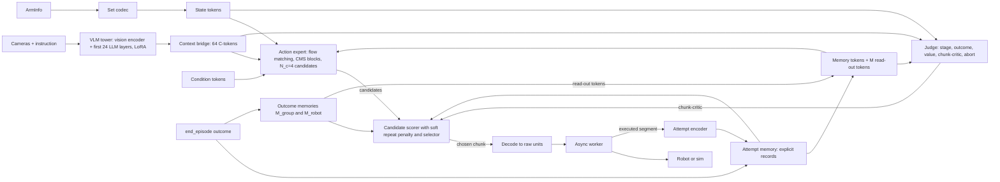
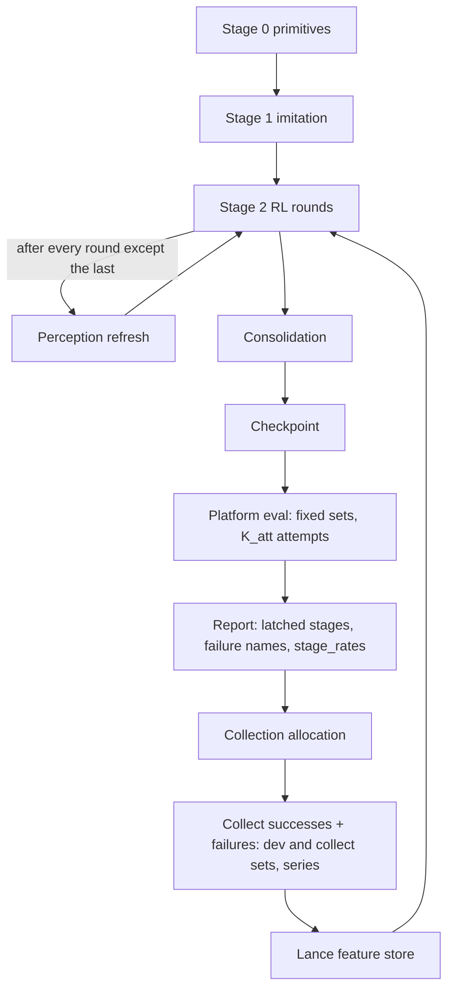

# ReNest-VLA: a retry-aware Vision-Language-Action model with nested multi-timescale memory — research design document

This document is a research design for ReNest-VLA ("Retry + Nested"), a Vision-Language-Action (VLA) model that stores its own failed attempts in a memory that persists across environment resets and is trained to use them. The one-line framing is: in-context identification of physical sim-to-real factors (simulated, injected on the real robot, and one uninjected real condition) from failed attempts, inside a real-time VLA. This is a meta-reinforcement-learning problem, because the hidden parameter stays fixed across the episodes of a trial. The status is design only: no experiment has been run and no result is reported. The design comes in two tiers that share all code: ReNest-VLA-L (the headline tier, built on the MolmoAct2 vision-language tower, with two variants, L/own and L/adapt, defined in Section 2.2) and ReNest-VLA-S (an ablation and low-VRAM tier, built on InternVL3-1B). Section 2.0 lists go/no-go milestones that precede any model training. Section 1 frames the paper, Section 2 specifies the core architecture, training and platform requirements, Section 3 lists proven add-ons, Section 4 gives the experimental plan, and Section 5 lists research ideas that are not part of the core claim.

Markers used in the text. "Own reasoning:" marks a design choice or argument made by the authors, not taken from a source. "Estimate (to be measured):" marks a number the authors computed or guessed and that must be measured before it is relied on. `[GAP: ...]` marks information the design needs and does not have. "(secondary source, unverified)" marks a number taken from a secondary summary or a search snippet and not checked against the paper. Square-bracket keys such as [RECAP] refer to the References list at the end.

## Section 1 — Paper framing

### 1.1 Problem and gap

Own reasoning: deployed VLAs fail, get reset, and try again as if nothing happened. On a policy trained in simulation, many failures are systematic for a given robot and scene, for example because of a calibration offset, a friction value or an actuation latency. An independent and identically distributed retry therefore repeats the same failure.

The evidence that this gap exists has five parts.

First, strong VLAs are memoryless across resets. The pi0.5 policy studied in FLARE "is Markovian—lacking history" [FLARE]. The base policy of RePO-VLA takes a single-timestamp observation and uses "no online value estimate, failure detector, or retry controller" [RePO-VLA]. Backtrack leaves the VLA unchanged and only rewinds it [Backtrack].

Second, memory work for VLAs is almost all within one episode: MemoryVLA, CronusVLA, HAMLET, ContextVLA, MemER and ReMem-VLA [MemoryVLA][CronusVLA][HAMLET][ContextVLA][MemER][ReMem-VLA]. ReMem-VLA explicitly excludes memory across sessions [ReMem-VLA]. Test-time fast-weight memories also reset every episode: T2Mem "reset to W0 at each episode boundary", and RoboTTT "starts each rollout from the learned initialization W0" [T2Mem][RoboTTT].

Third, a small number of cross-episode methods exist, and each lacks something relative to the target of this design.

- VLRLA (October 2026) adds in-context reinforcement learning to VLAs. A recurrent memory persists across episodes within a trial and receives reward feedback; the parameters are fixed at deployment. The one hidden factor is semantic (a withheld rewarded plate colour). It reports RoboTwin 63.4% against 50.9% for pi0.5. It has no sim-to-real study and no explicit anti-repetition mechanism, and its failed-then-success structure is built mainly by hindsight relabeling of successful demonstrations [VLRLA]. This is the closest prior work.
- TraceFlow (September 2026) retrieves successful and failed traces with one outcome bit to give a bounded guidance correction to a frozen flow-matching VLA, "without any weight update" [TraceFlow]. Retrieve-then-Steer stores successes only and moves LIBERO-10 pi0.5 from 92.4% to 94.4% [RtS]. RoboHarness and PhysMem use a VLM orchestrator or planner that reads a memory of successes and failures, with no trained low-level conditioning [RoboHarness][PhysMem].
- FAR (CoRL 2026) runs 10 gradient steps of failure-contrastive preference adaptation on a ResNet-18 diffusion policy after a failed attempt; the policy is not given past attempts as input. In simulation the average goes from 47.0 to 63.4 with a 5-attempt cap [FAR]. Bellman-Guided Retrials (BGR) keeps an avoidance set of proprioceptive states with a demonstrations-only policy, with more than 20% gains in simulation and more than 50% in real [BGR].
- Watch-Try-Learn (2019) conditions a small CNN policy on a demonstration and one failed trial in simulation; success is .42 against .30 for meta-imitation [WTL]. An orchestration study finds that summaries of previous episodes raise success (long-horizon 52.36 to 60.00) while in-episode summaries are neutral to negative [Orchestrating], which suggests that cross-episode information is the useful part.

Fourth, failure data is used in training, but not as retry context: RECAP conditions on advantage over all data including failures [RECAP]; AFIL uses a failure generator as negative guidance (LIBERO 96.9 to 98.4) [AFIL]; RePO-VLA labels values for failures and recovery suffixes [RePO-VLA]; FailSafe reports +22.6% on ManiSkill [FailSafe]; AHA and FailGen generate failures [AHA]; Mulligan re-collects from failed initial states and trains a critic on all data [Mulligan]. Failure analysis and recovery work is also extensive. AHA and RoboFAC already localise and explain failures in language [AHA][RoboFAC]. REFLECT uses an LLM to explain failures from summarised experience (arXiv:2306.15724) [REFLECT]. RACER provides language-guided recovery, with 10,159 recovery trajectories (arXiv:2409.14674) [RACER]. Sirius weights intervention data, with +8% in simulation and +27% in real (arXiv:2211.08416) [Sirius]. SuccessVQA detects success with a VLM (arXiv:2303.07280) [SuccessVQA].

Fifth, in-context sim-to-real identification exists outside VLAs and outside failure-driven retries. CAPTURE adjusts simulator parameters in context from interaction history and reaches at least 70% sim-to-real scooping success [CAPTURE]; cross-controller in-context adaptation is a second example [XController]. Nested Learning and its Continuum Memory System (CMS) have no application to robotics, VLAs or reinforcement learning that we found; the closest in spirit is LifelongVLA, with dual-timescale short-term and long-term adapters and partial replay [LifelongVLA]. PEAR shows that attempt and round history in context plus success-reward reinforcement learning works, but with a 27B model, about 1.1-4.3 s per round and about 50,000 H100-equivalent GPU-hours of reinforcement learning [PEAR]; that is three orders of magnitude outside the budget of this design.

There is also no standard multi-attempt metric. HyperSim reports SR1 and SR3 (success within three attempts) [HyperSim], FAR caps attempts at 5 [FAR], and no paper was found that defines a repeated-failure rate.

Own reasoning: the gap in one sentence is that nobody has trained a compact, real-time VLA to use its own failed attempts, across resets, to infer the physical discrepancy that made them fail, which is exactly the situation of a sim-trained policy on a real robot.

**Relation to meta-RL and system identification.** The problem is meta-reinforcement learning with a hidden parameter that is fixed across the episodes of a trial. RL^2 keeps recurrent state "across episodes in a given MDP" (arXiv:1611.02779) [RL2]. Algorithm Distillation models learning histories with a causal transformer (arXiv:2210.14215) [AD]. The Decision-Pretrained Transformer predicts optimal actions from an in-context dataset of interactions (arXiv:2306.14892) [DPT]. Meta-World reports ML10 test success of 31.6% (MAML), 35.8% (RL^2) and 13% (PEARL) (arXiv:1910.10897) [MetaWorld]; manipulation meta-RL across trials is hard even in state space. PEARL, VariBAD, AdA (adaptive agents), RMA (rapid motor adaptation) and UP-OSI are also relevant (named by the reviewer; not retrieved in our search, to be verified). Own reasoning: the method family is not new. What is new is doing it inside a pretrained real-time VLA, with stage-level failure outcomes as the feedback signal, for physical sim-to-real factors, with an identifiability analysis and a controlled real study.

The table below compares the closest prior work with this design. A cell contains only what the cited source description states; "not stated" means the design brief records nothing on that point.

**Table 1.1 — Closest prior work vs. this design**

| Work | Persists across resets? | Failures used as context? | Trained to use memory? | Test-time weight updates? | Hidden physical factor? | Sim-to-real? |
|---|---|---|---|---|---|---|
| VLRLA [VLRLA] | yes: recurrent memory within a trial | reward feedback; no anti-repetition mechanism | yes | no | no: semantic factor (withheld plate colour) | no study |
| TraceFlow [TraceFlow] | yes: trace bank | yes: failed traces with one outcome bit | no: training-free | no | not stated | real packing task; no sim-to-real pipeline |
| Retrieve-then-Steer [RtS] | yes: long-term memory | no: successes only | no: frozen VLA | no | not stated | real bimanual results; no sim-to-real study |
| RoboHarness, PhysMem [RoboHarness][PhysMem] | read by a VLM orchestrator or planner | yes, read by the VLM | no | not stated | not stated | not stated |
| FAR [FAR] | scene kept, robot returns to start pose | not policy input; triggers adaptation | no | yes: 10 gradient steps | not stated | real gains; no sim-to-real study |
| Bellman-Guided Retrials [BGR] | not stated | avoidance set; policy not conditioned | no | not stated | not stated | real gains (more than 50%) |
| Watch-Try-Learn [WTL] | one failed trial in context | yes: one failed trial with reward | yes | not stated | not stated | no: simulated |
| CAPTURE [CAPTURE] | interaction history in context | not failure-driven | not stated | not stated | tunes simulator parameters | yes: at least 70% scooping success; not a VLA |
| T2Mem, RoboTTT [T2Mem][RoboTTT] | no: reset at each episode boundary | not stated | not stated | yes: fast weights within one episode | not stated | not stated |
| ReNest-VLA (this design) | yes: memory persists across `reset()` within a retry group | yes: stage-attempt records with outcome and failure name | yes: failure, retry, success series | no policy weight changes; only the two ~2M-parameter outcome memories M_group and M_robot are updated | yes: series-constant hidden factors in simulation | yes: the target setting |

### 1.2 Central claim

A VLA that runs in real time on one RTX 4090 (budget estimated, to be measured), stores its failed attempts in a memory that persists across resets, and is trained on policy-generated failure -> retry -> success series with series-constant hidden physical factors, will (i) reach higher success within K_att attempts than the same checkpoint with its memory cleared, in simulation and in a controlled real-robot study with injected physical perturbations and one uninjected real condition, which together test identification of physical sim-to-real factors (simulated, injected on the real robot, and one uninjected real condition); (ii) beat baselines given the same attempt information in simulation; and (iii) retain earlier skills across self-improvement rounds at least as well as replay plus LoRA.

### 1.3 Contributions

Terms used below, defined at first use. A **retry group** is a set of consecutive attempts at the same start, identified by a `retry_group` id; memory persists across resets within one retry group. A **stage-attempt record** is the unit of memory: one segment of execution that ends when a stage latches, when the judge or platform declares failure, or at episode end. A **hidden-factor series** is a sequence of attempts in simulation in which hidden physical factors (friction, mass, joint offset, camera jitter (not teacher-supervised; Section 2.5), actuation delay, object size) are sampled once and held fixed across the attempts. The **outcome memory M** is a small fast-weight network (about 2M parameters) updated between attempts by a learned rule; there are two instances, M_group (per retry group) and M_robot (per physical robot), defined in Section 2.5. **C-tokens** are 64 learned summary tokens produced from the language-model hidden states by the context bridge. The **set codec** is the embodiment-agnostic encoding of states and actions as sets of per-dimension tokens built from the robot's `ArmInfo`. The **Continuum Memory System (CMS)** is the Nested Learning chain of MLP blocks updated at different frequencies.

C1 (method). Hidden-factor attempt series with an identifiability analysis and a posterior-sampling (Thompson) teacher (Section 2.5), turning retries into in-context identification of physical sim-to-real factors (simulated, injected on the real robot, and one uninjected real condition).

C2 (method). Attempt Memory: explicit stage-attempt records, a fast-weight outcome memory per retry group (M_group) and a soft repeat penalty, trained on policy-generated retry series. M_robot, a second fast-weight memory per physical robot (Section 2.5), is a secondary design choice and not a method component of C2.

C3 (design and empirical study, not claimed as a new mechanism). The nested multi-timescale organisation. The training-time part is parallel adapters with a frequency schedule and distillation-with-replay consolidation, which is standard (Progress & Compress, Learning without Forgetting; named by the reviewer; not retrieved in our search, to be verified). The paper reports whether it beats matched baselines.

C4 (protocol, not method). Judge label-regime handling and the multi-attempt protocol and metrics (success@k, attempts-to-success, repeated-failure rate), with an empirical memory-cleared null, on fixed pinned-seed sets, in simulation and in paired real trials.

### 1.4 Why each contribution is novel

**C1.** The closest work is VLRLA, which does cross-episode in-context reinforcement learning in a VLA; its hidden variable is a semantic goal ambiguity resolved from scalar reward, and it has no sim-to-real study [VLRLA]. CAPTURE is in-context sim-to-real, but it tunes simulator parameters, is not a VLA and is not failure-driven [CAPTURE]. Watch-Try-Learn is trial-conditioned but small scale and uses one trial [WTL]. RL^2, Algorithm Distillation and the Decision-Pretrained Transformer are the meta-RL family this belongs to (Section 1.1) [RL2][AD][DPT]. The difference is physical and calibration factors, stage-level failure outcomes as feedback, a pretrained real-time VLA, an identifiability analysis, and sim-to-real as the target.

**C2.** The closest work is TraceFlow (training-free guidance from success and failure traces, outcome bit only) [TraceFlow], BGR (non-learned avoidance set) [BGR], FAR (test-time gradient steps on the policy) [FAR], and T2Mem and RoboTTT (fast weights within one episode, reset at the episode boundary) [T2Mem][RoboTTT]. The difference is that the policy is trained to read the memory, the fast weights hold outcomes across resets (per retry group; a per-robot memory is a secondary design choice) and are updated by a learned rule between attempts, and no policy weights change at test time.

**C3.** The closest work is LifelongVLA, which has two timescales, adapters plus replay, and acts at training time only [LifelongVLA]; VLA-ER and Simple-Recipe show that replay or LoRA already forgets little [VLA-ER][Simple-Recipe]. The difference is more than two timescales, with test-time and training-time memory under one schedule. This is an organisation and an empirical study, not a new mechanism: the training-time part is parallel adapters with a frequency schedule and distillation-with-replay consolidation, which is standard (Progress & Compress, Learning without Forgetting; named by the reviewer; not retrieved in our search, to be verified). Our search found no prior application of Nested Learning or CMS in a robot policy; this is recorded as an observation, not as a claimed contribution. The continual-learning benefit over replay plus LoRA is a hypothesis to be tested, not assumed.

**C4.** The closest work is STARE-VLA and SARM/SARM2 (stage-aware rewards) [STARE-VLA][SARM], SAFE and Backtrack (scalar failure likelihood) [SAFE][Backtrack], HyperSim SR1/SR3 [HyperSim], and AHA and RoboFAC, which already localise and explain failures in language [AHA][RoboFAC]. The difference of our judge is only that it is an in-policy head trained from simulator latches and shared by reinforcement learning, memory and the loop. The metrics add a defined repeated-failure rate and an empirical memory-cleared null.

**What is not claimed as novel.**

- Advantage-conditioned reinforcement learning, which is RECAP [RECAP].
- The self-improving loop as such. HELP runs multi-round post-training with rollout segments [HELP]; EmbodiRSI uses failure-guided simulation data over rounds, 50.4% to 83.5% (secondary source, unverified; snippet-level) [EmbodiRSI]; PLD distils residual-RL specialists (snippet-level) [PLD]; SOP is a fleet system [SOP].
- Asynchronous action chunking.
- The backbone.

## Section 2 — Core architecture

### 2.0 Go/no-go milestones

These milestones come before any model training.

- **M0 Measure on the RTX 4090.** Image tokens per frame and prefill latency of the VLM for 2 cameras (the platform's MolmoAct2 policy uses the cameras room and wrist), full MolmoAct2 latency, and VRAM. M0 also measures L/adapt latency and VRAM on the RTX 4090.
- **M1 Identifiability study (no learning).** For each hidden factor compute the exact Bayes posterior over h by enumeration over the binned grid (at most 500 cells), given the attempt records (failure name, furthest stage, latch times, end-effector and object traces); the likelihood model is in Section 2.5(a). Report posterior shrinkage after 1, 2 and 3 attempts per factor. Keep only the factors that are identifiable within 3 attempts; bin continuous factors into the resolution the posterior supports; drop the rest from the series generator. M1 is run twice: with scripted-expert attempts (before training) and again with policy-generated attempts after Stage 1, because identifiability depends on the actions taken. If the second run drops a factor that Stage 1 already trained on, the factor is removed from the series generator and from the teacher-supervised set for all later training; the Stage 1 checkpoint is not retrained, and the change is reported. Deliverable: the posterior-sampling (Thompson) teacher, which acts optimally for an h sampled from the posterior (Section 2.5). It is a reference policy and the teacher, not an upper bound.
- **M2 Perception probe.** Linear probes on frozen C-tokens for camera-extrinsic jitter and joint offset (visible only as camera-to-gripper misalignment, never in proprioception). A factor counts as visible if a linear probe on C-tokens reaches R^2 >= 0.5 on held-out data [own threshold]; otherwise it is dropped from the teacher-supervised set. A factor that cannot be probed is either dropped or triggers the perception refresh (Section 2.7).
- **M3 Collection throughput.** Measured env-steps/s of parallel-env rendering on RTX hardware (Section 2.11). Pass criterion: aggregate throughput of at least 8x real time on the RTX GPU, for example 16 parallel environments at half real-time (Section 4.7).

Rule: if M1 shows fewer than two identifiable factors, the scope of the paper narrows to those factors.

### 2.1 Overview and block diagram

ReNest-VLA consists of a vision-language tower, a context bridge that compresses the tower's hidden states into 64 C-tokens, an embodiment-agnostic set codec for state and action, a flow-matching action expert whose MLPs are CMS blocks, a judge, an attempt encoder, an explicit attempt memory, and two small fast-weight outcome memories, M_group and M_robot. In the L/own and S variants, every module downstream of the bridge reads only C-tokens, state tokens, memory tokens and condition tokens, and does not depend on the backbone; L/adapt (Section 2.2) is the exception, because its pretrained expert is kept. Figure 2.1a shows the inference data flow. Figure 2.1b shows the training and self-improving loop.

**Figure 2.1a — Inference data flow**

**Figure 2.1b — Training and self-improving loop**

Module sizes are given below. Estimate (to be measured): all parameter counts are approximate and were computed by the authors, not measured.

**Table 2.1 — Components and approximate sizes**

| # | Component | Description | Approximate size |
|---|---|---|---|
| 1 | VLM tower | L/own: kept part of the MolmoAct2 tower; S tier: InternVL3-1B; bf16 at inference | L/own: ~3.1B kept; S: ~0.77B |
| 2 | Context bridge | Perceiver-style resampler, 4 layers, 64 learned queries, d=768; reads LLM hidden states at two depths (L tier: layers 16 and 24); outputs 64 C-tokens | ~35M |
| 3 | Set codec | Per-dimension descriptor MLP; no per-embodiment parameters | not stated |
| 4 | Action expert | Flow-matching transformer, 12 layers, d=768, 12 heads; self-attention over the H action tokens plus cross-attention to the context; MLPs are CMS blocks | ~140M |
| 5 | Judge | 4-layer transformer, d=512, over C-tokens, state tokens, memory tokens and S_max=8 stage-query tokens; plus a chunk-critic head | ~15M |
| 6 | Attempt encoder | 4-layer transformer, d=512; turns one stage-attempt segment into 4 summary tokens | ~15M |
| 7 | Outcome memory M | Titans-style residual MLP body M(x) = x + W1 sigma(W2 x), 512-d in and out, two blocks, plus a linear read head to residual logits over the value bins; fast weights in fp32; two instances, M_group and M_robot, with the same architecture | ~2M each |

Estimate (to be measured): the new modules total about 0.21B parameters; the L/own tier totals about 3.3B and the S tier about 1.0B.

### 2.2 Backbone choice and justification

**ReNest-VLA-L (headline tier), two variants.** L/own is the own-action-head variant, as the project brief requires. L/adapt is the control and fallback. The text below first describes L/own; L/adapt and the parity gate follow after the reasons for the choice. The vision-language tower is taken from the MolmoAct2-SO100_101 checkpoint. MolmoAct2 uses a Molmo2-ER-4B backbone, a SigLIP2 ViT vision encoder with 384x384 images, patch size 14 and 2x2 image pooling; its LLM and its action expert both have L=36 layers, and its action expert has 621M parameters, 768 dimensions, 36 layers and 8 heads [MolmoAct2]. L/own discards the 621M-parameter action expert and the depth and trace reasoning path. It keeps the vision encoder and the first 24 of the 36 LLM layers. The precedent for truncation is SmolVLA, which uses only the first 16 LLM layers, N = L/2 [SmolVLA]. This precedent is weaker than it looks: SmolVLA was trained that way from a VLM, whereas discarding MolmoAct2's jointly post-trained 621M expert and truncating the LLM after action post-training is not covered by it.

Own reasoning (arithmetic): the Hugging Face card gives MolmoAct2 as 5B parameters; subtracting the 621M-parameter expert leaves about 4.4B for the VLM, and keeping 24 of 36 LLM layers leaves roughly 3.1B. This assumes about 0.4B of vision encoder and about 4.0B of LLM. The exact split is `[GAP: measure from checkpoint]`.

The reasons for this choice are four.

1. It is the only candidate whose VLM has already been post-trained on SO-100/101 data: 38,059 episodes, 19.8M frames and about 184 h from 1,222 LeRobot datasets [MolmoAct2].
2. There is evidence on our robot class. MolmoAct2 reports a real-world SO-100/101 average of 56.7%, against 45.3% for the authors' open pi0 implementation and 2.3% for SmolVLA (their Table 7, their evaluation; this conflicts with SmolVLA's own SO100 results, 78.3% average [SmolVLA]) [MolmoAct2]. On LIBERO it reports an average of 97.2% (Spatial 97.8, Object 100.0, Goal 97.8, Long 93.2) [MolmoAct2].
3. It is already integrated in the platform (`policies/molmoact2`), which runs it in bfloat16 "under 16 GB" with the full 5B model, according to the platform server docstring. A truncated version plus small heads therefore fits 24 GB with wide margin.
4. It doubles as the primary baseline with the same visual prior. Own reasoning: this does not by itself isolate the contribution of the memory, because the action head of L/own differs from MolmoAct2's; L/adapt below is the isolating comparison.

On speed, MolmoAct2 reports 23.02 Hz (27.39 Hz with caching and 55.79 Hz with CUDA Graphs) on one H100 at action horizon 10, with its 36-layer expert and 10 flow steps [MolmoAct2]. No RTX 4090 number is published: `[GAP: MolmoAct2 latency on RTX 4090 not published]`.

Open risk: the licence of the MolmoAct2 and Molmo2-ER weights was not found on the Hugging Face card or in the paper, which says only that weights, code and data are released [MolmoAct2]. It must be confirmed before publication.

**The two L variants.**

- **ReNest-VLA-L/own** (own action head, as the project brief requires): the truncated tower, the bridge and the 140M expert described so far.
- **ReNest-VLA-L/adapt** (control and fallback): the full MolmoAct2 including its 36-layer expert, with LoRA on the VLM. Memory tokens and condition tokens enter the pretrained expert through new zero-initialised gated cross-attention adapters. The CMS mid and fast blocks are zero-initialised parallel adapters on the expert MLPs, so the pretrained MLP is the slow block. The judge, the bridge (for judge and memory only), the attempt encoder and M are as before. It uses MolmoAct2's own action space and normalisation, so the set codec does not apply. L/adapt cannot use the 64-C-token cache for its expert, because the MolmoAct2 expert reads the VLM per layer. Its Stage 2 runs the full model forward with the VLM frozen and no gradient through it. Cost [own estimate]: about 3x the L/own Stage 2 cost, about 120 H200-h per L/adapt model in total (Section 2.16). Own reasoning (VRAM estimate): the platform figure "under 16 GB" for MolmoAct2 plus about 0.5 GB gives about 16.5 GB. Latency: `[GAP: measure in M0]`.

**Pre-registered parity gate.** L/own is the headline model only if the lower bound of the 95% confidence interval of (L/own minus LoRA-fine-tuned MolmoAct2) attempt-1 success is above -6 points. It is evaluated on the dev set after Stage 1, with the comparator LoRA-trained on the identical Stage 1 data and 3 seeds each. The dev set has 500 starts; with 3 seeds pooled the confidence-interval half-width of the paired difference is about 4 points [own approximate], so a truly equal L/own can pass the 6-point gate. Otherwise L/adapt is the headline and L/own is reported as an ablation. L/adapt is always run, because "MolmoAct2 + our memory" is the cleanest isolation of the memory contribution. The truncation ablation (18/24/36 layers) is reported at attempt 1.

**ReNest-VLA-S (ablation and low-VRAM tier).** The S tier uses the InternVL3-1B backbone as used in Evo-1. Evo-1 has 0.77B parameters in total, reaches LIBERO average 94.8, and runs at 16.4 Hz with 2.3 GB VRAM on an RTX 4090d with chunk length H=50 [Evo-1]. The InternVL3_5-1B card lists 1.1B parameters (0.3B vision and 0.8B language), 448x448 tiles, 256 tokens per tile and the apache-2.0 licence [InternVL3.5 card]. The licence of the exact InternVL3-1B weights used by Evo-1 is `[GAP: licence of the InternVL3-1B weights used by Evo-1]`. Own reasoning: all component ablations run on S, which is about 4x cheaper, and headline numbers run on L; the S tier tests whether the result holds on a second backbone.

**Table 2.2 — Backbone candidates**

| Candidate | Numbers given | Licence / status | Decision |
|---|---|---|---|
| MolmoAct2 (L tier source) | Molmo2-ER-4B backbone; 5B total; 621M expert; SO-100/101 real-world average 56.7%; LIBERO average 97.2%; 23.02 Hz on H100 [MolmoAct2] | licence not found | chosen for L (L/own and L/adapt) |
| InternVL3-1B via Evo-1 (S tier) | 0.77B total; LIBERO average 94.8; 16.4 Hz and 2.3 GB on RTX 4090d; H=50 [Evo-1]; InternVL3_5-1B card: 1.1B, apache-2.0 [InternVL3.5 card] | `[GAP: licence of the InternVL3-1B weights used by Evo-1]` | chosen for S; X-VLA is a strong alternative but has no published 4090 VRAM or rate (Own reasoning) |
| pi0 / pi0.5 | PaliGemma, 3.3B for pi0, 300M expert, H=50, 10 steps; 73 ms on-board on RTX 4090 with 3 cameras; inference >8 GB; LoRA fine-tune >22.5 GB, full >70 GB [pi0][openpi] | code Apache-2.0, LICENSE_GEMMA file present [openpi] | baseline only (Own reasoning: not integrated in the platform, no SO-101 post-training; Gemma terms apply) |
| GR00T N1.7 | 3B, Cosmos-Reason2-2B backbone, 16-layer DiT, action horizon 40, 4 denoising steps; H100 PyTorch eager 85.8 ms = 11.7 Hz, TensorRT 27.9 ms = 35.9 Hz; inference 16 GB+ [GR00T N1.7] | code Apache 2.0, weights NVIDIA Open Model License [GR00T N1.7] | second integrated baseline (listed in the repository README with MolmoAct2); no comparable SO-101 post-training evidence |
| SmolVLA | 0.45B, 100M expert, 64 visual tokens/frame, H=50, 10 steps, LIBERO average 87.3 [SmolVLA]; 2.3% in MolmoAct2's SO-100/101 table [MolmoAct2], the MolmoAct2 authors' evaluation, which conflicts with SmolVLA's own SO100 results (78.3% average) [SmolVLA] | Apache-2.0 [SmolVLA] | baseline only |
| X-VLA | 0.9B, Florence-Large, LIBERO 98.1, SimplerEnv WidowX 95.8; LoRA 9M params: Spatial 95.4 / Object 96.6 / Goal 96.0 / Long 84.2; no 4090 latency or VRAM published [X-VLA] | code Apache-2.0; weights licence not found [X-VLA] | baseline |
| VLA-Adapter | Qwen2.5-0.5B, 97M policy, LIBERO 97.3, 219.2 Hz throughput [VLA-Adapter] | not stated | baseline candidate |

### 2.3 Context bridge, embodiment set codec and action head

**Context bridge.** The bridge is a Perceiver-style resampler with 4 layers, 64 learned queries and d=768. It reads LLM hidden states at two depths (on the L tier, layers 16 and 24) and outputs 64 C-tokens. Own reasoning: this decouples every downstream module from the backbone; the C-tokens are small enough to cache (64 x 768 in fp16 is about 98 KB per decision point), so Stage 2 never re-runs the VLM; and a fixed token count makes head latency independent of the number of cameras. The cost is that it gives up the per-layer KV conditioning used by pi0 and MolmoAct2, which is mitigated by the two read depths.

**Set codec.** Own design: from `ArmInfo` the codec builds one descriptor per action dimension j, containing the role, the joint type, the normalized index j/J, the lower and upper limits and a gripper-gap flag, plus the kinematics: the joint axis and the parent-link offset, taken from `arm.toml` or the URDF. An MLP maps the descriptor to an embedding e_j. Mimic joints are excluded, per the platform contract. The state enters as J tokens [value_j ; e_j], plus one forward-kinematics-derived end-effector pose token. The raw -100..100 units are per-arm calibrated, and the joint-offset hidden factor is defined in these units. Any cross-embodiment claim requires the Phase B held-out-arm experiment (Section 2.18); until then the document claims only an "embodiment-agnostic interface", not demonstrated transfer. The action chunk enters the expert as one token per timestep, in_t = sum_j phi([a_{t,j} ; e_j]), and the output is a_{t,j} = psi([h_t ; e_j]). There are no per-embodiment parameters, and any number of action dimensions can be handled. Fallback if expressivity is insufficient: padded-vector linear projections (D_max = 16) plus the same descriptor tokens.

**Action expert.** The expert is a flow-matching transformer with 12 layers, d=768 and 12 heads, using self-attention over the H action tokens and cross-attention to the context. The context is [64 C-tokens ; J state tokens ; up to 64 attempt-memory tokens ; condition tokens]. The condition tokens are the attempt index, the advantage indicator I, the target stage, and the delay or prefix length. Each layer's MLP is a CMS block (Section 2.6). The memory tokens include two read-out tokens from M_group and M_robot (Section 2.5).

**Action representation and decoding to the platform contract.** Own reasoning, unless stated otherwise:

- The platform's raw units are body joints from -100 to 100 and grippers from 0 to 100. A fixed affine map is used, with no dataset statistics: body u/100 lies in [-1,1], and gripper g/50 - 1 lies in [-1,1].
- The target for body joints is the chunk-relative delta to the measured joint position at chunk start, scaled by 1/0.5 (a maximum of 50 raw units excursion per chunk) and clipped to [-1,1]. The gripper target is absolute.
- Decoding is: body u_{t+k} = clip(100 * (q0 + 0.5 * delta_k), -100, 100); gripper g = clip(50 * (x + 1), 0, 100).
- The output is absolute joint targets in raw normalized units, which is the platform's "absolute_joint" representation and is the same as the MolmoAct2 integration. The client's calibrated `JointMapping` performs the per-unit conversion.
- Decoding is done in float32, because the platform already found that bf16 denormalization rounds angles (see `policies/molmoact2/server.py`).
- The chunk length is H = 30 actions (the platform MolmoAct2 default_horizon is 30). The control rate is 30 Hz, from the repository: episodes are 450 steps = 15 s at 30 Hz (simulation dt 1/120, task decimation 4). H = 30 therefore equals 1 s.
- Flow matching uses 4 Euler steps at inference. GR00T N1.7 uses 4 denoising steps [GR00T N1.7]; pi0, SmolVLA and MolmoAct2 use 10 [pi0][SmolVLA][MolmoAct2]. The number of steps is ablated (2/4/10).
- N_c = 4 candidate chunks are sampled in one batched head pass, and the VLM pass is shared.

### 2.4 Judge and stage-wise signals

The judge produces the following outputs at every inference from the shared C-tokens, without an extra VLM pass.

1. Stage head: for each of the task's stages (taken from `task.py`, up to S_max = 8), the probability that the stage has latched by now. It is trained with multi-label binary cross-entropy against per-step latched stages. The repository's benchmark currently OR-latches stages per episode at evaluation; per-step latch export into datasets is PR3 and does not exist today.
2. Outcome head: it predicts the pair (furthest-stage index, task failure-name id), which is the predicted final outcome of the episode. Failure vocabulary: the current repository emits task-specific failure names for pick_place_cube (never_reached, missed_grasp, dropped_before_box, dropped_outside, placed_not_confirmed, timeout_holding), while the target platform description specifies `failed_at_<stage>`. Each `task.py` therefore declares a mapping table from its failure names to stage indices (added to PR7 and PR10). Terminal values: success 0; every failure name -1; stage bonuses already earned are part of the return for all outcomes.
3. Value head: a distributional value with 101 bins, trained by cross-entropy to the discretised return. This follows pi*0.6, where a distributional value is trained by cross-entropy on empirical returns with 201 bins and failures receive a large negative terminal reward [RECAP]. Bellman-Guided Retrials used 50 progress bins [BGR].
4. Chunk-critic Q(s, chunk), with the same bins. It takes the judge state embedding and a chunk embedding (set codec plus a 1-D temporal convolution).
5. Abort flag: the outcome head's failure mass above a conformally calibrated threshold for N = 3 consecutive inferences, using functional conformal thresholds as in SAFE and FAIL-Detect [SAFE][FAIL-Detect].

Label regimes are all handled by loss masks (Own reasoning):

- Per-step latched stages and failure name (platform simulation data): all heads are supervised.
- Only the final failure name (mapped to a stage index): the outcome head is supervised; the value target gets partial credit for the furthest stage; the stage head is masked.
- Only success or failure: the value head (Monte-Carlo return) and a binary collapse of the outcome head are supervised; the rest is masked.
- No label (real rollouts without operator input): the judge's own outcome estimate is written with `label_source = judge` and is used for memory writes at deployment. It is never used as a training label in headline results; the option of using it with weight 0.3 moves to an ablation. Judge accuracy on real data is reported against operator labels. In the real controlled study (Section 4.7) the outcomes written to memory come from the judge (self-judged mode); operator labels are logged separately and used for scoring.

Values and advantages are trained only on platform- or operator-labelled outcomes, which removes the self-confirming loop. The judge is used for advantage labels in Stage 2 (on platform- or operator-labelled data), for the outcome of memory writes in the real world, as an in-episode recovery trigger, for early abort, and for curriculum statistics.

Prior work cited for the judge: SARM stage and progress reward models (60M model, RA-BC 83% vs 8% on medium T-shirt folding) [SARM]; the VLAC progress and done critic [VLAC]; Robometer [Robometer]; RePO-VLA value labels [RePO-VLA]; and a failure head on frozen VLA features [Backtrack]. AHA and RoboFAC also localise and explain failures in language [AHA][RoboFAC]. The difference is only that this judge is an in-policy head trained directly from simulator stage latches (ground truth, free) and shared by reinforcement learning, memory and the loop.

### 2.5 Retry memory

**Unit of memory.** Own reasoning: the unit is the stage-attempt record, defined in Section 1.3. Episode-level attempts are sequences of these records. In-episode recovery (for example a re-grasp after a drop) and cross-reset retries are therefore the same mechanism.

**Record fields.** Each record holds: the retry_group key; attempt_index; segment index; target stage; outcome in {latched, failed, timeout, unknown}; failure_name if known; 4 summary tokens from the attempt encoder; an "action sketch", which is the executed chunks of the segment resampled to 16 waypoints in the model's own normalized action space; the end-effector path of the segment from forward kinematics (relative to the target object when its pose is available), which is what the repeat penalty and the PR16 signature compare; a situation key, which is the mean-pooled C-tokens at segment start (d=768, projected to 512); and the source of the outcome label, in {platform, judge, operator}.

**Store.** The store is an explicit, inspectable ring buffer per retry group with a capacity of 16 records (equal to 64 memory tokens, 4 summary tokens per record). At attempt end the latched segments of that attempt are merged into one record; failed segments stay separate. Eviction order: merged success records, oldest first, but the most recent success per stage is always kept. The 64 memory tokens exclude the outcome and attempt-index embeddings, which are added to each record's tokens (not extra tokens), and exclude the 2 read-out tokens from M_group and M_robot, which are appended.

**Write.** A record is written at every segment end. The encoder input is the per-chunk tuples logged during the segment (pooled C-token, state, executed chunk embedding, judge stage probabilities), at most 32 chunks. At episode end the server's new `end_episode(outcome)` endpoint finalises the outcome: platform ground truth in simulation, judge or operator in the real world. Then one update step of M_group is taken (Section 2.5, outcome memory).

**Read.** At every inference, (a) all summary tokens of the group, with an outcome embedding and an attempt-index embedding added to each record's tokens, are placed in the expert and judge context, together with a read-out token M_group(situation key) and a read-out token M_robot(situation key) (Titans "memory as context" [Titans]), so M is not only a re-ranker; and (b) candidate scoring queries the explicit records and the two memories. Situation keys use C-tokens after the perception refresh policy (Section 2.7); the sensitivity of keys to lighting and viewpoint is measured on eval_dr.

**Reset.** The attempt memory persists across `reset()`. It is cleared when the retry_group id changes, when the client calls a new `clear_memory` endpoint, or (configurable) on success. M_group is reset to its meta-learned initial weights at the same time. M_robot is not reset automatically in deployment, but it is reset at every start in all primary analyses (see below). "Memory cleared" in the null means that the records, M_group and M_robot are all cleared at every reset.

**Detection of "already tried and failed".** Own reasoning: there are two layers.

1. Learned: the expert is trained on failure -> retry -> success series, so its conditional distribution moves away from what the memory tokens show failed.
2. Explicit scoring of the N_c = 4 candidates: score(c) = Q_slow(s,c) + DeltaQ_group(s,c) + DeltaQ_robot(s,c) - lambda_rep * rep(c). Here Q_slow(s,c) is the expectation of the judge's chunk-critic distribution, M outputs residual logits over the same value bins, and DeltaQ_M(s,c) is the change in expected value that M produces. rep(c) is a soft penalty only; there is no hard veto. Its purpose is to penalise re-executing the same trajectory, not small corrections of it. rep(c) is the maximum, over failed records j whose situation key has cosine similarity above tau_s with the current one, of a dead-zone kernel of d = d(c, sketch_j): the kernel is 1 if d <= delta_rep, decreases linearly to 0 at 2 * delta_rep, and is 0 beyond. delta_rep is the 95th percentile of the distance between policy rollouts of the same intent (same start, same h, same memory); it is calibrated on policy rollouts, not scripted ones. A correction larger than 2 * delta_rep is therefore not penalised at all. The distance d is computed in the following space: the end-effector path relative to the target object when available (forward kinematics from `ArmInfo` and `arm.toml`; the platform already computes the end-effector pose; the object pose comes from `task_meta` in simulation); else the end-effector path in the base frame (real); else joint space. Real-world mode has no object pose, so matching there uses the end-effector path in the base frame and loses the object-relative property. Matching: both the candidate and the stored sketch are indexed by (target stage, normalised progress within the stage as estimated by the judge), and the candidate's 30 steps are compared with the sketch waypoints covering the same progress interval. The diversity of the N_c candidates (mean pairwise distance) is reported, and so are results with and without the penalty per hidden-factor type. The penalty's behaviour is also reported with oracle stage progress (from the platform) against judge-estimated progress.

Relation to prior work: Bellman-Guided Retrials keeps an avoidance set of proprioceptive states and picks the sampled chunk farthest from it, with a demonstrations-only policy that is not conditioned on the failures [BGR]. This design adds learned conditioning, outcome labels, a learned critic term and training on retry series.

**Outcome memory M (Nested Learning level 2).** Own design using the Titans rules [Titans]. Two fast-weight memories with the same architecture form a two-level CMS chain at test time, which gives Nested Learning a real test-time role beyond one module.

- **M_group**: updated at every segment end; reset when the retry group ends.
- **M_robot** (secondary design choice): updated once per finished retry group with the group's records, with a smaller step and a stronger retention gate; not reset automatically in deployment; stored per physical robot (a persistent "gap memory"); it never changes policy weights; its outputs enter the candidate selector and, as a read-out token, the expert context; snapshot and rollback, triggered by operator labels and not by the judge, if success on recent groups drops; can be disabled. It is OFF (reset at every start) in all primary analyses, so per-start pairs stay independent.

The text below describes the common architecture and the M_group update.

- M has a residual MLP body (512-d in, 512-d out) and a linear read head to residual logits over the value bins. Its input is a key k = f([situation key ; chunk embedding ; target-stage embedding]). It acts as a per-series residual critic: it lowers the predicted value of (situation, action) regions that failed in this series and generalises to nearby actions. The read-out token given to the expert is the body output.
- Loss: cross-entropy between (chunk-critic logits + residual logits) and the realised return bin of that chunk. It is updated once per finished segment, and at episode end, with the Titans rule applied to this loss: S <- eta * S - theta * grad l; M <- (1 - alpha) * M + S. The step theta, the momentum eta and the forgetting alpha are produced by small learned gates [Titans]. Each update is one to three gradient steps on about 2M parameters, taken between attempts. No backbone, expert or judge weights change at test time.
- Bounds: the read-out token is norm-clamped, and |DeltaQ| is clamped to 0.25 of the value range [own]. Decoded actions always pass the contract clipping; M cannot bypass it. M_group is updated between segments and attempts; M_robot is updated between retry groups; both influence actions only through the bounded read-out token and the bounded score term.
- The initial weights of M and the gates are meta-learned in the outer loop by unrolling over series of up to 4 attempts. After attempt i the update is applied; the prequential loss requires M to predict the outcomes of attempt i+1's chunks before seeing them, and a flow loss of attempt i+1 given the memory tokens is added. Meta-learning uses a first-order approximation, with no second-order terms through the unrolled updates. This is not head-only cost; cost and stability (gradient norms, gate saturation frequency) are reported.
- Mandatory non-parametric baseline reading the same records: kernel regression (kNN or Gaussian-process style) of the outcome over (situation, chunk). If M does not beat it, the paper says so and the non-parametric reader replaces M_group.

**M_robot protocol.** Three conditions are reported: (1) full memory within the retry group, M_robot reset per start (primary); (2) fully cleared (the null); (3) M_robot warm (secondary): fixed start order, order randomised across seeds, analysed as a learning curve over consecutive groups, not with McNemar. Training of M_robot: robot-level factors (joint offset, actuation delay) are held over 3 consecutive retry groups, and object-level factors (friction, mass, size) are resampled per group; the same split is used in simulation evaluation of the warm condition. In the real study, M_robot is disabled in the primary comparison; in the secondary warm condition it is snapshotted and restored between perturbation blocks and between conditions (Section 4.7). Drift test: success on nominal starts after N = 20 groups under a perturbation, and again after the perturbation is removed.

**Training series.** Failure -> retry -> success series are obtained from three sources.

(a) *Hidden-factor series in simulation* (Own reasoning; central). For each series, hidden factors h are sampled once and held fixed across the attempts: gripper and object friction scale [0.5, 1.5], object mass scale [0.5, 3], per-joint zero-offset bias up to +-2 raw units (miscalibration), camera extrinsic jitter +-1 cm / +-2 deg, actuation delay 0-3 control steps, and object size +-10%. Only the factors that M1 finds identifiable stay in the generator (Section 2.0, including the rule for factors dropped by the second run). The scripted expert takes a strategy vector theta of 9 dimensions: the approach azimuth bin, grasp yaw, grasp height offset, lateral grasp offset x, lateral grasp offset y, pre-grasp standoff, gripper gap target, lift speed and place approach. The nominal expert does not know h, so some (h, theta) combinations fail.

The target for attempt i+1 is not the true-h expert. It is the posterior-sampling (Thompson) teacher from M1: sample h' from the posterior given the attempts in memory, then act optimally for h'. Targets are therefore consistent with the information the memory holds. The teacher is not Bayes-optimal, because it does not take deliberate information-gathering actions. It is a reference policy, not an upper bound; Stage 2 RL with memory may exceed it. The only upper bound is the true-h oracle.

- *Likelihood model.* For each grid cell h, re-simulate the executed actions of the attempt in state-only (non-rendered) physics and compare the furthest stage, the stage latch times and the final object pose with the recorded ones. The observation noise is Gaussian on pose and latch time, with scales set from the simulator's own run-to-run variation `[GAP: measured in M1]`. The posterior is computed exactly by Bayes enumeration over the binned factor grid from M1 (at most 500 cells), with one state-only re-simulation per grid cell per attempt.
- *Strategy table.* theta*(h) is precomputed once as a lookup table over the binned grid (at most 500 cells), by search over the 9-dimensional strategy vector with the scripted expert in state-only simulation. Cost [own estimate, to be measured]: up to 500 cells x 200 strategy candidates x 5 repeats = 500,000 short state-only episodes, on the order of 20-40 GPU-hours of non-rendered parallel simulation; the two added strategy dimensions leave this estimate unchanged in order of magnitude. DAgger relabelling then costs one exact grid-posterior update (one state-only re-simulation per grid cell, at most 500) per attempt plus a table lookup.
- *Which factors give a teacher signal.* The teacher's action depends on a factor only if theta*(h) changes with it:

**Table 2.5 — Does the teacher's action depend on the factor?**

| Factor | Teacher action depends on it? | Reason |
|---|---|---|
| friction | yes | grip gap target, lift speed |
| mass | yes | lift speed, gap target |
| object size | yes | gap target, grasp height |
| actuation delay | yes | speeds, pre-grasp standoff |
| joint zero-offset | partly | yes for offsets that appear as an end-effector position error, which the lateral and height offsets of the strategy compensate; wrist-joint offsets that produce orientation errors cannot be corrected by the strategy vector; M1 decides which joints stay in the factor set |
| camera-extrinsic jitter | no | the expert acts on privileged state, so theta*(h) does not change |

Consequence: camera-extrinsic jitter is removed from the teacher-supervised factors of C1. It is trained only through Stage 2 RL and visual domain randomisation and is reported separately.

Series are policy-generated from Stage 1 onward (DAgger over series): the attempts already in memory are rolled out by the current policy in simulation, so memory contents are the policy's own failures, and the teacher relabels the next attempt. Scripted-expert failures are used only to warm-start (Stage 0 and the first Stage-1 epochs). Stage 2 is RL with memory on policy rollouts (RL^2-style). Results are reported with policy-generated memories and with scripted memories (new ablation). The series is [failed attempts..., success]. Because h is not observable from one frame but is constrained by how earlier attempts failed, the memory carries real information, and retries become in-context identification of the hidden factor. At real deployment the sim-to-real gap (calibration, friction, latency) plays the role of h.

(b) *Policy rollouts in the self-improving loop.* K_att-attempt series are collected with memory enabled. Every series that ends in success after at least one failure is a training series.

(c) *Hindsight linking.* Hindsight linking is restricted to pairs that share the hidden factor: the same simulated h, or real episodes from the same robot and session (where the physical gap is constant by nature). The link is made after the fact by setting `retry_group_id` and `attempt_index` in the sidecar. Pairs that share only a start state (the same `start_state_hash` or pinned seed) are not linked; they remain unlinked data for the judge and RL.

**Memory dropout.** 25% of series samples are trained with the memory emptied, so attempt-1 behaviour is preserved.

**Auxiliary probe (simulation only).** A small head predicts h from the memory tokens (regression). It is used as a training signal (weight 0.05) and as a diagnostic. The hidden factors are never a model input.

### 2.6 Nested Learning implementation

**Background.** Nested Learning orders components into levels by update frequency. The Continuum Memory System (CMS) is a chain (or head-wise aggregation) of MLP blocks, where block l is updated only every C^(l) steps with the gradients accumulated over that chunk; a standard Transformer is the special case of one frequency [NL]. Titans gives the surprise, momentum and forgetting update for a neural memory at test time [Titans]. The authors of Nested Learning state that forgetting is "not solved in general" [NL]. No published application of Nested Learning or CMS to robotics, VLAs or reinforcement learning was found in our search; T2Mem and RoboTTT use fast weights inside one episode and cite Titans only as related work [T2Mem][RoboTTT].

**Table 2.6 — Levels, update frequencies and rules**

| Level | Component | Updated when (inference) | Updated when (training) | Rule |
|---|---|---|---|---|
| L0 | action queue / flow sampling state | every control step | - | no parameters |
| L1 | explicit attempt records (ring buffer) | every stage-attempt segment end | simulated in series batches | write/evict |
| L2a | M_group fast weights (~2M) | once per segment end and at episode end (1-3 gradient steps); reset when the retry group ends | inner loop of series unroll | Titans rule with learned gates |
| L2b | M_robot fast weights (~2M), per physical robot; secondary design choice | once per finished retry group, with a smaller step and a stronger retention gate; not reset automatically in deployment, reset at every start in primary analyses | outer-level unroll over 3 consecutive retry groups (protocol in Section 2.5); M_robot's initial weights and gates are meta-learned with the same first-order prequential loss | Titans rule with learned gates |
| L3 | CMS-fast blocks of the expert + judge/critic heads; M's initial weights and gates | never | every optimizer step of Stage 2; re-initialised or consolidated each self-improvement round | AdamW |
| L4 | CMS-mid blocks | never | every C_mid = 8 optimizer steps (accumulated gradient) in Stages 1-2; consolidation target at each round end | accumulated-gradient update (CMS Eq. 71) + distillation |
| L5 | CMS-slow blocks, attention weights of expert, bridge, attempt encoder | never | Stages 0-1 every step; in Stage 2 only at consolidation, every C_slow = 64 steps | accumulated-gradient update |
| L6 | backbone LoRA | never | Stages 0-1 and at each perception refresh | AdamW, low lr |
| L7 | backbone base weights | never | never | frozen |

**CMS block in the expert.** Own reasoning, using the head-wise (independent) CMS variant from Nested Learning: MLP_out = slow(x) + mid(x) + fast(x), with hidden sizes 3072 / 768 / 384. The mid and fast blocks are zero-initialised at their output, so adding them does not change the function. Structurally this is a set of parallel adapters. What Nested Learning adds is (i) the explicit frequency schedule with accumulated-gradient updates, (ii) the consolidation path fast -> mid -> slow, and (iii) one framework that also covers the test-time memory.

**(a) Test-time memory across retries** is L1 plus L2a and L2b.

**(b) Continual learning** is L3 to L6.

- A new self-improvement round or a new task or arm trains only CMS-fast (plus heads) at full frequency. CMS-mid receives accumulated gradients every 8 steps. The slow blocks and LoRA are frozen during the round, which limits but does not prevent interference with earlier skills, because the fast and mid outputs and the judge and critic weights change for every task.
- Consolidation at round end distils the round's function (slow+mid+fast) into (slow+mid), with fast reset to zero, on a replay mix of 50% new data and 50% replay of earlier tasks. Replay is stored as cached C-tokens, so it is cheap. Slow blocks get accumulated-gradient updates every 64 steps during consolidation only.
- Experience is promoted across levels. Failures stored in L1 and L2 during deployment are flushed to the dataset at series end, with their retry linkage, and become Stage-2 data for the next round: attempt -> round -> consolidated weights. Memories from fixed-eval-set runs are never flushed to training data.
- Honest positioning: recent results say that large pretrained VLAs with small replay, or with LoRA plus reinforcement learning, already forget little. Pi0 with a 1000-trajectory buffer has NBT -0.016, GR00T has 0.027, and sequential LoRA fine-tuning with reinforcement learning shows less than 2% forgetting on LIBERO suites [VLA-ER][Simple-Recipe]. The continual-learning claim is therefore not that this design fixes catastrophic forgetting. Hypothesis (to be tested): the same nested structure that gives retry memory also gives round-to-round and task-to-task retention at least as good as replay plus LoRA, with less replay. Experience replay and sequential LoRA are mandatory baselines, and if CMS does not beat them the paper says so.

### 2.7 Reward and Stage 2 reinforcement learning

**Reward.** Own reasoning, shaped as in RECAP: r_t = -1/T_max per step; +0.5/S when a new stage latches, where S is the number of task stages (dropped when stage labels are missing); a terminal failure gives -1 for every failure name; a success terminal gives 0. The stage bonuses already earned are part of the return for all outcomes. Values are clipped to [-2, 0.5] and discretised into 101 bins.

**Algorithm.** The algorithm is an advantage-conditioned flow policy as in RECAP [RECAP], which is off-policy and does not use PPO. The n-step advantage uses n = the replanning interval (10-15 executed actions), not H = 30: A = sum r + V(s_{t+n}) - V(s_t). The binary indicator is I = 1(A > eps_task). The indicator is dropped 30% of the time in training. Inference uses I = 1 with an optional classifier-free guidance weight beta in [1, 2]; CFGRL shows that the guidance weight acts as a controllable improvement operator [CFGRL]. The forced indicator I = 1 applies only to demonstrations and scripted successes without memory context, as in RECAP; for series data the indicator is computed from the advantage like any other data. V is trained with Monte-Carlo returns mixed with TD(lambda) on all sources, with a data-source token (scripted, perturbed, policy), and is evaluated per source. Memory-conditioned V is ablated against V without memory, and advantage calibration is reported on held-out series. The interaction of indicator dropout (30%), memory dropout (25%) and guidance weight beta is analysed in one 2x2x3 grid on the S tier. The threshold eps_task is a per-task percentile chosen so that about 40% of chunks are positive; this is a hyperparameter, and RECAP uses a 30th-percentile rule [RECAP].

**Why this and not PPO, GRPO or residual RL.** Own reasoning: it reuses the supervised flow loss, works on mixed offline and on-policy data including failures, and needs no likelihoods. RECAP reports that AWR and PPO "fall far short" of it [RECAP]. The evidence that reinforcement-learning post-training of VLAs pays is:

- SimpleVLA-RL: LIBERO 91% to 99.1% (secondary source, unverified) [SimpleVLA-RL].
- RIPT-VLA: OpenVLA-OFT 96.7% to 97.5%, and QueST +10.9 points [RIPT-VLA].
- ConRFT: 96.3% average real success after 45-90 min of online training [ConRFT].
- pi*0.6: roughly halves the failure rate on the hardest tasks [RECAP].

**Retry-aware.** V, Q and the indicator are all conditioned on the memory tokens, so "repeat what failed" receives low advantage.

**Data in Stage 2.** Scripted successes; scripted failures (perturbed expert); recovery segments (state perturbed mid-episode, expert resumes); hidden-factor series; and on-policy K_att-attempt rollouts from R = 3 rounds. Values and advantages use only platform- or operator-labelled outcomes (Section 2.4).

**Efficiency.** The VLM, LoRA and bridge are frozen within a Stage 2 round. C-tokens for offline data are precomputed once; for on-policy rollouts the policy server logs the C-tokens it has already computed. The expert, judge and critic updates therefore run on cached features. The meta-learning of M is not head-only cost (Section 2.5). A consequence is that there is no image augmentation within a round, so visual diversity must come from `eval_dr` and dr-replay rendering.

**Perception refresh.** After every Stage-2 round except the last (with 3 rounds: after rounds 1 and 2), a perception refresh runs, so that the on/off ablation is meaningful: 5k image-based steps that train LoRA and the bridge (Stage-1 losses, with eval_dr-style rendering and image augmentation), followed by re-computation of the C-token cache. Estimate (to be measured): about 4 GPU-h per refresh on the L tier plus the cache recomputation. The limit is stated plainly: between refreshes the loop cannot fix perception errors. The SO-101 Bench finding that simulation overstates real success by 9-31 points (secondary source, unverified) [SO101Bench] suggests that the visual gap may be the binding constraint. Ablation: Stage 2 with versus without refresh.

### 2.8 What is frozen, LoRA-adapted or trained, and losses, per stage

**Table 2.8 — Trained parameters and losses per stage**

| Stage | Frozen | Trained | Losses |
|---|---|---|---|
| Stage 0 (primitive grounding, short) | backbone base weights | LoRA rank 32 on LLM attention of the kept layers; LoRA rank 16 on the last 4 vision blocks; bridge; set codec; expert slow+mid (fast held at zero); judge; attempt encoder; M init + gates | L_flow (weight 1) on primitive successes and recovery segments; L_judge = stage BCE + outcome CE + value CE (0.5); L_fk (0.1): from C-tokens + state predict end-effector position in the arm base frame and the gripper-tip pixel in each camera; L_idm (0.1): predict the executed chunk from C-tokens at t and t+H; series losses (prequential M loss 0.2, hidden-factor probe 0.05) on primitive retry series |
| Stage 1 (imitation on target tasks) | backbone base weights | same set as Stage 0; LoRA lr reduced 5x | L_flow with I = 1 on successes and on the successful suffix of recovery episodes; judge losses on all episodes including failures; series losses on series whose memory contents are policy-generated (scripted-expert failures only in the first epochs), with the posterior-sampling (Thompson) teacher as target (Section 2.5) |
| Stage 2 (RL on failures + successes, R = 3 rounds) | VLM, LoRA, bridge (C-tokens cached), except during the perception refresh (LoRA + bridge trained with Stage-1 losses, 5k steps, after rounds 1 and 2) | CMS-fast every step; CMS-mid every 8 steps; judge + critics; attempt encoder; M init + gates (every step); slow only in consolidation | advantage-conditioned flow loss; value CE; chunk-critic TD(lambda)/MC mix; prequential M loss (first-order meta-gradient); probe |

### 2.9 Data format: failed and retry episodes as sidecar extensions

The data format extends the schema-2 `task_meta` sidecar to a proposed schema-3. All fields are optional, and a missing field masks the corresponding loss. Quaternions stay WXYZ on disk, per the platform convention.

Per-episode fields (new):

- `outcome.success`: bool; `outcome.failure_name`: str or null (the task's failure name, mapped to a stage index by the `task.py` table; the target vocabulary is `failed_at_<stage>`); `outcome.timeout_holding`: bool; `outcome.furthest_stage`: str or null; `outcome.stage_latch_step`: int[S] (-1 = never); `outcome.label_source`: enum {platform, judge, operator, none}.
- `retry.group_id`: str (uuid or start hash); `retry.attempt_index`: int (1-based); `retry.prev_episode`: int or null; `retry.start_state_hash`: str.
- `source.kind`: enum {teleop, scripted, mimic, dr_replay, policy_rollout, perturbed_expert}; `source.policy_checkpoint`: str or null; `source.expert_strategy`: dict or null; `source.perturbation`: {type, t_start, magnitude} or null.
- `hidden_factors`: dict or null (simulation only; never a model input; used for the probe loss and analysis).
- `subtasks`: list of {name, start_frame, end_frame} (from task stages or Mimic annotations).
- `failure_reason_text`: str or null (optional free text or templated).

Per-frame fields (new): `stage_latched` (uint8 bitmask); `ee_pose` (xyz + WXYZ, metres, arm base frame); `gripper_tip_px` per camera (u, v, visible flag).

### 2.10 Training data pipeline and storage backend

**Facts about the LeRobot Lance backend** [LeRobot-Lance]:

- It was merged in PR #4363 and shipped in v0.7.0 (2026-11-05). It is read-only: datasets are recorded and edited in the default format and then converted with the `lerobot-lancedb` package. Image-backed features are not supported (open PR #5079).
- No DDP rank sharding or sampler is documented for the Lance path, and streaming and Lance cannot be combined. The standard format has `EpisodeAwareSampler` with per-rank reproducibility for DDP.
- Vendor-published throughput, not independently reproduced: global shuffle versus upstream on local NVMe is 1.1x-1.3x, and window shuffle from an object store is 1.9x-8.2x. The vendor itself reports converter defects: "three of eight converted datasets had frame-count defects".
- The platform is on LeRobot v0.6.1 (repository README).

**Decision** (Own reasoning):

- Canonical datasets stay in standard LeRobot v3 format, because the platform records, replays and builds eval sets from it and the Lance backend cannot write.
- Stages 0-1 read standard LeRobot v3 with torchcodec decoding and the episode-aware DDP sampler. The datasets are local and small (10^5-10^6 frames), where the published Lance advantage is only 1.1-1.3x.
- Stage 2 and all series sampling use a derived feature store written directly with the Lance library, not the LeRobot Lance backend. It has a table `decisions` (one row per decision point: cached C-tokens as a fixed-size list in fp16, state, executed chunk, stage bitmask, value targets, indicator), a table `episodes` (outcome and retry fields with scalar indexes) and a table `series`. The reasons are random access across episodes for series batches, filtering by failure_name, stage or round, and adding relabel columns each round without rewriting data. This store holds no video, so the read-only and image limitations do not apply.
- The LeRobot Lance backend will be revisited when its write path (open PRs #4576, #4720, #5036) lands and the platform upgrades to version 0.7 or later.

**Framework decision** (Own reasoning). The codebase is a custom PyTorch codebase living in `policies/renest/` (`server.py`, `client.py`, `train/`), using LeRobot only as a dataset reader and writer library. Cross-episode memory, series batches, a multi-frequency optimizer and test-time fast weights do not fit a policy API built around per-episode reset and single-step `select_action`. The platform's plugin contract (`policy.toml` plus `server.py`, `client.py` and `train/` scripts) already gives the integration point, and its `[train]` table supports `dataset_format = "lerobot_v3"`.

### 2.11 Stage 0 -> Stage 1 -> Stage 2 schedule

- Stage 0: about 10k steps, batch 128 (L tier). Primitives on the arm of the phase: SO-101 in Phase A; SP7 and Stage 0 on a second arm are Phase B (Section 2.18).
- Stage 1: about 30k steps, batch 128. Phase A tasks are pick_place_cube and stack_two_cubes (stack_bowls is Phase B), with scripted, Mimic, DR-replay and teleop successes, plus scripted failures and hidden-factor series (policy-generated from Stage 1 onward, Section 2.5).
- Stage 2: 3 rounds. Each round collects about 1,000 on-policy episodes in series of up to K_att = 4 attempts from a collect set (seeds disjoint from all eval sets), then runs 20k steps on cached features at batch 512 and 5k steps of consolidation. A perception refresh runs after every round except the last (Section 2.7).
- The budgeted experiments use exactly 3 Stage-2 rounds. The open-ended loop that repeats Stage 2 rounds until the stop rule applies (Section 2.13) is the deployment mode and is not part of the paper's compute plan.

**Hardware split.** Own reasoning (to be verified): Isaac Sim's RTX rendering needs RTX-class GPUs, and H100/H200 data-centre GPUs are not supported for it, so the H200s cannot do the camera rendering. Rendering and simulation run on RTX hardware; the only one known to us is the RTX 4090 (`[GAP: number and type of RTX GPUs available for simulation]`). Policy inference for collection runs on an H200 through `infer_batch` over ZMQ. Training runs on the H200s. Repository facts: episodes are 450 steps = 15 s at 30 Hz, and evaluation today enforces a single environment ("requires --num_envs 1"). PR14 (parallel-env collection and evaluation) is therefore a hard prerequisite, with a measured env-steps/s (M3). Single-environment real-time collection would need about 4 h per 1,000 fifteen-second episodes per attempt (own arithmetic: 1,000 x 15 s), so parallel environments are needed to make rounds practical.

### 2.12 Stage 0 primitive-skill curriculum

Stage 0 grounds the model in each arm with ten short primitive tasks. Each primitive is defined through `ArmInfo` roles, so the same `task.toml` and `task.py` work for SO-101 and SP7. Own reasoning on volume: about 2,000 short episodes (2-8 s) per primitive per arm, about 20k episodes per arm. In Phase A, Stage 0 runs on SO-101 only; running it on a second arm is Phase B (Section 2.18). In the table, "NEW check" means a check that the platform does not yet have (see PR10 in Section 2.18).

**Table 2.12 — Primitive curriculum**

| # | Name | Description and what it teaches | Success check | Data generation | Natural failure / retry data? |
|---|---|---|---|---|---|
| P1 | joint-sweep | move one named joint to a target value, others still; joint identity, sign, limits, appearance in each camera | NEW `joint_at_target(joint, tol)` + hold | scripted joint-space interpolation (no IK); DR replay | few; with a hidden joint-offset bias it gives the simplest retry series |
| P2 | gripper-gap | open/close the gripper to a target physical gap; gripper codec, gap units | NEW `gripper_at_gap(gap, tol)` + hold | scripted | few |
| P3 | reach-point | move the gripper tip to a visible 3-D marker; reachable workspace, joint command to end-effector motion (with L_fk) | existing `reached` (on a marker object) + hold | scripted IK expert; DR replay | yes: targets near the boundary and hidden calibration bias miss |
| P4 | calibration-probe reach | reach-point under a hidden per-series joint offset; attempt 1 misses, later attempts must compensate; retry memory at its cheapest | `reached` + hold, K_att-attempt series | hidden-factor series with scripted IK expert (nominal first, then the posterior-sampling (Thompson) teacher) | yes, by construction (the memory-grounding primitive) |
| P5 | waypoint-path | visit 3-5 markers in order; sequencing, multi-stage latches | NEW `path_tracked` (ordered reached latches) | scripted IK | yes: skipped waypoint under actuation delay |
| P6 | touch-object | touch a cube with the fingertip without moving it more than 1 cm; contact onset | NEW `touched` (contact force > threshold, displacement < 1 cm) | scripted IK | yes: miss or shove |
| P7 | push-to-region | push a cube into a marked region; contact dynamics, friction | NEW `in_region(object, region)` + hold | scripted push; hidden friction/mass per series | yes, rich (overshoot/undershoot depends on friction) |
| P8 | grasp-and-lift | grasp a cube and lift it; gripper-object interaction | existing `reached`, `grasped`, `lifted`, hold | scripted pick; Mimic; DR replay | yes: slips, misses |
| P9 | place-at-location | place a held cube at a target; release dynamics | existing `placed` + hold | scripted place; Mimic | yes: early release, off-target |
| P10 | re-grasp after drop | lift, forced drop mid-lift, re-grasp and lift again; in-episode recovery | `grasped`, `lifted`, NEW `released` (forced), NEW `regrasped`, `lifted`, hold | perturbed scripted expert: gripper forced open mid-lift, expert resumes | yes, inherently (every episode contains failure then recovery) |

**Evidence that this kind of stage helps.** None of the following tests exactly a primitive curriculum, so a with/without-Stage-0 ablation is needed (Section 4). GraspVLA pretraining on synthetic grasping: scratch 10/30 versus pretrained 90/100 (overall/grasp success, Task 1) [GraspVLA]. Sim-and-real co-training improves real performance by 38% on average [SimRealCoTrain]. Play-LMP reaches 85.5% on 18 tasks against 70.3% for 18 task-specific behaviour-cloning policies [Play-LMP]. RoboTwin 2.0 synthetic data plus 10 real demonstrations gives a 367% relative improvement over 10 real demonstrations alone [RoboTwin2]. Neural Jacobian Fields learns a robot self-model from random motor commands and vision alone [NJF]. Align-Then-Steer reports up to 9.8% multi-task gain in simulation and 32% in a real cross-embodiment setting [ATE].

Own reasoning (expectation): the gain is largest on the SP7 arm, which MolmoAct2 has never seen, and on the S tier, which has no robot prior, and smallest on SO-101 with the L tier. The new-arm benefit is a Phase B claim.

### 2.13 Self-improving loop and eval-loop interface

**Loop, per round r.** Serve checkpoint r; run the platform eval on the dev set (same distribution as the eval sets, disjoint seeds; variants `eval` and `eval_dr`, K_att-attempt protocol); read from the report the per-episode latched stages, the failure name (mapped to a stage), the `timeout_holding` flag and `stage_rates`; allocate collection by sampling collect-set starts and scripted or Mimic generation in proportion to each stage's failure mass (the bottleneck stage gets the most new data, including stage-targeted perturbations); collect successes and failures with retry linkage; relabel values and advantages from platform- or operator-labelled outcomes with the current value head; run a Stage 2 round; consolidate; write checkpoint r+1.

**Rules** (Own reasoning). (1) Training data never comes from the fixed eval starts. Collection is steered by a separate dev set (same distribution, disjoint seeds), not by the reporting sets, and only aggregate `stage_rates` and failure-name histograms steer it. Memories from fixed-eval-set runs are never flushed to training data. Recordings that are the source of any eval set are excluded from training. (2) One eval set is sealed. It is evaluated once at the end, on the stored checkpoints of every round. (3) The stop rule is computed on the dev set: the loop stops when every stage rate is above target with its 95% interval, or when two consecutive rounds show no significant paired improvement (McNemar on pinned seeds, which the platform's `compare_eval_results` already implements). The budgeted experiments use exactly 3 Stage-2 rounds; the open-ended loop with this stop rule is the deployment mode and is not part of the paper's compute plan.

**K_att-attempt eval protocol (new hook).** For each start in the eval set, for attempt i = 1..K_att (K_att = 4 in simulation, 3 in real): `reset(seed, retry_group_id = start hash, attempt_index = i)`, roll out, call `end_episode(outcome)`, and stop the series on success. Two outcome modes are reported: oracle (the platform outcome is given to the policy) and self-judged (the policy's judge decides; this is the real-world default).

**Scaling to a new task** (Own reasoning). Add `task.toml` and `task.py` with stages; a scripted expert or Mimic produces Stage-1 data and failure series; the loop runs unchanged because everything it consumes is the generic stage vocabulary.

### 2.14 Serving through the policy server and async worker

The policy lives in the folder `policies/renest/` and follows the platform plugin contract: a `ServerPolicy` with `load`, `reset`, `infer` and `info`, and a ZMQ/msgpack server with the endpoints `get_action`, `reset`, `describe`, `ping`, `kill` and `seed_policy`.

Needed extensions (also listed in Section 2.18):

- `configure(ArmInfo)` including joint limits and types.
- `reset(seed, retry_group_id, attempt_index)`, which does not clear memory.
- New `end_episode(outcome)` and `clear_memory` endpoints.
- The infer request carries the number of already-committed actions and the measured delay.
- The infer response adds judge outputs {stage_probs, p_success, predicted_failure, abort} and a chunk id.
- `infer_batch` for parallel-environment collection (required by PR14).
- Optional feature logging (C-tokens) to the Stage-2 store.

The platform's background-inference worker executes the current chunk while the next one is computed. Chunk boundary consistency (Own reasoning): the expert is trained with a random-length prefix (0-10 steps) of the previous chunk, given as clean, clamped tokens plus a delay token. At inference the already-committed actions are clamped and the rest is generated consistently. Real-Time Chunking does this by inference-time inpainting (97 ms against 76 ms model latency on pi0.5, RTX 4090) [RTC]; it is listed as an add-on (Section 3). SmolVLA's asynchronous stack completes tasks about 30% faster (9.70 s against 13.75 s) [SmolVLA]. The policy replans every 10-15 executed actions.

### 2.15 RTX 4090 VRAM and latency budget

Estimate (to be measured): all numbers in this section are the authors' estimates. Reference points are published, but the totals have not been measured. Measuring them is milestone M0 (Section 2.0). The table below is for L/own; the L/adapt estimate is about 16.5 GB (Section 2.2), with latency `[GAP: measure in M0]`.

**Table 2.15 — VRAM and latency budget**

| Item | L/own tier | S tier |
|---|---|---|
| VLM weights (bf16) | ~3.1B kept, ~6.2 GB | S tier VLM ~0.77B (VRAM total below) |
| New modules | ~0.21B, ~0.45 GB | included in total |
| Outcome memories M_group and M_robot fast weights (fp32) | ~0.01 GB | included in total |
| Activations + N_c=4 head batch + CUDA context | ~2.5-3.5 GB | included in total |
| Total VRAM | ~9.5-10.5 GB; with optional strategy module (top 12 LLM layers loaded, between attempts only) +~2.7 GB, ~13 GB | ~3-4 GB |
| Vision + prefix | 24-layer prefix with vision ~45-60 ms | included in total |
| Bridge + judge | ~3 ms | included in total |
| Expert, 4 steps x N_c=4 | ~12-20 ms | included in total |
| Scorer with soft repeat penalty | ~1 ms | included in total |
| Total latency per inference | ~65-85 ms, i.e. 12-15 inferences/s | ~35-45 ms |
| Memory update between attempts | <10 ms | <10 ms |
| Strategy module (optional) | ~1-2 s between attempts | not stated |

References for the L-tier latency: pi0's 3B VLM KV prefill takes 46 ms on a 4090 [RTC]; pi0 total is 73 ms with 3 cameras [pi0]; an optimised pi0 reaches 27.3 ms with two views [pi0-realtime]. The full 5B MolmoAct2 runs under 16 GB in bf16 on the platform. For the S tier, the reference is Evo-1 at 16.4 Hz and 2.3 GB on a 4090d with H=50 and its own head [Evo-1]. Each chunk has 30 actions; 10-15 are executed before replanning; control is at 30 Hz via asynchronous execution; reaction latency is one inference (about 65-85 ms) plus transport.

**Efficiency practices adopted.** bf16 autocast, with float32 for action decode. PyTorch SDPA and FlashAttention-2 kernels on the 4090 (FA2 supports Ampere, Ada and Hopper; FA3 is Hopper-only and optional on the H200s for training) [FlashAttention]. torch.compile and CUDA Graphs (MolmoAct2 goes from 23.02 to 55.79 Hz with caching and CUDA Graphs on an H100 [MolmoAct2]). The VLM prefix is computed once and shared by all flow steps and all candidates. LLM truncation, 4 flow steps, a fixed 64 context tokens, and cached C-tokens in Stage 2. LoRA instead of full fine-tuning (OpenVLA: an 8x compute reduction) [OpenVLA]. Asynchronous inference.

### 2.16 Training-time estimate on 2x H200

Estimate (to be measured): the uncertainty is about 2x either way.

- Per-model training cost, all [own] estimates: L/own about 80 H200-h (Stage 0 12 + Stage 1 36 + Stage 2 24 + refreshes 8); L/adapt about 120 H200-h (Section 2.2); S about 20 H200-h. Stage 2 is not purely head-only: series unrolls and M meta-learning add cost, included in these figures as an allowance, to be measured. Simulation and rendering do not run on the H200s (Section 2.11): rendering runs on RTX hardware and collection inference on an H200.
- Per-run environment time (15 s episodes), all [own] estimates: on-policy collection 3 rounds x 1,000 episodes x about 2 attempts = about 25 env-h (upper bound 50 at 4 attempts); full final evaluation about 30 env-h; reduced evaluation about 4 env-h; per-round dev evaluations about 5 env-h in total. The run table, wall-clock and cut list are in Section 4.7.
- The assumed throughput is about 60 samples/s for LoRA training of the L tower across both GPUs and about 2,000 samples/s for head-only Stage 2. Both are `[GAP: measure]`.

Reference points: an OpenVLA LoRA fine-tune takes 10-15 h on one A100 [OpenVLA]; GR00T N1.5 standard training takes about 14 h on 4x A100 (secondary source, unverified) [HAMLET]; VLA-Adapter trains in 8 h on one consumer GPU [VLA-Adapter]; FLOWER was pretrained in 200 H100-hours [FLOWER].

### 2.17 Risks and mitigations

**Table 2.17 — Risks and mitigations**

| # | Risk | Mitigation |
|---|---|---|
| 1 | Weight licence of MolmoAct2/Molmo2-ER unknown | confirm; S tier (Apache-licensed InternVL family) and pi0.5 as fallbacks |
| 2 | LLM truncation to 24 layers and discarding MolmoAct2's jointly post-trained expert lose quality (not covered by the SmolVLA precedent) | pre-registered parity gate against LoRA-fine-tuned MolmoAct2 (lower bound of the 95% confidence interval of the attempt-1 difference above -6 points, on the dev set after Stage 1); L/adapt is the fallback and headline if the gate fails; ablate 18/24/36 at attempt 1; full depth costs about +2.7 GB and about +20 ms (Estimate, to be measured) |
| 3 | Policy ignores memory | hidden-factor series make memory necessary; memory dropout; probe loss; counterfactual-memory test (correct vs conflicting vs empty memory; T2Mem is cited only as the test design we copy, not as evidence about this design [T2Mem]) |
| 4 | Over-avoidance (a failed attempt was bad luck, not a bad strategy) | soft repeat penalty only (no hard veto), situation-similarity gate, dead-zone kernel with delta_rep at the 95th percentile of the spread between policy rollouts of the same intent, M's forgetting gate, outcome counts per record; report success rate on attempt 2 after a "noise" failure, and results with and without the penalty per hidden-factor type |
| 5 | Judge errors write wrong outcomes in the real world | conformal thresholds, "unknown" outcome, operator override; judge-only labels are used for memory writes but never as training labels in headline results; judge accuracy on real data is reported against operator labels |
| 6 | CMS consolidation not better than replay + LoRA | report honestly; fall back to ER |
| 7 | Sim hidden factors do not span the real gap | widen ranges from calibration data in `arms/<arm>/calibration`; add real retry series through `real_rollout` |
| 8 | Cached C-tokens block image augmentation in Stage 2; between refreshes the loop cannot fix perception errors, and the visual gap may be the binding constraint | perception refresh after every round except the last (5k image-based steps on LoRA + bridge, then C-token cache recomputation); render diversity through `eval_dr` / dr-replay; ablate Stage 2 with versus without refresh; milestone M2 probes |
| 9 | Set codec too weak, or not shown to transfer across embodiments | padded-vector fallback; kinematic descriptors and an FK end-effector token; only an "embodiment-agnostic interface" is claimed until the Phase B held-out-arm experiment |
| 10 | Eval contamination in the loop | disjoint collect set, separate dev set for steering and the stop rule, sealed set evaluated once at the end, no flushing of fixed-eval-set memories to training data, aggregate-only steering |
| 11 | Fast-weight instability | bounded step, forgetting gate, M_group reset per group, M_robot off in primary analyses with snapshot, operator-triggered rollback and a disable switch, norm-clamped read-out token and |DeltaQ| clamped to 0.25 of the value range, M only adds a residual to the slow critic; gradient norms and gate saturation frequency are reported |
| 12 | Latency/VRAM/training-time numbers are estimates | milestones M0 and M3 measure them |
| 13 | Reward shaping bias from stage bonuses | bonuses are small (0.5 total), ablate binary-only reward |
| 14 | Hidden factors are not identifiable from a few attempts | milestone M1 (identifiability study); keep only identifiable factors; if fewer than two remain, the scope narrows |
| 15 | Rendering cannot run on the H200s; single-environment evaluation | rendering on RTX hardware (`[GAP: number and type of RTX GPUs available for simulation]`), inference for collection on an H200, PR14 as a hard prerequisite, M3 measures env-steps/s |

### 2.18 Platform requirements

The requirements below are what the platform must provide. "Blocks" states whether the requirement blocks the core design or only an add-on.

**Table 2.18 — Platform requirements**

| ID | Requirement | Interface (fields, types, units, frequency) | Why | Blocks core or add-on |
|---|---|---|---|---|
| PR1 | Failure-allowed recording | recorder flag `commit_failures=true`; failed, timed-out and aborted episodes are committed with full frames | training on failures; judge negatives | blocks core; Phase A |
| PR2 | Sidecar schema-3 | fields of Section 2.9, per episode and per frame; quaternions WXYZ on disk, metres, radians | labels, retry linkage | blocks core; Phase A |
| PR3 | Per-step stage latches in datasets | `stage_latched` uint8 bitmask per committed frame + stage name list in episode meta | judge supervision, reward; does not exist today (the repository's benchmark OR-latches stages per episode at evaluation) | blocks core; Phase A |
| PR4 | Series-scoped domain randomization | DR scope = "series": hidden factors sampled once per retry group and held across resets; logged in `hidden_factors` | hidden-factor retry series | blocks core; Phase A |
| PR5 | Parameterised and perturbed scripted expert | strategy vector theta as arguments to approach/pick/place moves; perturbation hooks (action noise, forced gripper open, state teleport at t) with expert resume by IK | cheap failure, recovery and retry data | blocks core; Phase A |
| PR6 | K-attempt eval hook | eval config `attempts_per_start: int` (K_att); same start re-instantiated per attempt; passes `retry_group_id` and `attempt_index`; calls `end_episode` | retry evaluation | blocks core; Phase A |
| PR7 | Eval report extensions | per start: `attempts[]` each with success, failure_name, timeout_holding, latched stages, signature; aggregates `success_at_k[k]`, `attempts_to_success`, `repeated_failure_rate`, `stage_rates` per attempt index; latency p50/p95 and peak VRAM; each `task.py` declares a mapping table from its failure names to stage indices | metrics and loop | blocks core; Phase A |
| PR8 | Policy server extensions | `end_episode(outcome: dict)`, `clear_memory()`, `reset(seed, retry_group_id: str, attempt_index: int)`, `infer_batch`, extra infer response fields; `configure(ArmInfo)` with joint limits (rad or m), joint type, role, joint axis and parent-link offset (from `arm.toml` or the URDF), codec | memory, judge, robot-agnostic codec | blocks core; Phase A |
| PR9 | Async worker extension | reports measured inference delay (control steps) and number of committed actions to `infer` | consistent chunk boundaries | blocks core (real-time); Phase A (needed for real-time execution) |
| PR10 | Primitive task definitions + new checks | `task.toml`/`task.py` for P1-P10; checks `joint_at_target(joint, tol_rad)`, `gripper_at_gap(gap_m, tol_m)`, `path_tracked(ordered markers, tol_m)`, `touched(force_N, max_disp_m)`, `in_region(object, region)`, `released`, `regrasped`; failure-name to stage-index mapping per task | Stage 0 | blocks core (Stage 0); Phase A for SO-101 (Stage 0); Phase B for the second arm |
| PR11 | Kinematic/camera ground truth in sidecar | per frame `ee_pose` (m, WXYZ, arm base frame), `gripper_tip_px` per camera (pixels), camera intrinsics/extrinsics per episode | `ee_pose`: attempt records, repeat penalty, L_fk; `gripper_tip_px` and camera parameters: L_fk auxiliary loss only | `ee_pose` per frame: blocks core (records, penalty, L_fk); Phase A. `gripper_tip_px` and camera intrinsics/extrinsics: add-on |
| PR12 | Collect-set generator and sealed set | `make_eval_set` option to produce a collect set and a dev set with seeds disjoint from all eval sets; one sealed set with content hash | uncontaminated self-improvement claims | blocks core (claims); Phase A |
| PR13 | Real rollout outcome input | `real_rollout`: operator success/fail/stage key at episode end, retry_group and attempt index, calls `end_episode` | real-world retries and labels; operator labels are logged separately (`label_source = operator`), while memory writes in the controlled study use the judge outcome | blocks core (real path); Phase A for the real study |
| PR14 | Parallel-env policy collection and evaluation | batched rollout mode with N envs calling `infer_batch`; writes `policy_rollout` episodes with C-token logging; evaluation today enforces a single environment, so this is a hard prerequisite, with measured env-steps/s (M3) | Stage 2 throughput | blocks core (efficiency); hard prerequisite; Phase A |
| PR15 | Mimic subtask spans exported | `subtasks` list in sidecar from Mimic annotations and task stages | subtask-conditioned training | add-on; Phase B |
| PR16 | Object-centric attempt signature | per attempt: end-effector path relative to the target object, stage-segmented, resampled to 16 points | repeated-failure metric independent of the model | blocks core (metric); Phase A (repeated-failure metric) |
| PR17 | LeRobot >= 0.7 | only if the LeRobot Lance backend is adopted later | storage option | add-on; Phase B |
| PR18 | stack_two_cubes task package | `task.toml`; `task.py` with stages; failure-name mapping table; scripted expert taking the strategy vector; eval sets | second Phase A task | blocks core; Phase A |
| PR19 | Fixed eval sets and hidden-factor suite | fixed eval sets of 150, 200 and 150 starts with pinned seeds and content hashes for each Phase A task; a dev set of 500 starts; the sealed set; the hidden-factor suite B2 = 200 starts, each with one pre-drawn in-range hidden-factor sample, plus an out-of-range copy with factor values up to 1.25 times beyond the training range bounds [own]; the noise-failure control = 200 starts | pre-registered evaluation | blocks core; Phase A |

The user-specified design target (SO-101 and SP7 arms; pick_place_cube, stack_two_cubes and stack_bowls; `failed_at_<stage>` failure names) is kept as the target. The table below compares it with the current repository.

**Table 2.18b — Current repository vs. design target**

| Aspect | Current repository | Design target |
|---|---|---|
| Arms | so101 only | SO-101 and SP7 |
| Tasks | pick_place_cube only | adds stack_two_cubes and stack_bowls |
| Failure names | six task-specific names (never_reached, missed_grasp, dropped_before_box, dropped_outside, placed_not_confirmed, timeout_holding) | `failed_at_<stage>`; bridged by the per-task mapping table (PR7, PR10) |
| Eval sets | pick_place_cube sets derived from one recording, and pick_place_v1 with seed 1984, including 75-episode subsets | fixed sets of 150, 200 and 150 starts (PR19) |
| Evaluation | num_envs 1 | parallel environments and K_att attempts |
| Policy server reset | `reset(seed)` | adds the retry fields (`retry_group_id`, `attempt_index`) |
| Control rate | 30 Hz | 30 Hz |

**Phasing.** Phase A (paper core) is SO-101 with pick_place_cube and stack_two_cubes. Its minimal requirement set is PR1-PR10, PR12, PR14, PR16, PR18 and PR19, plus PR13 for the real study; PR11 is split, and `ee_pose` per frame is Phase A while `gripper_tip_px` and the camera parameters remain an add-on. Pre-registered fallback scope: if stack_two_cubes is not ready, the paper is pick_place_cube only and the hidden-factor suite B2 carries C1. Stage 0 in Phase A runs on SO-101; its largest expected benefit (a new arm) is a Phase B claim. Phase B (extension) is stack_bowls, SP7, Stage 0 on a second arm, and the cross-embodiment and subtask-composition experiments. Each PR row above is marked with its phase.

## Section 3 — Proven add-ons

The add-ons below are published methods that attach to the core design. None is part of the core claim. Numbers are those reported by the cited sources; items marked "(secondary source, unverified)" were not checked against the paper. Cost entries marked as estimates are the authors' own.

**Table 3 — Add-ons A1-A13**

| ID | Add-on | Source | Evidence | Cost | How it attaches |
|---|---|---|---|---|---|
| A1 | Inference-time Real-Time Chunking | [RTC] | holds success under delays above 300 ms; 97 ms vs 76 ms model latency on pi0.5 / RTX 4090 | about +28% latency (Own reasoning: arithmetic from 76 to 97); no training | replaces the trained prefix-clamping at the same interface |
| A2 | Knowledge insulation | [KI] | 7.5x fewer training steps than pi0 on a bussing task (PI blog) | adds a discrete-token loss in Stages 0-1 | stop-gradient between expert and VLM; use if LoRA degrades language following |
| A3 | Latent-noise steering (DSRL) | [DSRL] | 5-10x sample efficiency (secondary source, unverified); about 500K trainable parameters | negligible | a small actor chooses the flow's initial noise per candidate; suited to real-robot Stage 2 |
| A4 | Residual RL on a frozen policy | [ResidualRL][PolicyDecorator][OC-Residual] | zero-shot sim-to-real 42% to 76% on a Franka with a sim-trained residual on a frozen VLA [OC-Residual] | small MLP; <1 ms | fallback if advantage conditioning underperforms |
| A5 | Failure-generator negative guidance | [AFIL] | LIBERO 96.9 to 98.4; ManiSkill task 39.3 to 71.3 | about 2x head cost | alternative to the repeat penalty: the I = 0 branch of our own expert as a negative CFG term |
| A6 | Reward-aligned BC weighting | [SARM] | T-shirt folding medium 83% vs 8% BC | none at inference | use judge progress to weight Stage-1 samples of noisy teleop data |
| A7 | Conformal failure thresholds | [SAFE][FAIL-Detect] | FAIL-Detect balanced accuracy 78.6 seen / 68.1 unseen on LIBERO-10 (secondary source, unverified) | none | calibrates the abort flag (core uses the threshold rule; the add-on is time-varying bands) |
| A8 | Hindsight relabeling of failures | [LfH] | about 5x fewer rollouts than GRPO; real 56% vs 22% at 160 rollouts | VLM relabeling about 155 s per training step on 8 H100, expensive | cheap variant: relabel a failed episode with the furthest latched stage as a successful shorter-task sample |
| A9 | VLM token caching / pruning | [VLA-Cache][EfficientVLA][VLA-Pruner] | 1.7x, 1.93x, up to 1.99x speedups | training-free | apply to the VLM prefix if measured latency exceeds budget |
| A10 | Quantization | [QVLA][QuantVLA][BitVLA] | QVLA: 29.2% VRAM, 98.9% performance, 1.49x speed on OpenVLA-OFT; QuantVLA about 70% memory saving on quantized parts, 1.22x | large VRAM saving | 4-bit/8-bit VLM tower to leave room for the strategy module or a second camera stream |
| A11 | Few-step / one-step flow heads | [ElasticFlow][ReinFlow] | ElasticFlow 14 ms (71 Hz) at 1 NFE on RTX 4090 | lower head latency | distil the 4-step expert to 1-2 steps if N_c must grow |
| A12 | Sim data via Mimic and DR replay | [IsaacLabMimic][MimicGen][IntervenGen] | Isaac Lab Mimic yield 65-80% over 1000 demos in 18-40 min; IntervenGen 86.0% vs 54.7% MimicGen vs 32.0% source interventions | sim time only | already used in Stage 1; IntervenGen-style replay for real-world recovery data |
| A13 | Experience replay as the continual-learning baseline-turned-component | [VLA-ER] | Pi0 NBT -0.016 with 1000 trajectories per task | storage only | already inside consolidation |

### A14 Optional slow reason-before-retrying mode

*What.* Between attempts only, the model runs the top 12 LLM layers that it normally skips (plus a small LoRA) on [key frames of the failed attempt; judge outcome; memory summary] and generates at most 64 tokens: a diagnosis and a strategy change. These are appended to the instruction for the next attempt and stored in the record.

*Evidence.* PEAR reasons before every move with rounds in context and goes from 1.6% to 74.4% on LIBERO, but needs 1.1-4.3 s per round on a GB300 and a 27B model [PEAR]. AHA failure reasoning gives +21.4% on average when its feedback is used downstream [AHA]. RoboFAC reports +29.1% relative on four real tasks (abstract; a review gives 13.75%) [RoboFAC]. FailSafe reports up to +22.6% [FailSafe]. Cross-episode summaries help while in-episode ones do not [Orchestrating]. PhysMem reports principle abstraction at 76% against 23% for raw experience retrieval [PhysMem].

*Cost.* Estimate (to be measured): about +2.7 GB VRAM, about 1-2 s per attempt boundary, and zero cost in the control loop. Training data is free in simulation: templated text from `failure_name`, hidden factors and the strategy difference between the failed and the successful attempt.

*Verdict.* Own reasoning: it is worth it only where failures are semantic or strategic (wrong object, wrong order). For physical failures (offset, friction) the latent memory should already carry the information. It is optional, off by default, and ablated.

### A15 Subtask annotation and composition (assessment)

*Prior work.* pi0.5 predicts a subtask and then acts [pi0.5]. Hi Robot has a high-level VLM that emits subtask commands, with more than 40% higher instruction accuracy than GPT-4o [HiRobot]. RT-H language motions give +15% over RT-2 (secondary source, unverified) [RT-H]. The LOTUS skill library gives +11% (secondary source, unverified) [LOTUS]. BOSS does skill chaining [BOSS]. "Primitive subspaces" reports about 78% of the fine-tuned upper bound with 3 demonstrations against 10 (secondary source, unverified) [PrimSub]. VLABench has 60 primitive and 40 composite tasks [VLABench]. No retrieved paper reports results on unseen subtask orders specifically.

*Feasibility and cost.* Own reasoning: high and cheap, with no VRAM or latency cost. The expert already takes a target-stage token, and the platform's stages and Mimic subtask annotations give spans for free (PR15). The training change is to sample the target-stage token from the subtask span; at test time a sequencer supplies an unseen order such as (a, b, c, f). It needs object-referenced subtask names so that stages from different tasks are comparable.

*Risk.* Transitions between subtasks that never co-occurred; the recovery data and the judge help. Evaluation is on held-out orders. This is not part of the core claim.

## Section 4 — Experimental plan

### 4.1 Protocol and statistics

- The target is fixed eval sets of 150, 200 and 150 starts per Phase A task, with pinned seeds and content hashes, built by PR19. They do not exist today: the repository has pick_place_cube sets derived from one recording, including 75-episode subsets. The same set and hash are used across all rounds and checkpoints. The variants are teleop, eval and eval_dr, and sim-vs-real trials are paired. One set is sealed until the end (PR12).
- The K_att-attempt protocol uses K_att = 4 in simulation and K_att = 3 in real, in oracle-outcome and self-judged modes.
- Memory conditions. "Memory cleared" means that the records, M_group and M_robot are all cleared at every reset. Three conditions are reported: (1) full memory within the retry group, M_robot reset per start (primary); (2) fully cleared (the null); (3) M_robot warm (secondary; learning curve over consecutive groups, Section 2.5).
- **Primary endpoint (pre-registered, superiority).** success@K_att on the hidden-factor suite B2: ours (condition 1) versus fully cleared (condition 2), on the same starts, paired per start. This empirical null replaces the analytic one. The noise-failure control (200 starts, the same number as B2) is a non-inferiority endpoint with a 6-point margin: memory must not hurt when failures are not persistent. Secondary endpoints are corrected with Holm within their family. The analytic retry gain stays as a secondary descriptive number, with the caveat that pooling over heterogeneous starts biases it (Jensen).
- Statistics: the 3 training seeds are combined with a mixed-effects logistic regression with random effects for start and seed; per-seed paired McNemar on pinned seeds (the platform's `compare_eval_results`) is reported as a sensitivity analysis; 95% Wilson or Clopper-Pearson intervals; Holm correction within each ablation family; 3 training seeds for every claim-bearing row (family F1 in Section 4.4; the single-seed families are exploratory). For real trials, sequential testing limits the trial count (STEP reduces trials by up to 32%) [STEP]. Conditions and failure modes are reported following [EmpiricalScience].
- Power (Own reasoning; approximate): B2 with 200 starts detects about a 10-point paired difference at 80% power per seed; pooling 3 seeds in the mixed model improves this, and the exact value is to be computed in the pre-registration. This applies once PR19 is built. 5-point differences are not detectable on one set.

### 4.2 Benchmarks

- **B1 (ours, main).** Phase A: pick_place_cube and stack_two_cubes on SO-101, in simulation (eval, eval_dr) and real; the real study has a nominal condition, a controlled injected-perturbation condition and an uninjected real gap condition (Section 4.7). Phase B adds stack_bowls and SP7. Pre-registered fallback scope: if stack_two_cubes is not ready, the paper is pick_place_cube only and B2 carries C1.
- **B2 hidden-factor retry suite (ours).** The same tasks with series-constant hidden factors: 200 starts, each with one pre-drawn in-range hidden-factor sample, plus an out-of-range copy with factor values up to 1.25 times beyond the training range bounds [own] (built by PR19); plus a "noise failure" control of 200 starts (the same number as B2) in which the failure cause is not persistent.
- **B3 SO-101 Bench (external).** An Isaac Lab digital twin with 4 tasks and 916 eval episodes; the best learned policy reaches about 61%, and simulation overestimates real by 9-31 points (secondary source, unverified) [SO101Bench].
- **B4 LIBERO four suites.** A sanity check that the architecture is competitive. Reference numbers: OpenVLA-OFT 97.1, MolmoAct2 97.2, X-VLA 98.1, pi0.5 96.85 (secondary source, unverified), SmolVLA 87.3 [OFT][MolmoAct2][X-VLA][SmolVLA]. LIBERO-PRO and LIBERO-Plus are used for robustness [LIBERO-PRO][LIBERO-Plus]. LIBERO-Recover has recovery levels including action retry (snippet-level information only) [LIBERO-Recover].
- **B5 Continual learning.** The task sequence pick_place -> stack_two_cubes -> stack_bowls, then a new arm (SP7); the stack_bowls and SP7 steps are Phase B; and the LIBERO lifelong protocol with FWT / NBT / AUC [LIBERO].
- **B6 (optional).** RoboMME or MIKASA-Robo for within-episode memory, only to show that the memory does not hurt [RoboMME][MIKASA].

### 4.3 Baselines

- Large VLAs: MolmoAct2 (integrated; zero-shot SO100/101 checkpoint and LoRA fine-tuned on our data); GR00T N1.7 (integrated); pi0.5 (openpi LoRA); SmolVLA; X-VLA or VLA-Adapter as a small strong VLA.
- Our model without memory and without failure training (IL only).
- Our model plus RECAP-style RL but no memory, which separates memory from RL.
- L/adapt, which is "MolmoAct2 + our memory" and the cleanest isolation of the memory contribution (Section 2.2).
- Retry baselines on the same information (to answer the objection that B2 builds in the win): the same checkpoint with memory cleared at every reset (the primary null); an RL^2 / Algorithm-Distillation-style baseline, in which the same expert is given the raw attempt history through a causal transformer context and trained on the same series [RL2][AD]; VLRLA-style recurrent cross-episode memory with scalar reward feedback only [VLRLA]; TraceFlow-style training-free trace guidance [TraceFlow]; FAR-style test-time preference adaptation with 10 gradient steps [FAR]; BGR-style avoidance set [BGR]; and the kernel-regression memory reader (Section 2.5). Reference policy: the posterior-sampling (Thompson) teacher, which is not an upper bound (Stage 2 RL with memory may exceed it). The only upper bound is the true-h oracle.
- Continual-learning baselines: sequential LoRA [Simple-Recipe]; experience replay [VLA-ER]; per-task adapters (TAIL) [TAIL]; dual-timescale adapters in the style of LifelongVLA [LifelongVLA]; parallel adapters with matched learning-rate ratios; Progress & Compress; LoRA plus replay at equal replay budget (named by the reviewer; not retrieved in our search, to be verified); joint training (upper bound).

### 4.4 Ablations

All ablations run on the S tier unless noted. The ablation numbers A1-A19 below are distinct from the add-on IDs of Section 3; this section refers to them as "ablation A#". Evaluation levels: "full" = all fixed sets and variants + B2, K_att attempts, both memory conditions; "reduced" = B2 (one variant) with K_att attempts plus dev-set attempt-1; "attempt-1 and latency" = attempt-1 success and latency only.

**Table 4.4 — Ablations**

| # | Ablation | Claim it supports | Tier | Seeds | Evaluation level | Holm family |
|---|---|---|---|---|---|---|
| A1 | memory tokens on/off | C2 | S | 3 | full | F1 |
| A2 | outcome memory: M vs kernel-regression reader vs none | C2 | S | 3 | full | F1 |
| A3 | hidden-factor hold on/off (factors resampled every attempt) | C1 | S | 3 | full | F1 |
| A4 | policy-generated vs scripted memories | C1, C2 | S | 3 | full | F1 |
| A5 | Stage 0 on/off on SO-101 (second arm in Phase B) | supporting (Section 2.12) | S | 1 | reduced | F2 |
| A6 | repeat penalty on/off, per factor type, with oracle vs judge progress | C2 | S | 3 | full | F1 |
| A7 | M_robot reset vs warm | supporting (C2) | S | 1 | reduced | F2 |
| A8 | Stage 2 rounds 0/1/2/3 | supporting (self-improving loop) | S | 1 | reduced | F2 |
| A9 | perception refresh on/off | supporting (Section 2.7) | S | 1 | reduced | F2 |
| A10 | judge label regime: full latches / failure name only / binary only | supporting (C4) | S | 1 | reduced | F2 |
| A11 | reward: binary vs stage-shaped | supporting (Section 2.7) | S | 1 | reduced | F2 |
| A12 | memory-conditioned V on/off; judge-label training on/off (the 0.3-weight option of Section 2.4) | supporting (Section 2.7) | S | 1 | reduced | F2 |
| A13 | indicator dropout x memory dropout x guidance weight beta grid (Section 2.7) | supporting (Section 2.7) | S | 1 | reduced | F2 |
| A14 | set codec vs padded projections | supporting (Section 2.3) | S | 1 | reduced | F2 |
| A15 | reason-before-retry module on/off | supporting (Section 3) | S | 1 | reduced | F2 |
| A16 | counterfactual memory (correct / conflicting / empty), as a diagnostic | supporting (C2) | S | 1 | reduced | F2 |
| A17 | CMS levels 1/2/3, with and without consolidation, against the continual baselines | C3 | S | 1 | reduced, plus the continual-learning metrics (NBT, FWT, AUC) on the task sequence | F3 |
| A18 | LLM depth 18/24/36; flow steps 2/4/10; N_c 1/2/4/8 | efficiency (latency-success trade-off) | L | 1 | attempt-1 and latency | F4 |
| A19 | subtask composition on held-out subtask orders; Stage 0 on the second arm (Phase B) | supporting (Section 3, Section 2.12) | S | 1 | reduced | exploratory, outside the Holm families |

F2 is reported as exploratory. Under the compute plan (Section 4.7), the F2 and F3 runs are capped at 12 single-seed runs, so A8 is run at levels 0 and 3 only, A13 with 4 cells, and A14-A16 only if budget remains.

### 4.5 Metrics

- **success@k**: the fraction of starts solved within k attempts, k = 1..K_att. The primary endpoint is success@K_att on B2 against the fully cleared null (Section 4.1).
- **attempts-to-success**: the mean number of attempts, with unsolved starts counted as K_att+1.
- **retry gain** (Own definition; secondary and descriptive): success@K_att - [1 - (1 - success@1)^K_att], the improvement over independent retries with the same first-attempt rate; pooling over heterogeneous starts biases it (Jensen). It is reported together with P(success at attempt 2 | attempt 1 failed).
- **repeated-failure rate** (Own definition): among attempts that follow a failure in the same series, the fraction that fail at the same stage with an object-centric signature distance (PR16) below delta to an earlier failed attempt. One delta serves both the metric and the penalty (delta_rep, Section 2.5): it is calibrated on policy rollouts. The rate is always reported jointly with success@k and against a distance-matched random-perturbation null, which is a policy that perturbs its previous attempt by the same average distance without using outcome information.
- **posterior agreement** (simulation): after each attempt, the hidden-factor probe's estimate is compared with the exact grid posterior from M1, as calibration and as KL divergence per factor, so that in-context identification is measured, not inferred.
- **per-stage rates**: the platform `stage_rates`, per attempt index, and the failure-name histogram.
- **forgetting**: NBT, FWT and AUC as defined in LIBERO [LIBERO], plus per-round stage rates of earlier tasks.
- **sim-to-real gap** (descriptive): success(sim) - success(real) on paired starts, at attempt 1 and at attempt K_att. Rank agreement is measured by MMRV and Pearson r as in SIMPLER [SIMPLER]. A gap that shrinks with k is confounded by ceiling and selection effects, so it is not by itself the evidence for the sim-to-real claim (Section 4.6).
- **judge quality**: stage-latch F1, failure-stage accuracy, AUROC of failure prediction, calibration, and accuracy on real data against operator labels.
- **other**: hidden-factor probe error; latency p50/p95 per inference, control Hz and peak VRAM on the RTX 4090; training GPU-hours.

### 4.6 Which result supports which claim

Own reasoning:

- **C1**: ablation A3, the M1 identifiability study, posterior agreement between the hidden-factor probe and the exact grid posterior, and the primary endpoint on B2 against the fully cleared null. The sim-to-real claim is supported by the controlled real hidden-factor study and the descriptive uninjected real condition (Section 4.7), not by "the gap shrinks with k" alone; gap-versus-k is descriptive.
- **C2**: this design against the retry baselines on the same information (including the RL^2 / Algorithm-Distillation-style baseline and the kernel-regression reader) on success@K_att and on the repeated-failure rate reported jointly with success@k, plus the counterfactual-memory test.
- **C3**: NBT and AUC against experience replay and sequential LoRA at equal replay, and round-over-round success@k on pinned seeds.
- **C4**: judge metrics under the three label regimes, and agreement between self-judged and oracle modes.

### 4.7 Compute plan

Estimate (to be measured): all numbers below are [own] estimates derived from the per-model costs and per-run environment times in Section 2.16.

**Table 4.7 — Compute by block**

| Block | Runs | Train H200-h | Env-hours |
|---|---|---|---|
| L/own headline | 3 seeds | 240 | 3 x ~60 = ~180 |
| L/adapt | 3 seeds | 360 | ~180 |
| S ablations, family F1: 5 ablations (A1-A4, A6) x 3 seeds = 15 runs at ~60 env-h each (collection ~25, full evaluation ~30, dev ~5) | 15 | 300 | ~900 |
| S ablations, families F2/F3: capped at 12 single-seed runs at ~30 env-h each, filled in this order: A5, A7, A8 (levels 0 and 3 only), A9, A10, A11, A12, A17; A13 reduced to 4 cells; A14-A16 only if budget remains | 12 | 240 | ~360 |
| S block total | 27 | 540 | ~1,260 |
| Baselines: MolmoAct2 LoRA x 3 seeds (90), GR00T N1.7 (40), pi0.5 (60), SmolVLA (10), RL^2/AD-style and VLRLA-style on S x 3 seeds (120), continual baselines (125); training-free retry baselines cost no training | ~14 | 445 | ~360 |
| Evaluation and collection inference on an H200 | - | ~300 | - |
| Posterior teacher table and grid-posterior relabelling | - | 20-40 (non-rendered) | - |
| Total (the S block rows are counted once, via the S block total) | | ~1,900-1,950 H200-h | ~1,980 env-h |

Wall-clock: with serial collect/train/eval per round, about 11-12 weeks. Rendering: the M3 pass criterion (Section 2.0) is an aggregate throughput of at least 8x real time on the RTX GPU, for example 16 parallel environments at half real-time, which turns about 1,980 env-h into about 250 RTX-hours (about 10 days). Cut list if M3 misses the criterion, in order: (1) continual baselines reduced to replay + LoRA and sequential LoRA; (2) supporting single-seed ablations (F2/F3, cut from the end of the fill order above); (3) pi0.5 and GR00T N1.7 evaluated at attempt 1 only; (4) L/own reduced to 2 seeds.

**Real-robot plan (Estimate, to be measured).**

- (i) Nominal: one task (pick_place_cube), 60 starts, K_att = 3, two conditions (ours, and ours with memory cleared), plus LoRA-fine-tuned MolmoAct2 at attempt 1.
- (ii) Controlled real hidden-factor study: inject known perturbations, namely a deliberate calibration offset of +-2 raw units on a named joint, friction tape on the cube, added cube mass, and added command delay. The design is 4 perturbations x 30 starts (120 starts) x 2 conditions x up to 3 attempts. M_robot is disabled in the primary comparison.
  - Primary analysis: one pooled comparison over the 4 perturbations, with a mixed-effects model with perturbation as a fixed effect; it detects roughly a 15-point difference [own approximate]. Per-perturbation results are descriptive only.
  - Design: condition order is randomised and counterbalanced per physical start; each injected factor is measured (scale for added mass, calibration-file value for the joint offset, commanded delay value; friction tape is categorical only); the operator is blinded to the condition (conditions are switched by script); the study runs in self-judged mode, with operator labels logged separately and used for scoring.
  - Probe check, pass criterion [own]: for joint offset and delay, the probe's sign and bin match the injected value in at least 70% of groups after two failed attempts; there is no probe check for friction or mass.
  - Secondary warm condition (M_robot warm): M_robot is snapshotted and restored between perturbation blocks and between conditions; rollback is triggered by operator labels, not by the judge. Drift test: success on nominal starts after N = 20 groups under a perturbation, and again after the perturbation is removed (Section 2.5). Estimate (to be measured): the warm condition and the drift test add about 200 attempts.
- (iii) Uninjected real gap (third real condition): a second SO-101 follower unit or a different calibration session whose calibration differs from the one used to tune the simulator, with the gap measured afterwards from the calibration files; 60 starts, K_att = 3, ours versus fully cleared; descriptive secondary endpoint. Adds about 360 attempts: about 1,650 real attempts in total [own estimate].
- Total about 1,100 attempts for (i) and (ii) without the warm condition and without (iii), roughly 12 h of robot time at about 40 s per attempt.
- Start reproduction: printed start template plus recorded object pose tolerance `[GAP: achievable start-pose precision]`.
- Other VLAs and retry baselines are compared in simulation only.

### 4.8 Scope note

The platform's existing training recipes cover SO-101 pick-place only. Every claim beyond that (stacking tasks, SP7, real retries, continual learning) needs the planned experiments and the platform requirements PR1-PR19; Phase A needs the minimal set listed in Section 2.18, and SP7, stack_bowls and cross-embodiment claims are Phase B. Pre-registered fallback scope: if stack_two_cubes is not ready, the paper is pick_place_cube only and the hidden-factor suite B2 carries C1. Every number marked secondary-source or snippet-level must be verified against the primary source before submission.

## Section 5 — Novel research ideas

These are ideas only. None is part of the core design, and none has been evaluated.

**I1 Gap fingerprint.** Persist the probe's hidden-factor estimate per physical robot across tasks and days, as a learned calibration (the per-robot persistence of the outcome memory itself is already core, as M_robot in Section 2.5). It might work because the gap belongs to the robot more than to the task.

**I2 Active first attempt.** When the memory is empty and the judge is uncertain, choose the candidate that maximises expected information about the hidden factor, measured as the disagreement of M-conditioned critics, as a cheap probing motion before the committed attempt. The reviewer ranked this as the change that would most raise the idea-alone score, because it would make the policy Bayes-adaptive rather than Thompson-like; it is the first candidate for promotion into the method.

**I3 Counterfactual attempt replay in simulation.** After a real failure, search the simulator's hidden factors for those that reproduce the same failure stage and signature, then generate retry series under that posterior for the next round. It might work because the platform already reports failure names and signatures.

**I4 Failure atlas.** Cluster attempt records across the fleet into a graph of failure modes per stage; the loop allocates data generation per node, and the atlas doubles as an interpretable report.

**I5 Memory distillation.** Periodically distil what M learned during deployment into CMS-fast via the prequential loss, so that recurring fixes stop needing a failed first attempt (a promotion from L2 to L3 without new data collection).

**I6 Retry budget as a decision.** The judge predicts P(success at next attempt | memory); below a threshold the robot asks for help or switches to the reason-before-retry mode instead of burning attempts.

**I7 Anti-goal conditioning.** Use the I = 0 branch as a generator of plausible failures, to pre-populate the memory with "imagined" failed attempts before attempt 1, giving zero-shot avoidance.

**I8 Cross-embodiment memory transfer.** Test whether a failure recorded on SO-101 changes behaviour on SP7 for the same scene. It might work because the set codec has no per-embodiment parameters. Any such claim needs the Phase B held-out-arm experiment.

**I9 Stage-conditional hidden factors.** Let the simulator learn which hidden factors matter per stage from the sensitivity of `stage_rates`, and sample series from that distribution, giving an automatic curriculum over the gap.

**I10 Subtask-level memory for composition.** Key records by subtask rather than by task, so that a failure of subtask c in task A informs c in an unseen sequence (subtask spans come from PR15).

## Section 6 — Review log and self-score

### 6.1 Review log

Reviewer: Opus 5.5 subagent acting as a Q1 reviewer; the orchestrator decided every response.

**Round 1 (reviewer's idea score 4/10 as written)**

| Point | Reviewer point | Decision | What changed |
|---|---|---|---|
| R1 | novelty is recombination, meta-RL missing | accepted | reframed as meta-RL / in-context sim-to-real identification; C3 and C4 demoted; RL^2/AD-style baseline added |
| R2 | hidden factor not shown identifiable | accepted | milestones M1 (grid-posterior identifiability) and M2 (perception probe) gate the factor set |
| R3 | privileged teacher, scripted-vs-policy failures, false hindsight links | accepted | posterior-sampling teacher, policy-generated series, linking restricted to shared hidden factor |
| R4 | outcome memory redundant/undefined | accepted | single cross-entropy definition over value bins (after round 2), read-out token, first-order meta-gradient, kernel-regression reader as mandatory baseline |
| R5 | guard conflicts with small corrections | accepted | hard veto removed, soft dead-zone penalty in end-effector space calibrated on policy noise |
| R6 | judge/label/reward loops | accepted | no judge-only training labels in headline results, terminal values defined, advantage horizon = replanning interval, failure-name mapping table |
| R7 | advantage conditioning under-specified | accepted | source token, per-source evaluation, ablations, calibration |
| R8 | CMS is adapters with learning rates | partly accepted | conceded for training time and stated as standard; baselines added; test-time two-level memory added; Nested Learning kept because the project brief requires it, not claimed as a new mechanism |
| R9 | truncation and discarded expert confound | accepted with a choice | L/own (required own head) behind a parity gate, L/adapt always run |
| R10 | frozen perception | accepted | perception refresh and probe |
| R11 | compute and rendering infeasible | accepted | rendering on RTX hardware, rounds reduced, budget derived |
| R12 | platform gap | partly rebutted | the design targets the owner-specified platform; repository-vs-target table, phasing and mapping layer added |
| R13 | inference budget ungrounded | accepted | milestone M0 |
| R14 | invalid null, gameable metrics | accepted | memory-cleared paired null, repeated-failure rate with a matched null, pre-registered primary |
| R15 | power | accepted | power statements, Holm, seeds |
| R16 | sim-to-real claim not testable | accepted | controlled real hidden-factor study |
| R17 | contamination | accepted | eval memories never flushed, dev set, sealed set |
| R18 | set codec | accepted | kinematic descriptors; transfer claim deferred to Phase B |
| R19 | notation | accepted | one symbol per quantity (K_att, N_c, S), tables reconciled |
| R20 | literature | accepted | REFLECT, RACER, Sirius and SuccessVQA added; reviewer-named works listed as to be verified |

**Round 2 (reviewer's idea score 6/10).** The reviewer marked R1, R6, R7, R9 (in principle), R13, R17 and R18 resolved and the rest partly resolved. The reviewer accepted the R12 rebuttal subject to four conditions, all adopted: PR18, PR19, a reconciled Phase A set, and a fallback scope. New points and decisions:

| Point | Reviewer point | Decision | What changed |
|---|---|---|---|
| N1 | teacher mislabelled as Bayes-optimal, likelihood and cost missing | accepted | renamed Thompson teacher, likelihood model, precomputed strategy table with cost |
| N2 | perception-only factors give no teacher signal | accepted | per-factor table; camera jitter removed from teacher-supervised C1 |
| N3 | M_robot breaks independence and controls; safety | accepted | M_robot off in primary analyses, three reported conditions, snapshot/restore, bounds, operator-triggered rollback, drift test |
| N4 | parity gate undecidable | accepted | confidence-interval gate with a 6-point margin on the dev set; L/adapt Stage 2 cost budgeted |
| N5 | real study under-powered and uncontrolled | accepted | single pooled primary, counterbalancing, blinding, measured factors, probe criterion |
| N6 | compute not derived | accepted | run table, M3 pass criterion, cut list |
| N7 | ablation bookkeeping | accepted | single table with families |
| N8 | residual overclaims | accepted | central claim restated |
| N9 | internal inconsistencies | accepted | tables reconciled |
| N10 | penalty depends on judge progress | accepted | oracle-progress check |

Remaining items the reviewer listed under R2-R5, R8, R10, R14 and R15 were accepted and applied: second identifiability run on policy data, single M loss, dead-zone kernel, wording, refresh schedule, null definition, mixed-effects model.

**Round 3 (final; reviewer's idea-alone score 7/10; expected 8/10 if the planned results hold, about 8.5 if L/own passes the parity gate and the real pooled primary is significant).** The reviewer marked all round-2 items resolved or mostly resolved and listed seven remaining inconsistencies; all were fixed: the M update wording, the retention sentence restated as a hypothesis, the under-counted S-tier compute (recounted, totals raised), a round cap for budgeted runs, the repeat-penalty ablation moved to the 3-seed family and M_robot restated as a secondary design choice, the camera-jitter note, and the review-log wording. Further changes adopted from the final report: exact grid posterior instead of particles, two lateral-offset strategy dimensions and a qualified joint-offset row, a rule for factors dropped by the second identifiability run, a 500-start dev set so the parity gate is passable, posterior-agreement measurement, and an uninjected real condition.

**Unresolved disagreements.**

1. Nested Learning framing. Reviewer: remove "nested multi-timescale" from the contribution list and the title; the training-time part is parallel adapters with a frequency schedule plus distillation with replay, and the test-time part is two fast-weight memories that stand on their own. Orchestrator: kept as C3 (design + empirical study) and in the title because the project requirements make Nested Learning part of the architecture; it is not used as a novelty argument.
2. Own action head. Reviewer: make L/adapt (MolmoAct2 plus memory) the primary model. Orchestrator: L/own stays the default because the project requirements ask for an own action head; the pre-registered parity gate decides, and L/adapt is always reported.
3. Scope of the sim-to-real headline. Reviewer: injected perturbations test identification of chosen factors, not the sim-to-real gap itself. Orchestrator: agreed in substance; the framing is now qualified and an uninjected real condition is added, but it is a secondary, descriptive endpoint, so the disagreement is only partly closed.

### 6.2 Self-score (orchestrator)

Idea without results: 7/10. This matches the reviewer's final score and is below the 8/10 target set for this design. Reasons: the problem setting (using failed attempts across resets to identify physical sim-to-real factors inside a real-time VLA) is timely and falsifiable, and the evaluation design is strong; but the method is an integration of known parts — meta-RL over attempt series, a Titans-style fast-weight memory, advantage-conditioned RL, adapters with a frequency schedule — and two papers from September-October 2026 (VLRLA, TraceFlow) already occupy the neighbouring ground. Several numbers that carry argument come from secondary sources and must be verified, and the latency, VRAM and compute figures are estimates.

What would raise it: (1) promote active first attempts (I2) into the method so the policy gathers information deliberately, and show it beats the Thompson teacher; (2) show that the memory's implied posterior tracks the exact posterior (the posterior-agreement measurement); (3) make the uninjected real condition a powered primary endpoint, ideally across two physical robots; (4) pass the parity gate with the own head; (5) Phase B results on a second arm, which would support the embodiment-agnostic interface and the Stage 0 curriculum; (6) verify every secondary-source number and measure milestones M0-M3.

With the planned results as hypothesised, the reviewer expects 8/10 (about 8.5 with the parity gate passed and a significant real primary), which is below the 10/10 target for idea plus results; reaching that would need items (1), (3) and (5) as well.

## References

- [NL] Behrouz, Razaviyayn, Zhong, Mirrokni. Nested Learning: The Illusion of Deep Learning Architectures. NeurIPS 2025. arXiv:2512.24695. Blog: https://research.google/blog/introducing-nested-learning-a-new-ml-paradigm-for-continual-learning/
- [Titans] Behrouz et al. Titans: Learning to Memorize at Test Time. arXiv:2501.00663.
- [PEAR] Tang et al. (MIT Han Lab). Training Reasoning Models in Simulation to Natively Use Real Robots (PEAR). https://mit-han-lab.github.io/pear-blog/
- [MolmoAct2] Fang et al. MolmoAct2: Action Reasoning Models for Real-World Deployment. arXiv:2605.02881. https://huggingface.co/allenai/MolmoAct2
- [SmolVLA] Shukor et al. SmolVLA. arXiv:2506.01844.
- [pi0] Black et al. pi0: A Vision-Language-Action Flow Model for General Robot Control. arXiv:2410.24164.
- [pi0.5] Physical Intelligence. pi0.5. arXiv:2504.16054.
- [openpi] https://github.com/Physical-Intelligence/openpi
- [pi0-realtime] Running VLAs at Real-time Speed. arXiv:2510.26742.
- [GR00T N1.7] NVIDIA. GR00T N1.7. https://huggingface.co/nvidia/GR00T-N1.7-3B ; https://github.com/NVIDIA/Isaac-GR00T
- [X-VLA] Zheng et al. X-VLA. ICLR 2026. arXiv:2510.10274.
- [VLA-Adapter] Wang et al. VLA-Adapter. arXiv:2509.09372.
- [Evo-1] Lin et al. Evo-1. arXiv:2511.04555.
- [InternVL3.5 card] https://huggingface.co/OpenGVLab/InternVL3_5-1B
- [FLOWER] FLOWER: Democratizing Generalist Robot Policies with Efficient VLA Flow Policies. arXiv:2509.04996.
- [OpenVLA] Kim et al. OpenVLA. arXiv:2406.09246.
- [OFT] Kim, Finn, Liang. OpenVLA-OFT. RSS 2025. arXiv:2502.19645.
- [RECAP] Physical Intelligence. pi*0.6: a VLA That Learns From Experience. arXiv:2511.14759.
- [CFGRL] Frans, Levine et al. Diffusion Guidance Is a Controllable Policy Improvement Operator. arXiv:2505.23458.
- [SimpleVLA-RL] SimpleVLA-RL. arXiv:2509.09674.
- [RIPT-VLA] RIPT-VLA. arXiv:2505.17016.
- [ConRFT] Chen et al. ConRFT. RSS 2025. arXiv:2502.05450.
- [DSRL] Wagenmaker et al. Steering Your Diffusion Policy with Latent Space RL. CoRL 2025. arXiv:2506.15799.
- [ResidualRL] Ankile et al. Residual Off-Policy RL for Finetuning BC Policies. arXiv:2509.19301.
- [PolicyDecorator] Yuan et al. Policy Decorator. ICLR 2025. arXiv:2412.13630.
- [OC-Residual] Kim et al. Object-Centric Residual RL for Zero-Shot Sim-to-Real VLA Enhancement. arXiv:2606.18953.
- [ReinFlow] ReinFlow. NeurIPS 2025. arXiv:2505.22094.
- [ElasticFlow] ElasticFlow. arXiv:2605.08799.
- [VLRLA] VLRLA: Deployment-Time Adaptation of VLA Models through In-Context RL. arXiv:2610.19517.
- [TraceFlow] Zhang et al. TraceFlow: Guiding Frozen Flow-Matching Robot Policies with Success and Failure Traces. arXiv:2609.20646.
- [RtS] Zhao et al. Retrieve-then-Steer. arXiv:2605.10094.
- [RoboHarness] Li et al. RoboHarness. arXiv:2603.24060.
- [PhysMem] Li, You, Su, Guibas. PhysMem. arXiv:2602.20323.
- [FAR] Hao, Syed, Ichnowski, Schneider. FAR: Failure-Aware Retry. CoRL 2026. arXiv:2607.01111.
- [BGR] Du, Khazatsky, Gerstenberg, Finn. To Err is Robotic (Bellman-Guided Retrials). arXiv:2406.15917.
- [WTL] Zhou et al. Watch, Try, Learn. arXiv:1906.03352.
- [Orchestrating] What Matters in Orchestrating Robot Policies. arXiv:2606.10267.
- [AFIL] Zheng et al. Failing Forward (AFIL). arXiv:2605.08434.
- [RePO-VLA] Liufu et al. RePO-VLA. arXiv:2605.09410.
- [FLARE] Zhao et al. FLARE. arXiv:2608.26645.
- [Backtrack] Landeg, Tambe. If at First You Don't Succeed, Backtrack. arXiv:2610.32941.
- [FailSafe] Lin, Duan et al. FailSafe. arXiv:2510.01642.
- [AHA] Duan et al. AHA. ICLR 2025. arXiv:2410.00371.
- [RoboFAC] Lu et al. RoboFAC. arXiv:2505.12224.
- [Mulligan] Ankile et al. Mulligan. arXiv:2610.05882.
- [CAPTURE] Zhang et al. Dynamics as Prompts: In-Context Learning for Sim-to-Real System Identifications. arXiv:2410.20357.
- [XController] Yang, Finn, Sadigh. Cross-Controller Transfer via In-Context Behavior Adaptation. arXiv:2610.39280.
- [T2Mem] Liu et al. T2Mem: Learning Test-Time Memory for Robotics. arXiv:2609.36720.
- [RoboTTT] Jiang et al. RoboTTT: Context Scaling for Robot Policies. arXiv:2607.15275.
- [MemoryVLA] Shi et al. MemoryVLA. ICLR 2026. arXiv:2508.19236.
- [CronusVLA] CronusVLA. arXiv:2506.19816.
- [HAMLET] HAMLET. ICLR 2026. arXiv:2510.00695.
- [ContextVLA] Jang et al. ContextVLA. arXiv:2510.04246.
- [MemER] Sridhar et al. MemER. ICLR 2026. arXiv:2510.20328.
- [ReMem-VLA] ReMem-VLA. arXiv:2603.12942.
- [RoboMME] Dai et al. RoboMME. ICML 2026. arXiv:2603.04639.
- [MIKASA] Cherepanov et al. MIKASA-Robo. arXiv:2502.10550.
- [LifelongVLA] He et al. LifelongVLA. arXiv:2607.14852.
- [VLA-ER] Liu et al. Pretrained VLA Models are Surprisingly Resistant to Forgetting in Continual Learning. arXiv:2603.03818.
- [Simple-Recipe] Hu et al. Simple Recipe Works: VLA Models are Natural Continual Learners with RL. arXiv:2603.11653.
- [TAIL] Liu et al. TAIL. ICLR 2024. arXiv:2310.05905.
- [LIBERO] Liu et al. LIBERO. NeurIPS 2023. arXiv:2306.03310.
- [LIBERO-PRO] arXiv:2510.03827.
- [LIBERO-Plus] arXiv:2510.13626.
- [LIBERO-Recover] arXiv:2609.05178.
- [SARM] Chen et al. SARM. arXiv:2509.25358. (SARM2: arXiv:2606.10305)
- [STARE-VLA] Xu et al. arXiv:2512.05107.
- [VLAC] arXiv:2509.15937.
- [Robometer] Liang et al. RSS 2026. arXiv:2603.02115.
- [SAFE] Gu et al. NeurIPS 2025. arXiv:2506.09937.
- [FAIL-Detect] Xu et al. RSS 2025. arXiv:2503.08558.
- [HyperSim] arXiv:2605.26638.
- [RTC] Black, Galliker, Levine. Real-Time Execution of Action Chunking Flow Policies. arXiv:2506.07339.
- [KI] Physical Intelligence. Knowledge Insulating VLA Models. arXiv:2505.23705.
- [FlashAttention] FlashAttention-2/3/4: https://github.com/Dao-AILab/flash-attention ; FA3 arXiv:2407.08608.
- [VLA-Cache] arXiv:2502.02175.
- [EfficientVLA] NeurIPS 2025.
- [VLA-Pruner] arXiv:2511.16449.
- [QVLA] arXiv:2602.03782.
- [QuantVLA] arXiv:2602.20309.
- [BitVLA] arXiv:2506.07530.
- [LfH] Xu et al. Learning from Hindsight for VLA RL. arXiv:2607.09042.
- [IsaacLabMimic] Isaac Lab Mimic documentation (v3.0.0).
- [MimicGen] arXiv:2310.17596.
- [IntervenGen] arXiv:2405.01472.
- [GraspVLA] Deng et al. CoRL 2025. arXiv:2505.03233.
- [SimRealCoTrain] Maddukuri et al. RSS 2025. arXiv:2503.24361.
- [Play-LMP] Lynch et al. CoRL 2019. arXiv:1903.01973.
- [RoboTwin2] Chen et al. arXiv:2506.18088.
- [NJF] Li et al. Neural Jacobian Fields. arXiv:2407.08722.
- [ATE] Align-Then-Steer. ICLR 2026. arXiv:2509.02055.
- [HiRobot] Shi et al. arXiv:2502.19417.
- [RT-H] arXiv:2403.01823.
- [LOTUS] arXiv:2311.02058.
- [BOSS] arXiv:2310.10021.
- [PrimSub] arXiv:2605.30695.
- [VLABench] arXiv:2412.18194.
- [HELP] Zhai et al. arXiv:2607.09776.
- [EmbodiRSI] (snippet-level; ID not retrieved).
- [PLD] NVIDIA, ICLR 2026 (snippet-level).
- [SOP] Pan et al. arXiv:2601.03044.
- [SO101Bench] Hickok. SO-101 Bench. arXiv:2610.36420.
- [SIMPLER] Li et al. SimplerEnv. arXiv:2405.05941.
- [STEP] Snyder et al. RSS 2025. arXiv:2503.10966.
- [EmpiricalScience] Kress-Gazit et al. Robot Learning as an Empirical Science. arXiv:2409.09491.
- [LeRobot-Lance] LeRobot PR #4363 and docs/source/lerobot-dataset-v3.mdx (https://github.com/huggingface/lerobot); LanceDB docs https://docs.lancedb.com/training/lerobot
- [RL2] Duan et al. RL^2: Fast Reinforcement Learning via Slow Reinforcement Learning. arXiv:1611.02779.
- [AD] Laskin et al. In-context Reinforcement Learning with Algorithm Distillation. arXiv:2210.14215.
- [DPT] Lee et al. Supervised Pretraining Can Learn In-Context Reinforcement Learning (Decision-Pretrained Transformer). arXiv:2306.14892.
- [MetaWorld] Yu et al. Meta-World. arXiv:1910.10897.
- [REFLECT] REFLECT: summarizing robot experiences for failure explanation. arXiv:2306.15724.
- [RACER] RACER: language-guided failure recovery. arXiv:2409.14674.
- [Sirius] Sirius: human-in-the-loop intervention data weighting. arXiv:2211.08416.
- [SuccessVQA] SuccessVQA: VLM success detection. arXiv:2303.07280.

**Named by the reviewer, to be verified** (not retrieved in our search; years and identifiers to be added from the primary sources):

- PEARL; VariBAD; AdA (adaptive agents); RMA (rapid motor adaptation); UP-OSI.
- Progress & Compress; Learning without Forgetting.
