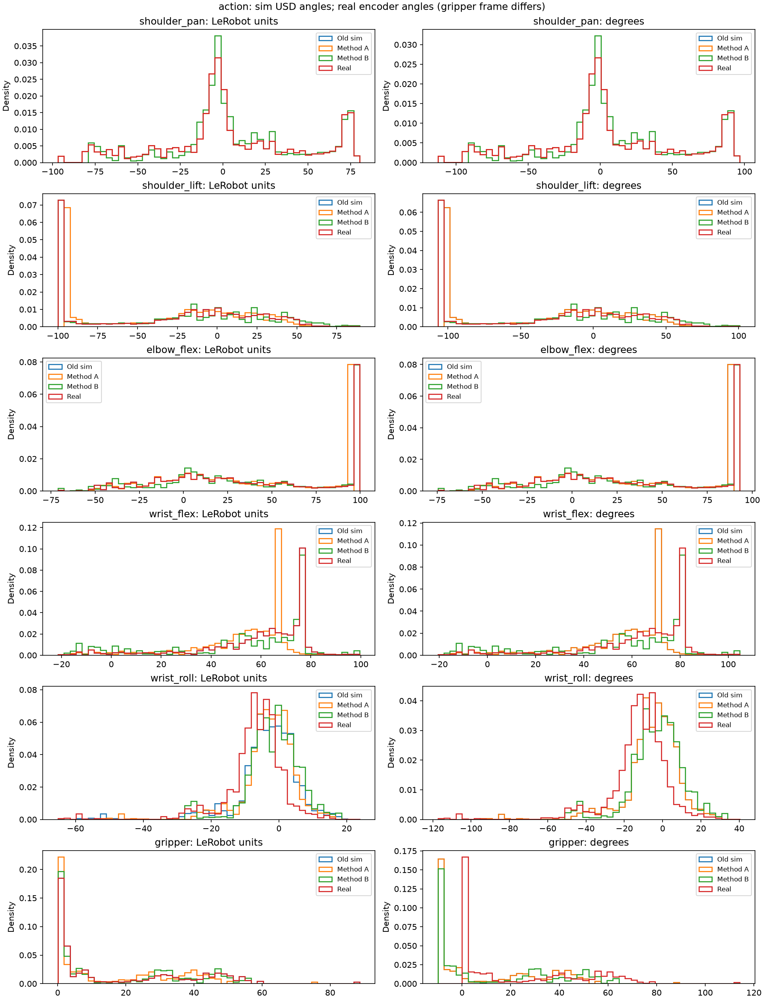
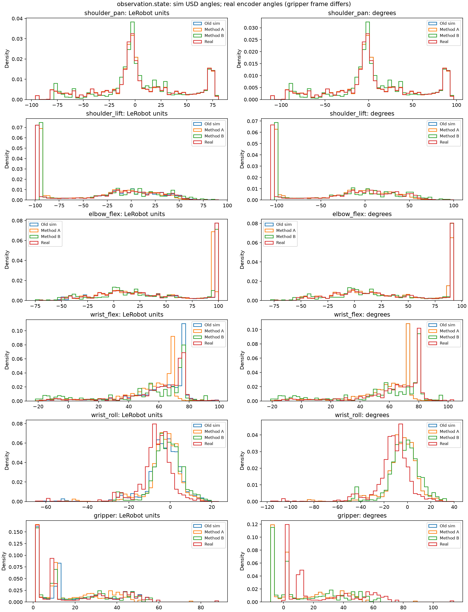

# Calibration fixes — 2026-10-27

The simulation now derives all six follower spans through one shared function. The real calibration files, original sim/real datasets, weights, scene assets and completed evaluation results remain intact.

Step 0 was reported in the conversation before implementation. [step0.json](step0.json) preserves the pxr audit from the teleop image, the original mapping, the follower fixture and the pre-change per-file dataset hashes.

## Step 0: counts and degrees

| Joint | Calibration counts | Encoder degrees | Old sim mapping | New sim mapping | USD limits | Outside USD |
|---|---|---|---|---|---|---|
| shoulder_pan | 725 … 3411 | -116.279297 … 119.794922 | -116.279297 … 119.794922 | -116.279297 … 119.794922 | -109.999870 … 109.999870 | lower, upper |
| shoulder_lift | 831 … 3326 | -106.962891 … 112.324219 | -100.000000 … 100.000000 | -106.962891 … 112.324219 | -100.000038 … 100.000038 | lower, upper |
| elbow_flex | 877 … 3109 | -102.919922 … 93.251953 | -100.000000 … 90.000000 | -102.919922 … 93.251953 | -100.000038 … 90.000206 | lower, upper |
| wrist_flex | 888 … 3245 | -101.953125 … 105.205078 | -95.000000 … 95.000000 | -101.953125 … 105.205078 | -94.999832 … 94.999832 | lower, upper |
| wrist_roll | 0 … 4095 | -180.000000 … 179.912109 | -160.000000 … 160.000000 | -180.000000 … 179.912109 | -160.000183 … 160.000183 | lower, upper |
| gripper | 2039 … 3514 | -0.791016 … 128.847656 | -10.000000 … 100.000000 | -10.000004 … 119.638668 | -10.000004 … 100.000038 | upper |

The USD does not contain a separate ‘closed’ label. The closing mechanical end-stop is its jaw lower limit, −10.000003815°. Its authored angular state and drive target are 0°. The existing CAD diagnostic contact-point gap is 15.8 mm at 0°, 3.48 mm at the lower stop, and −6.97 mm at −19°. Thus the available calibration and USD data do not verify a 19° offset. Gripper unit 0 uses the closing end-stop and its measured span is 129.638671875°.

Wrist encoder 2048 still maps to 0°. The 0–4095 range gives a −0.0439453125° midpoint at normalized unit 0; no additional follower zero rotation was introduced.

## Initial poses and shared mapping

`utils/joint_calibration.py:follower_mapping_from_calibration` is used by the regeneration command, runtime sim setup, and real rollout. The JSON stores all joint ranges, methods, follower ID, calibration hash and the measured USD gripper anchor. The fixture regression checks equality for all six joints.

The `assets/so101.py` initial radians remain `[-0.2736, -0.6109, -0.0745, 1.5148, -0.0326036732051, -0.1465]`. The MyRoom override also keeps its existing physical pose. Both are representable by the new mapping. The real rollout loop has no fixed rest pose or automatic rest-pose movement; its observed state and first-target guard remain in follower units.

MyRoom initial radians: `-0.2736000000, -1.5700000000, 1.4500000000, 0.9494000000, -0.0326036732, -0.1465000000`. The corresponding new units are `-14.769879, -84.487445, 89.628408, 50.947185, -1.013641, 1.238961`.

Frozen eval sets retain their original files and cube starts. Their arm-start states now use the `scene.joint_mapping` saved in each set, preserving the frozen physical poses. Non-benchmark profiles use Method A for their recorded starts. Evaluation results from before and after this revision cannot be directly compared. Existing old-unit checkpoints need retraining or an explicit adapter before use with the relabeled units; no weights were changed.

## USD and camera cleanup

Only `SO-ARM101-USD.usd` remains as the controlled arm asset. The alternate no-camera arm and `S0101_NO_CAMERA_CFG` were removed. The room package, room wrapper, wrist mount, meshes and other scene assets remain.

The removed `ARM_new.usd` layer changed exactly five composed attributes: wrist-roll `physics:localRot1`, gripper orientation/translation, and jaw orientation/translation. Its mesh geometry and relationships were unchanged. Adding 90° to the canonical wrist coordinate reproduced its body transforms over 100 poses with a maximum matrix difference of 5.02e-07. The affected Molmo profiles now use the canonical USD and `wrist_roll_model_offset: -90` in both mapping directions. The canonical wrist still clamps at ±160°; native Molmo wrist targets above 70° reach its upper stop. The initial follower wrist pose and encoder zero remain unchanged.

pxr found **zero Camera prims** in all three original arm assets, including inactive prims. Camera-mount geometry is retained. The optional runtime camera was `{ENV_REGEX_NS}/molmo_room`. Its helper, evaluation-script spawn/routing/report paths, shell/config flags, YAML settings, capability-sweep candidate, and obsolete feature tests were removed. The calibrated room RGB/depth and wrist cameras remain. Original call sites were listed in the conversation before removal. Historical reports retain their original asset names and camera-result fields as evidence, not current launch instructions.

## Dataset methods

| Method | Output root | Retained episodes | Success evidence |
|---|---|---:|---|
| A: relabel | `datasets/pick_place_v1_calibrated_A` | 75 / 75 | Original physical trajectories and images preserved; no new dynamics success score |
| B: physics replay | `datasets/pick_place_v1_calibrated_B` | 22 / 75 | Existing contact/lift/release/25-tick placement benchmark |

**Recommend Method A** for preserving the demonstrations. It relabels action and state units with `inverse_new_mapping(old_mapping(u))`, without clipping, and transforms global/per-episode joint statistics. All 16,448 frames remain; maximum physical-angle roundoff is 4.88311052e-06°. Video bytes, cube sidecars and unrelated metadata match the source hashes. The pinned LeRobot reader decoded both cameras in the first and last frames successfully.

Method A preserves existing successes and failures. Original recordings do not store the contact/lift/release benchmark labels, so an independently verified original success count is unavailable; **75 retained is not a new 75/75 success claim**.

Method B replayed every original action sequence from its recorded initial physical joint/cube positions with zero initial velocities. Only the initial cube pose was restored; subsequent cube motion came from physics. Images and measured states were rendered/recorded anew; failed episodes were discarded. A confirmed benchmark success at any step counts, matching the usual termination event; saved episodes retain the full original action sequence. It retained 22 episodes and 4,404 frames. [method_b.json](method_b.json) records every attempt and retained source ID. This is an open-loop replay of demonstrations, not a policy evaluation or a new real-robot trial.

Failed Method B source episodes (zero-based): `0, 1, 2, 3, 4, 5, 6, 8, 9, 10, 11, 14, 15, 18, 19, 20, 22, 23, 24, 25, 26, 27, 28, 29, 30, 31, 32, 33, 34, 37, 38, 40, 41, 48, 50, 51, 53, 54, 55, 56, 57, 59, 60, 61, 63, 64, 65, 66, 69, 70, 72, 73, 74`.

Successful Method B source episodes (zero-based): `7, 12, 13, 16, 17, 21, 35, 36, 39, 42, 43, 44, 45, 46, 47, 49, 52, 58, 62, 67, 68, 71`.

[Episode mapping CSV](method_b_episode_map.csv) maps every original episode ID to its retained output ID. Outputs are renumbered after failed attempts are discarded. Original episode 7 succeeded and became output episode 0; output episode 7 is successful original episode 36. ‘Failed’ is a task benchmark result, not a claim that the follower calibration is invalid.

The source sim and paired real datasets match their complete pre-change hash snapshots; the actual `rpd_robot.json` calibration hash also matches. [method_a.json](method_a.json), [Method A reader verification](method_a_verification.json), [Method B reader verification](method_b_verification.json), and [the complete data audit](completion-data-audit.json) preserve the verification details.

## Tests before and after

All host pytest commands used `PYTEST_DISABLE_PLUGIN_AUTOLOAD=1`. Isaac/USD geometry checks and the physical replay ran inside the teleop image. The host suite excludes `test_rerecording.py` because LeRobot is absent there; the full teleop-image suite includes it.

| Environment | Before | After | Failure set |
|---|---|---|---|
| host | 7 failed, 748 passed, 40 skipped, 2 warnings, 284 subtests passed in 28.16s | 7 failed, 741 passed, 36 skipped, 2 warnings, 279 subtests passed in 25.06s | Unchanged |
| container | 7 failed, 779 passed, 31 skipped, 7 warnings, 284 subtests passed in 209.21s (0:03:29) | 7 failed, 772 passed, 27 skipped, 7 warnings, 279 subtests passed in 240.61s (0:04:00) | Unchanged |

Final targeted regression suite: **182 passed, 2 skipped**. Isolated real-pxr USD tests: **2 passed**. The frozen-start regression also passes. Removed overhead-camera cases account for fewer total tests. [test_comparison.json](test_comparison.json) lists every unchanged baseline failure and links to the full logs below.

host failures before and after:

- `FAILED tests/test_launch_pick_place_n17.py::WrapperTests::test_official_flags_and_selected_config_are_forwarded_unchanged`
- `FAILED tests/test_launch_pick_place_n17.py::WrapperTests::test_runpy_entry_adds_project_helper_path_and_restores_it`
- `SUBFAILED(error='RuntimeError') tests/test_launch_pick_place_n17.py::WrapperTests::test_training_exception_and_system_exit_are_preserved_and_patch_restored`
- `SUBFAILED(error='SystemExit') tests/test_launch_pick_place_n17.py::WrapperTests::test_training_exception_and_system_exit_are_preserved_and_patch_restored`
- `FAILED tests/test_lerobot_eval_rollout.py::EvaluatorRolloutTests::test_benchmark_progress_updates_stages_and_retains_terminal_milestone`
- `FAILED tests/test_lerobot_eval_rollout.py::EvaluatorRolloutTests::test_resume_retains_completed_attempt_and_videos_and_retries_interrupted_start`
- `FAILED tests/test_pick_place_benchmark.py::StatisticsTests::test_mcnemar_exact`

container failures before and after:

- `FAILED tests/test_docker_training.py::test_existing_entrypoints_route_to_docker_without_starting_training[policies/groot_n17/train/train_dit.sh-dit]`
- `FAILED tests/test_eval_script.py::test_bare_config_name_is_looked_up_in_configs_eval`
- `FAILED tests/test_launch_pick_place_n17.py::WrapperTests::test_official_flags_and_selected_config_are_forwarded_unchanged`
- `FAILED tests/test_launch_pick_place_n17.py::WrapperTests::test_runpy_entry_adds_project_helper_path_and_restores_it`
- `SUBFAILED(error='RuntimeError') tests/test_launch_pick_place_n17.py::WrapperTests::test_training_exception_and_system_exit_are_preserved_and_patch_restored`
- `SUBFAILED(error='SystemExit') tests/test_launch_pick_place_n17.py::WrapperTests::test_training_exception_and_system_exit_are_preserved_and_patch_restored`
- `FAILED tests/test_lerobot_eval_rollout.py::EvaluatorRolloutTests::test_process_exit_without_finally_retains_completed_episode`

The host additionally lacks Rerun, PyAV and SciPy for the affected existing cases; wrapper/mock failures also predate this change. The isolated container suite additionally lacks host training-storage mounts, uses a read-only repository mount for the temporary-config case, and its bare subprocess Python lacks NumPy in one case. No baseline failure was hidden or treated as a passing result.

[Before host](before-host.txt), [after host](after-host.txt), [before container](before-container.txt), [after container](after-container.txt), [targeted](final-targeted.txt), [USD geometry](usd-tests.txt).

## Files changed

[changed_files.txt](changed_files.txt) lists the complete change set. Changes cover calibration derivation/configuration, legacy start-pose handling, dataset tools, Molmo wrist/camera options, alternate asset removal, tests, documentation and this evidence bundle.

## Joint comparisons

Paired real-arm data exists at `datasets/pick_place_v1-real`: 75 episodes and 16,448 frames. These are actual recorded action/state columns, not invented samples or calibration endpoints. All five requested statistics are reported separately for actions and measured states, for both new methods.

[CSV](joint_comparison.csv) · [JSON](joint_comparison.json)

Each cell is **mean / min / max / p5 / p95**. All frames are included.

Simulation degrees use the USD joint frame. Real degrees use encoder zero 2048;
the real gripper's USD-equivalent angle subtracts 9.209 degrees from its encoder angle.

### action: LeRobot units

| Joint | Old sim | Method A | Method B | Real |
|---|---|---|---|---|
| shoulder_pan | 3.812 / -94.680 / 80.376 / -72.040 / 73.663 | 3.812 / -94.680 / 80.376 / -72.040 / 73.663 | 6.934 / -77.868 / 79.934 / -68.635 / 73.663 | 3.808 / -96.902 / 80.376 / -72.040 / 73.663 |
| shoulder_lift | -30.948 / -100.000 / 89.434 / -99.329 / 45.379 | -30.671 / -93.650 / 79.123 / -93.038 / 38.943 | -28.862 / -100.000 / 89.434 / -99.329 / 54.034 | -30.948 / -100.000 / 89.434 / -99.329 / 45.379 |
| elbow_flex | 38.892 / -71.097 / 99.732 / -36.039 / 98.662 | 37.499 / -69.030 / 96.425 / -35.075 / 95.389 | 38.463 / -71.097 / 99.732 / -40.321 / 98.930 | 38.892 / -71.097 / 99.732 / -36.039 / 98.662 |
| wrist_flex | 59.074 / -21.410 / 99.570 / 4.987 / 77.300 | 52.611 / -21.207 / 89.753 / 3.004 / 69.328 | 52.230 / -21.410 / 99.570 / -8.426 / 77.373 | 59.074 / -21.410 / 99.570 / 4.987 / 77.300 |
| wrist_roll | -3.389 / -58.506 / 23.839 / -20.313 / 8.161 | -2.989 / -51.993 / 21.219 / -18.036 / 7.280 | -1.662 / -26.906 / 18.271 / -13.370 / 9.577 | -7.144 / -65.177 / 22.393 / -23.956 / 3.883 |
| gripper | 18.539 / 0.077 / 88.675 / 1.310 / 52.003 | 15.731 / 0.065 / 75.242 / 1.111 / 44.125 | 17.758 / 0.616 / 56.240 / 1.310 / 51.156 | 18.539 / 0.077 / 88.675 / 1.310 / 52.003 |

### action: degrees

| Joint | Old sim | Method A | Method B | Real |
|---|---|---|---|---|
| shoulder_pan | 6.257 / -110.000 / 96.632 / -83.276 / 88.707 | 6.257 / -110.000 / 96.632 / -83.276 / 88.707 | 9.943 / -90.155 / 96.109 / -79.257 / 88.707 | 6.253 / -112.622 / 96.632 / -83.276 / 88.707 |
| shoulder_lift | -30.948 / -100.000 / 89.434 / -99.329 / 45.379 | -30.948 / -100.000 / 89.434 / -99.329 / 45.379 | -28.965 / -106.963 / 100.739 / -106.227 / 61.925 | -31.252 / -106.963 / 100.739 / -106.227 / 52.436 |
| elbow_flex | 31.948 / -72.542 / 89.746 / -39.237 / 88.729 | 31.948 / -72.542 / 89.746 / -39.237 / 88.729 | 32.893 / -74.570 / 92.989 / -44.383 / 92.202 | 33.314 / -74.570 / 92.989 / -40.183 / 91.939 |
| wrist_flex | 56.120 / -20.340 / 94.592 / 4.738 / 73.435 | 56.120 / -20.340 / 94.592 / 4.738 / 73.435 | 55.726 / -20.550 / 104.760 / -7.102 / 81.768 | 62.814 / -20.550 / 104.760 / 6.792 / 81.693 |
| wrist_roll | -5.423 / -93.609 / 38.142 / -32.501 / 13.057 | -5.423 / -93.609 / 38.142 / -32.501 / 13.057 | -3.035 / -48.463 / 32.835 / -24.104 / 17.191 | -12.900 / -117.334 / 40.254 / -43.154 / 6.943 |
| gripper | 10.393 / -9.915 / 87.542 / -8.559 / 47.203 | 10.393 / -9.915 / 87.542 / -8.559 / 47.203 | 13.022 / -9.201 / 62.909 / -8.302 / 56.317 | 23.243 / -0.691 / 114.166 / 0.907 / 66.625 |

### observation.state: LeRobot units

| Joint | Old sim | Method A | Method B | Real |
|---|---|---|---|---|
| shoulder_pan | 3.834 / -94.680 / 80.486 / -72.358 / 73.702 | 3.834 / -94.680 / 80.486 / -72.358 / 73.702 | 6.908 / -77.417 / 80.032 / -68.576 / 74.022 | 3.806 / -96.277 / 79.970 / -72.152 / 73.641 |
| shoulder_lift | -30.426 / -99.670 / 90.672 / -99.335 / 46.715 | -30.195 / -93.348 / 80.253 / -93.043 / 40.161 | -27.498 / -93.654 / 85.026 / -93.650 / 52.588 | -30.232 / -99.760 / 88.697 / -99.359 / 45.972 |
| elbow_flex | 39.732 / -70.462 / 100.002 / -35.310 / 99.570 | 38.313 / -68.414 / 96.687 / -34.369 / 96.268 | 38.017 / -74.866 / 96.688 / -41.076 / 96.685 | 39.829 / -70.968 / 99.104 / -34.108 / 98.566 |
| wrist_flex | 59.420 / -20.650 / 99.369 / 4.207 / 77.455 | 52.929 / -20.509 / 89.569 / 2.289 / 69.470 | 51.811 / -21.842 / 90.156 / -12.372 / 77.388 | 59.199 / -20.068 / 98.642 / 4.370 / 77.514 |
| wrist_roll | -3.322 / -60.696 / 23.210 / -20.128 / 8.132 | -2.929 / -53.941 / 20.661 / -17.871 / 7.255 | -1.654 / -27.210 / 18.252 / -13.722 / 9.465 | -7.162 / -65.031 / 22.002 / -24.005 / 3.639 |
| gripper | 20.429 / 1.229 / 88.412 / 1.394 / 51.657 | 17.334 / 1.043 / 75.019 / 1.183 / 43.831 | 19.207 / 1.119 / 56.209 / 1.387 / 49.206 | 19.683 / 1.424 / 88.271 / 1.627 / 51.390 |

### observation.state: degrees

| Joint | Old sim | Method A | Method B | Real |
|---|---|---|---|---|
| shoulder_pan | 6.283 / -110.000 / 96.761 / -83.652 / 88.753 | 6.283 / -110.000 / 96.761 / -83.652 / 88.753 | 9.912 / -89.623 / 96.225 / -79.187 / 89.132 | 6.250 / -111.885 / 96.152 / -83.408 / 88.682 |
| shoulder_lift | -30.426 / -99.670 / 90.672 / -99.335 / 46.715 | -30.426 / -99.670 / 90.672 / -99.335 / 46.715 | -27.470 / -100.005 / 95.906 / -100.000 / 60.341 | -30.467 / -106.699 / 99.932 / -106.260 / 53.086 |
| elbow_flex | 32.746 / -71.939 / 90.002 / -38.545 / 89.592 | 32.746 / -71.939 / 90.002 / -38.545 / 89.592 | 32.456 / -78.267 / 90.003 / -45.123 / 90.000 | 34.232 / -74.443 / 92.373 / -38.290 / 91.846 |
| wrist_flex | 56.449 / -19.617 / 94.401 / 3.997 / 73.582 | 56.449 / -19.617 / 94.401 / 3.997 / 73.582 | 55.291 / -20.998 / 95.009 / -11.189 / 81.784 | 62.943 / -19.160 / 103.799 / 6.152 / 81.914 |
| wrist_roll | -5.315 / -97.113 / 37.136 / -32.205 / 13.011 | -5.315 / -97.113 / 37.136 / -32.205 / 13.011 | -3.020 / -49.011 / 32.801 / -24.737 / 16.990 | -12.932 / -117.070 / 39.551 / -43.242 / 6.504 |
| gripper | 12.471 / -8.648 / 87.254 / -8.467 / 46.822 | 12.471 / -8.648 / 87.254 / -8.467 / 46.822 | 14.899 / -8.549 / 62.869 / -8.202 / 53.790 | 24.725 / 1.055 / 113.643 / 1.318 / 65.830 |
