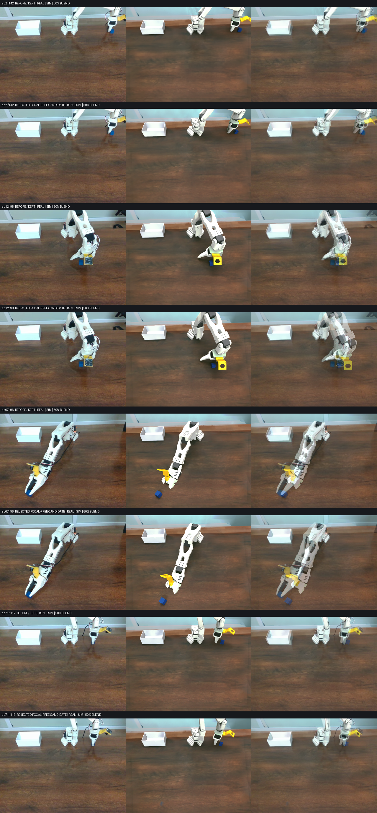
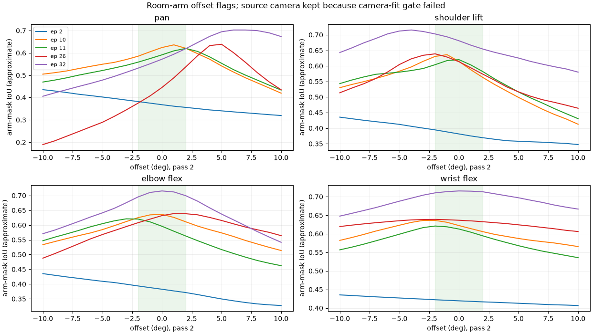
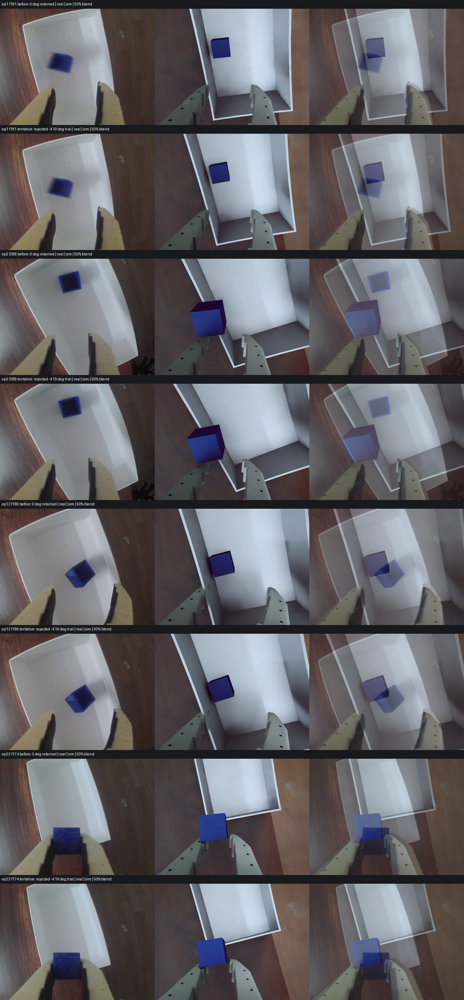
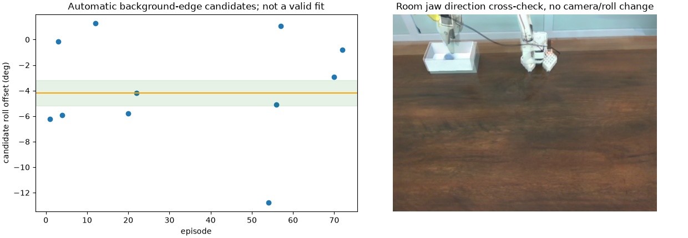
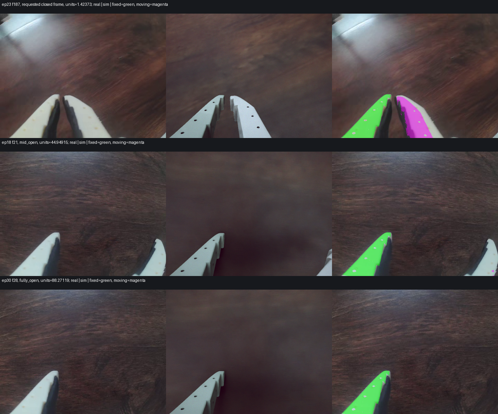
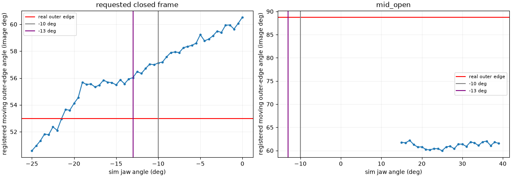

# Camera, gripper and recording audit — 2026-10-27

Work is on `calibration-fixes`; source datasets and USD assets are protected. Calibration gates concern numerical alignment, not whether a recorded video succeeded.

## Part 1 — static room-camera fit: gate not met

No camera values were applied. Used 21 episodes: 11 fit, 10 held out. Static landmarks only: five box corners, up to four base-foot corners, and two back wall/brown-boundary line samples. No arm points entered the camera objective. Dark right-side box vertex and occluded/ambiguous contours were excluded before the split. RGB corner localisation and the small fixed viewpoint limit confidence; the fit is an image measurement, not a new hardware calibration.

| Fit | Fit median / max (px) | Held-out median / max (px) |
|---|---:|---:|
| Existing camera | 5.904 / 17.065 | 5.135 / 17.065 |
| Extrinsics, measured K fixed | 2.753 / 10.574 | 2.796 / 10.574 |
| Extrinsics + common focal scale | 2.727 / 9.269 | 3.018 / 9.304 |

Gate: held-out median ≤2 px. Both candidates miss it. Free focal was attempted only after the fixed-K fit missed; it drifted to 0.7273× measured focal, illustrating focal/distance ambiguity. Neither candidate is a replacement calibration. Old values remain intact in the setup and the before snapshot. The contact sheet labels the rejected candidate explicitly; production “after” equals “before”.

The room camera reports inverse Brown–Conrady coefficients `[0,0,0,0,0]`. `CalibratedPinholeCameraCfg` authors the RTX native OpenCV pinhole model, so these measured zero coefficients are represented exactly: distortion omission error **0 px**. Nonzero inverse coefficients would require conversion; the existing code rejects them rather than interpreting them as a forward model. This does not establish that the physical lens has no residual distortion beyond its reported calibration.

Median signed edge displacements (real minus sim, pixels; normals for landmark edges):

| Edge | Before | Rejected candidate |
|---|---:|---:|
| front_bottom_real_minus_sim_px | 6.000 | 4.000 |
| back_edge_median_real_minus_sim_px | -3.500 | -4.000 |
| box_back_rim | 2.369 | -0.312 |
| box_front_bottom | -5.504 | -2.678 |
| box_left_vertical | 6.030 | -1.481 |
| box_left_top_depth | 8.160 | 0.101 |
| base_lower_span | 1.061 | -0.401 |

The joint check used five quiet, original-USD-in-limit follower frames, two coordinate-descent passes, offsets −10…+10° in 1° steps, with only pan/lift/elbow/flex varied. Because the camera gate failed, this diagnostic uses the unchanged source camera. Arm masks use plastic segmentation and filled components near the rendered arm, excluding the base; mask and camera uncertainty make these flags unsuitable as calibration estimates. No joint mapping was changed.

| Episode / frame | Pan / lift / elbow / flex best offsets (deg) | IoU before → after |
|---|---|---:|
| 2 / 142 | -10, -10, -10, -10 | 0.295 → 0.435 |
| 10 / 182 | +1, -1, +0, -2 | 0.617 → 0.636 |
| 11 / 115 | +2, +0, -3, -2 | 0.583 → 0.621 |
| 26 / 77 | +5, -2, +1, -2 | 0.421 → 0.639 |
| 32 / 44 | +6, -4, +0, +0 | 0.557 → 0.715 |

Offsets above 2° and solutions on the sweep boundary are flagged, not applied. The user's physical arm/box checks remain the established geometry reference.

Part 1 blocks only the camera image rerender in 5a, the paired measurement dataset in 5b, and the live cube guide in 6. Independent parts continue.

## Evidence files

Bulk data stay outside git. SHA-256 below fixes the exact evidence used:

| File | SHA-256 |
|---|---|
| `/tmp/so101-camera-gripper-recording/source_hashes_before.json` | `3097b681816a0852f44adbd2776452e395b1867915a4871358b090d4be5346e8` |
| `/tmp/so101-camera-gripper-recording/real_setup_before.json` | `c518cf0ac9509b83d51af944817e3d24162de20b843255e08165edee403790f5` |
| `/tmp/so101-camera-gripper-recording/camera_fit.json` | `0e71890d4d08cbf7d23c8ef7d70c0ef1e1edac386072dc7d49983d2da44f492e` |
| `/tmp/so101-camera-gripper-recording/camera_edges_bulk.json` | `671a7ce526c68e744e406c3a25424d2ec882e17c56b0bdfcdd84f4507c76875e` |
| `/tmp/so101-camera-gripper-recording/joint_check.json` | `578aee78bbba6a8ea5e4df697c36cddc874ba7c1879f21754aa6f714418f9048` |
| `/tmp/so101-camera-gripper-recording/tests_before_host.txt` | `b15c01bdc1dcf075ead4d299ad7a7c469f6e0ab9cea67314b004c2172757372b` |
| `/tmp/so101-camera-gripper-recording/tests_before_container.txt` | `4f6750fffc4dcf705fae011b3f641e3759cbe0f7dafe468746216f336948c7c2` |

## Baseline tests

Host (`PYTEST_DISABLE_PLUGIN_AUTOLOAD=1`, temporary analysis venv, excluding the Isaac/LeRobot codec integration file): 761 passed, 33 skipped, 5 reported failures including two failing subtests. Existing failures: three `test_launch_pick_place_n17` wrapper tests (missing `gr00t.data`) and `test_benchmark_progress_updates_stages_and_retains_terminal_milestone` (missing host `rerun`).

Teleop container: 772 passed, 27 skipped, 7 reported failures including two failing subtests. Existing failures: the `train_dit.sh` entrypoint storage-path test; bare config lookup under a read-only repo bind; the same three `test_launch_pick_place_n17` wrapper tests; and `test_process_exit_without_finally_retains_completed_episode` (bare child Python lacks NumPy). Full logs above contain tracebacks. Final failure-set comparison is recorded in Part 7.

## Part 2A — wrist roll: UNRESOLVED

Posed the simulator from **real follower observation.state**, without action-based episode re-zero correction, on 55 quiet frames from 55 episodes. The pool has 630 original-USD-in-limit quiet frames from 55 episodes. Quiet means all-six-joint maximum adjacent step ≤0.25° and five-frame excursion ≤0.5°. Selected roll extremes are −116.982° and +23.643°. The global +39.551° extreme has no frame satisfying the original all-joint in-limit/quiet gate; it is included in the limit audit, not mislabelled as a quiet roll calibration point.

Undistorted background-edge candidates were matched to projected static box edges, using FK of the gripper and the verified camera mount. A +1° roll render provides the rotation axis and camera orbit, so fitting is in joint degrees rather than assuming image rotation equals wrist rotation. Camera sensor pose metadata is stale when Isaac Lab's `update_latest_camera_pose` is false; analysis therefore used live body FK plus the mount and checked the CAD projection against the rendered silhouette. The corrected capture worker also enables current camera metadata.

The generous automatic matcher found **11 candidate frames/episodes**, median offset **−4.188°**, standard deviation **3.921°**, range **−12.780…+1.289°**. These include ambiguous edges; they are an upper bound on usable matches, not 11 independently verified correspondences. The narrower matcher finds only two clear matches. Neither set meets ≥15 cross-episode frames with spread about 1°. Background edges are absent from most still frames; wood grain, cube edges and specular highlights were not accepted as established static geometry.

The −4.19° trial is shown for diagnosis and **was not applied**. Its scatter does not establish any multiple-of-90° zero change. The room overlay provides a jaw-direction cross-check, but room camera error and overlapping silhouettes cannot validate a roughly 4° roll adjustment; it supplies no independent numeric confirmation. The physical arm-vs-USD roll zero remains unresolved. The existing sim-only wrist re-zero must therefore remain for future recordings.

## Part 2B — gripper: no contact-anchor change

Stillness was evaluated on **gripper only**. The requested episode 23/frame 187 is usable despite body motion: state **1.4237288 units**, five-frame jaw excursion **0.35156°**. Mid-open episode 18/frame 21 is 44.94915 units with 0° jaw excursion. Fully-open episode 30/frame 28 is 88.27119 units with 0.08789° excursion. No source frame reaches the calibrated zero-unit closed endpoint.

Real and simulated **fixed white jaw faces** were registered first (affine image fit; moving pixels excluded). Fixed-jaw IoUs are **0.951, 0.940, 0.942** for closed/mid/open. The real moving-jaw outer-edge image angles are **52.993°** and **88.766°** for closed and mid-open. The fully-open moving jaw leaves the wrist image and cannot supply an angle.

Direct moving-edge scans after this registration do **not** yield a consistent contact anchor. The closed diagnostic reaches a best angle match at −21.5° USD (implied unit-zero anchor −23.35°), already beyond the CAD contact proxy. The mid-open scan has a large residual (26.57° at its best accepted line) and an incompatible anchor. These are rejected image-fit outputs, not motor calibration measurements: a partial fixed-jaw silhouette permits nonphysical affine shear, and side faces/occlusion change the measured moving edge. High registration IoU alone does not validate a 3D angle. The lowest recorded frame also does not establish that the empty pads are touching.

Thus these images cannot defensibly decide between a true touching angle near −10° and −13°. The CAD proxy at −12.93098° remains a proxy. The previous −10.0000038° at unit 0 is retained explicitly with **unresolved** status, independent of the jaw's runtime lower limit. No offset was inferred from the jaw's moving body or forced to the proxy value.

Live capture needed to resolve contact:

1. Keep the wrist camera rigidly mounted, remove the cube, and put a contrasting background behind both fingertips. Use a pose where both fixed and moving white faces, their holes, and the touching pads are visible. Hold the arm supported and stationary.
2. Close the empty gripper slowly until the pads just touch, without squeezing further. Verify contact directly from the side; the lowest dataset value alone is not evidence of contact.
3. Hold for at least one second. Save a lossless wrist image and the **same-tick follower `get_observation()` six `.pos` values**, timestamp, follower ID, and calibration-file SHA-256. Save 30 consecutive observations/images so jaw-only stillness can be checked. Do not substitute leader actions.
4. Repeat at mid-open and fully open, and repeat empty contact three times. Take one room/side image confirming pad contact. Use fixed-jaw hole correspondences to recover a physical camera/plane registration; then fit the moving edge and require the same anchor across openings before changing it.

Additional bulk evidence:

| File | SHA-256 |
|---|---|
| `/tmp/so101-camera-gripper-recording/wrist_selection.json` | `8898c7bbd21361de25cb184b3bfb7b647a6503a763ea6fb623595d2bcc7e3a2f` |
| `/tmp/so101-camera-gripper-recording/roll_fit.json` | `8dcb61e2aa50b0e795e96dd3588d6cb65173e44cc55af19a9abdf2345f00363b` |
| `/tmp/so101-camera-gripper-recording/gripper_measurements.json` | `790c0402b631458c1f0a86961a880732eb0d366a9602852c7b37248c3d20c714` |
| `/tmp/so101-camera-gripper-recording/gripper_fit.json` | `34b37adcbf954b40ffeee1e25ae6c422ca84c32edacde8064c211b7155af68c2` |
