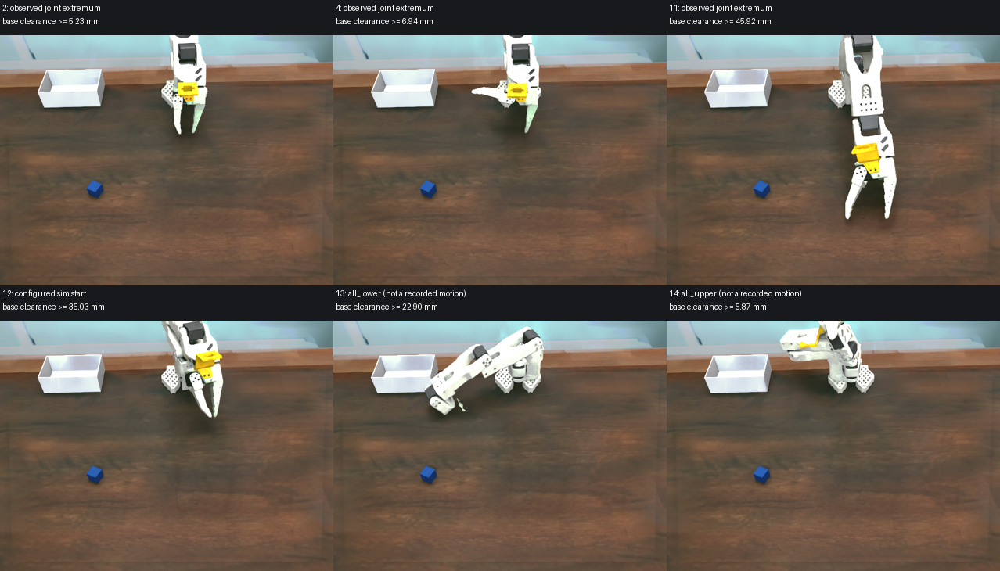
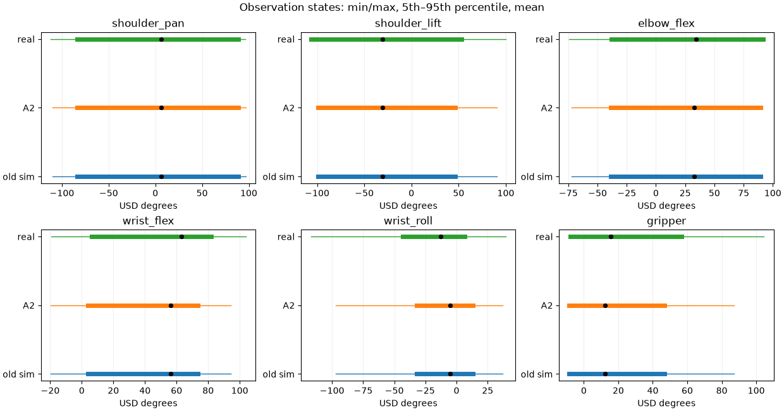
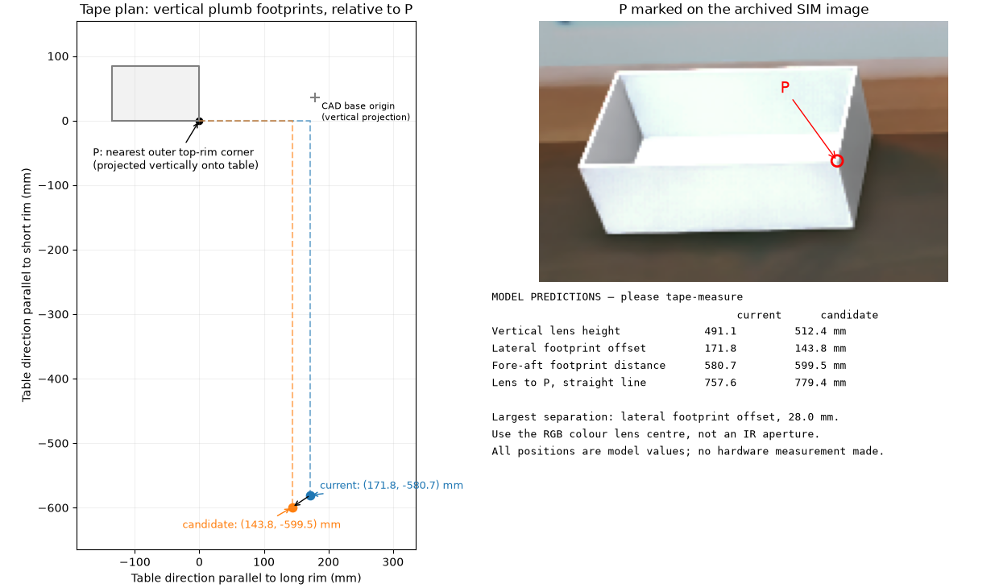

# Camera, gripper and recording audit — 2026-10-27

**Current follow-up:** recording contract v3 synchronizes all six joints and has no per-episode wrist re-zero. The original Parts 1–7 below describe the earlier implementation and run; the Follow-up section supersedes their recorder fallback instructions.

Work is on `calibration-fixes`; source datasets and USD assets are protected. Calibration gates concern numerical alignment, not whether a recorded video succeeded.

## Part 1 — static room-camera fit: gate not met

No camera values were applied. Used 21 episodes: 11 fit, 10 held out. Static landmarks only: five box corners, up to four base-foot corners, and two back wall/brown-boundary line samples. No arm points entered the camera objective. Dark right-side box vertex and occluded/ambiguous contours were excluded before the split. RGB corner localisation and the small fixed viewpoint limit confidence; the fit is an image measurement, not a new hardware calibration.

| Fit | Fit median / max (px) | Held-out median / max (px) |
|---|---:|---:|
| Existing camera | 5.904 / 17.065 | 5.135 / 17.065 |
| Extrinsics, measured K fixed | 2.753 / 10.574 | 2.796 / 10.574 |
| Extrinsics + common focal scale | 2.727 / 9.269 | 3.018 / 9.304 |

Gate: held-out median ≤2 px. Both candidates miss it. Free focal was attempted only after the fixed-K fit missed; it drifted to 0.7273× measured focal, illustrating focal/distance ambiguity. Neither candidate is a replacement calibration. Old values remain intact in the setup and the before snapshot. The contact sheet labels the rejected candidate explicitly; production “after” equals “before”.

The room camera reports inverse Brown–Conrady coefficients `[0,0,0,0,0]`. `CalibratedPinholeCameraCfg` authors the RTX native OpenCV pinhole model, so these measured zero coefficients are represented exactly: distortion omission error **0 px**. Nonzero inverse coefficients would require conversion; the existing code rejects them rather than interpreting them as a forward model. This does not establish that the physical lens has no residual distortion beyond its reported calibration.


Median signed edge displacements (real minus sim, pixels; normals for landmark edges):

| Edge | Before | Rejected candidate |
|---|---:|---:|
| front_bottom_real_minus_sim_px | 6.000 | 4.000 |
| back_edge_median_real_minus_sim_px | -3.500 | -4.000 |
| box_back_rim | 2.369 | -0.312 |
| box_front_bottom | -5.504 | -2.678 |
| box_left_vertical | 6.030 | -1.481 |
| box_left_top_depth | 8.160 | 0.101 |
| base_lower_span | 1.061 | -0.401 |

The joint check used five quiet, original-USD-in-limit follower frames, two coordinate-descent passes, offsets −10…+10° in 1° steps, with only pan/lift/elbow/flex varied. Because the camera gate failed, this diagnostic uses the unchanged source camera. Arm masks use plastic segmentation and filled components near the rendered arm, excluding the base; mask and camera uncertainty make these flags unsuitable as calibration estimates. No joint mapping was changed.

| Episode / frame | Pan / lift / elbow / flex best offsets (deg) | IoU before → after |
|---|---|---:|
| 2 / 142 | -10, -10, -10, -10 | 0.295 → 0.435 |
| 10 / 182 | +1, -1, +0, -2 | 0.617 → 0.636 |
| 11 / 115 | +2, +0, -3, -2 | 0.583 → 0.621 |
| 26 / 77 | +5, -2, +1, -2 | 0.421 → 0.639 |
| 32 / 44 | +6, -4, +0, +0 | 0.557 → 0.715 |

Offsets above 2° and solutions on the sweep boundary are flagged, not applied. The user's physical arm/box checks remain the established geometry reference.


Part 1 blocks only the camera image rerender in 5a, the paired measurement dataset in 5b, and the live cube guide in 6. Independent parts continue.

## Evidence files

Bulk data stay outside git. SHA-256 below fixes the exact evidence used:

| File | SHA-256 |
|---|---|
| `outputs/calibration-evidence/2026-10-27-camera-gripper-recording/source_hashes_before.json` | `3097b681816a0852f44adbd2776452e395b1867915a4871358b090d4be5346e8` |
| `outputs/calibration-evidence/2026-10-27-camera-gripper-recording/real_setup_before.json` | `c518cf0ac9509b83d51af944817e3d24162de20b843255e08165edee403790f5` |
| `outputs/calibration-evidence/2026-10-27-camera-gripper-recording/camera_fit.json` | `0e71890d4d08cbf7d23c8ef7d70c0ef1e1edac386072dc7d49983d2da44f492e` |
| `outputs/calibration-evidence/2026-10-27-camera-gripper-recording/camera_edges_bulk.json` | `671a7ce526c68e744e406c3a25424d2ec882e17c56b0bdfcdd84f4507c76875e` |
| `outputs/calibration-evidence/2026-10-27-camera-gripper-recording/joint_check.json` | `578aee78bbba6a8ea5e4df697c36cddc874ba7c1879f21754aa6f714418f9048` |
| `outputs/calibration-evidence/2026-10-27-camera-gripper-recording/tests_before_host.txt` | `b15c01bdc1dcf075ead4d299ad7a7c469f6e0ab9cea67314b004c2172757372b` |
| `outputs/calibration-evidence/2026-10-27-camera-gripper-recording/tests_before_container.txt` | `4f6750fffc4dcf705fae011b3f641e3759cbe0f7dafe468746216f336948c7c2` |

## Baseline tests

Host (`PYTEST_DISABLE_PLUGIN_AUTOLOAD=1`, temporary analysis venv, excluding the Isaac/LeRobot codec integration file): 761 passed, 33 skipped, 5 reported failures including two failing subtests. Existing failures: three `test_launch_pick_place_n17` wrapper tests (missing `gr00t.data`) and `test_benchmark_progress_updates_stages_and_retains_terminal_milestone` (missing host `rerun`).

Teleop container: 772 passed, 27 skipped, 7 reported failures including two failing subtests. Existing failures: the `train_dit.sh` entrypoint storage-path test; bare config lookup under a read-only repo bind; the same three `test_launch_pick_place_n17` wrapper tests; and `test_process_exit_without_finally_retains_completed_episode` (bare child Python lacks NumPy). Full logs above contain tracebacks. Final failure-set comparison is recorded in Part 7.

## Part 2A — wrist roll: UNRESOLVED

Posed the simulator from **real follower observation.state**, without action-based episode re-zero correction, on 55 quiet frames from 55 episodes. The pool has 630 original-USD-in-limit quiet frames from 55 episodes. Quiet means all-six-joint maximum adjacent step ≤0.25° and five-frame excursion ≤0.5°. Selected roll extremes are −116.982° and +23.643°. The global +39.551° extreme has no frame satisfying the original all-joint in-limit/quiet gate; it is included in the limit audit, not mislabelled as a quiet roll calibration point.

Undistorted background-edge candidates were matched to projected static box edges, using FK of the gripper and the verified camera mount. A +1° roll render provides the rotation axis and camera orbit, so fitting is in joint degrees rather than assuming image rotation equals wrist rotation. Camera sensor pose metadata is stale when Isaac Lab's `update_latest_camera_pose` is false; analysis therefore used live body FK plus the mount and checked the CAD projection against the rendered silhouette. The corrected capture worker also enables current camera metadata.

The generous automatic matcher found **11 candidate frames/episodes**, median offset **−4.188°**, standard deviation **3.921°**, range **−12.780…+1.289°**. These include ambiguous edges; they are an upper bound on usable matches, not 11 independently verified correspondences. The narrower matcher finds only two clear matches. Neither set meets ≥15 cross-episode frames with spread about 1°. Background edges are absent from most still frames; wood grain, cube edges and specular highlights were not accepted as established static geometry.

The −4.19° trial is shown for diagnosis and **was not applied**. Its scatter does not establish any multiple-of-90° zero change. The room overlay provides a jaw-direction cross-check, but room camera error and overlapping silhouettes cannot validate a roughly 4° roll adjustment; it supplies no independent numeric confirmation. The physical arm-vs-USD roll zero remains unresolved. The existing sim-only wrist re-zero must therefore remain for future recordings.


## Part 2B — gripper: no contact-anchor change

Stillness was evaluated on **gripper only**. The requested episode 23/frame 187 is usable despite body motion: state **1.4237288 units**, five-frame jaw excursion **0.35156°**. Mid-open episode 18/frame 21 is 44.94915 units with 0° jaw excursion. Fully-open episode 30/frame 28 is 88.27119 units with 0.08789° excursion. No source frame reaches the calibrated zero-unit closed endpoint.

Real and simulated **fixed white jaw faces** were registered first (affine image fit; moving pixels excluded). Fixed-jaw IoUs are **0.951, 0.940, 0.942** for closed/mid/open. The real moving-jaw outer-edge image angles are **52.993°** and **88.766°** for closed and mid-open. The fully-open moving jaw leaves the wrist image and cannot supply an angle.

Direct moving-edge scans after this registration do **not** yield a consistent contact anchor. The closed diagnostic reaches a best angle match at −21.5° USD (implied unit-zero anchor −23.35°), already beyond the CAD contact proxy. The mid-open scan has a large residual (26.57° at its best accepted line) and an incompatible anchor. These are rejected image-fit outputs, not motor calibration measurements: a partial fixed-jaw silhouette permits nonphysical affine shear, and side faces/occlusion change the measured moving edge. High registration IoU alone does not validate a 3D angle. The lowest recorded frame also does not establish that the empty pads are touching.

Thus these images cannot defensibly decide between a true touching angle near −10° and −13°. The CAD proxy at −12.93098° remains a proxy. The previous −10.0000038° at unit 0 is retained explicitly with **unresolved** status, independent of the jaw's runtime lower limit. No offset was inferred from the jaw's moving body or forced to the proxy value.


Live capture needed to resolve contact:

1. Keep the wrist camera rigidly mounted, remove the cube, and put a contrasting background behind both fingertips. Use a pose where both fixed and moving white faces, their holes, and the touching pads are visible. Hold the arm supported and stationary.
2. Close the empty gripper slowly until the pads just touch, without squeezing further. Verify contact directly from the side; the lowest dataset value alone is not evidence of contact.
3. Hold for at least one second. Save a lossless wrist image and the **same-tick follower `get_observation()` six `.pos` values**, timestamp, follower ID, and calibration-file SHA-256. Save 30 consecutive observations/images so jaw-only stillness can be checked. Do not substitute leader actions.
4. Repeat at mid-open and fully open, and repeat empty contact three times. Take one room/side image confirming pad contact. Use fixed-jaw hole correspondences to recover a physical camera/plane registration; then fit the moving edge and require the same anchor across openings before changing it.

Additional bulk evidence:

| File | SHA-256 |
|---|---|
| `outputs/calibration-evidence/2026-10-27-camera-gripper-recording/wrist_selection.json` | `8898c7bbd21361de25cb184b3bfb7b647a6503a763ea6fb623595d2bcc7e3a2f` |
| `outputs/calibration-evidence/2026-10-27-camera-gripper-recording/roll_fit.json` | `8dcb61e2aa50b0e795e96dd3588d6cb65173e44cc55af19a9abdf2345f00363b` |
| `outputs/calibration-evidence/2026-10-27-camera-gripper-recording/gripper_measurements.json` | `790c0402b631458c1f0a86961a880732eb0d366a9602852c7b37248c3d20c714` |
| `outputs/calibration-evidence/2026-10-27-camera-gripper-recording/gripper_fit.json` | `34b37adcbf954b40ffeee1e25ae6c422ca84c32edacde8064c211b7155af68c2` |

## Part 3 — one shared mapping derivation

`utils/joint_calibration.py` now accepts and validates explicit persisted `wrist_roll_zero_offset_degrees`, `gripper_closed_degrees`, and `gripper_contact_units`. The gripper anchor is the USD angle **at the stated contact sample**, so a future measured nonzero contact-unit value does not get mistaken for the unit-zero angle. Encoder spans are retained. Joint limits are independent of all three anchors.

The unresolved roll fit retains offset **0°**. The unresolved contact fit retains **−10.000003814697266° at 0 units**. Both statuses and evidence references are saved in `sim_joint_mapping_source`; the CAD contact proxy is separately labelled. These are retained assumptions, not newly verified physical zeros.

Regenerated `sim_joint_mapping` with `scripts/update_sim_calibration.py` from the unchanged rpd_robot calibration inside the teleop image. No mapping numbers were hand edited. The generator preserves anchor/provenance fields, accepts explicit anchor overrides, and no longer derives contact from the USD jaw lower limit. `assets/real_setup.py` recomputes with all anchors and still rejects stale persisted mappings. Real rollout passes the same complete anchor dictionary into the shared function.

Molmo's **−90° policy convention is retained separately**. The unresolved arm fit cannot establish a replacement or independently prove −90° on the physical arm. There is no extra 90° in the shared mapping. Mapping midpoints still give wrist `arm_zero_degrees = −0.0439453125°`; a synthetic +90° arm-zero regression moves that policy zero to 89.9560546875° without changing its encoder span or Molmo option.

Validation: 43 host tests passed (21 subtests), including nonzero contact samples, roll-offset midpoint consistency, invalid anchors, generator provenance preservation and real-rollout entry points. A fresh teleop-image import passed the runtime stale-map check (`PART3_SHARED_SETUP_IMPORT_OK`).

| Evidence | SHA-256 |
|---|---|
| `outputs/calibration-evidence/2026-10-27-camera-gripper-recording/part3-tests.txt` | `c84b94f19321f17dc22bf833a32dd20279b48839c79679ba855e94f9c5ce6d2a` |
| `outputs/calibration-evidence/2026-10-27-camera-gripper-recording/part3-container-import.txt` | `233aacf17c929f913d25e81ee318eabf46fe5eba91bd61211ef6422af88be77b` |

## Part 4 — runtime limits

Both clamps now read `runtime_joint_limits` in `real_setup.json`: the interface's code clamp and the startup PhysX articulation limits. The installed Isaac Lab call is `Articulation.write_joint_position_limit_to_sim(limits, joint_ids=..., env_ids=...)`, confirmed in `/workspace/isaaclab/source/isaaclab/isaaclab/assets/articulation/articulation.py:710`. Limits are radians at that API and degrees in JSON. A fresh Isaac environment read them back from `robot.data.joint_pos_limits`; all six match the code clamp within 0.00002°. Twelve full recorded poses at per-joint extrema pass the production mapping without clipping, maximum float32 conversion error 0.0000214°.

Bounds are the union of previous bounds and observed real extrema plus 1°; the jaw lower is 5° below the retained unit-zero anchor. The wrist roll remains **−160…+160°**, which already covers −117.070…+39.551°; it was not expanded to ±180°.

| Joint | Observed min / max (deg) | Runtime min / max (deg) |
|---|---:|---:|
| shoulder_pan | -111.88477 / 96.15234 | -112.88477 / 110.00000 |
| shoulder_lift | -106.69922 / 99.93164 | -107.69922 / 100.93164 |
| elbow_flex | -74.44336 / 92.37305 | -100.00000 / 93.37305 |
| wrist_flex | -19.16016 / 103.79883 | -95.00000 / 104.79883 |
| wrist_roll | -117.07031 / 39.55078 | -160.00000 / 160.00000 |
| gripper | -8.15430 / 104.43359 | -15.00000 / 105.43359 |

The base USD and its layers were not modified. Self-collision remains off. Checked the 12 recorded joint-extreme poses, configured start, and simultaneous all-lower/all-upper limit corners. Using conservative convex hulls of each authored collision mesh, FCL found **zero intersections** between the base and upper arm/distal links; minimum tested clearance is **5.229 mm**. The directly adjacent shoulder/base joint is excluded. These discrete checks do not prove clearance for every combined pose or intermediate trajectory.



Tests cover observed-extrema coverage, the restricted wrist range, jaw anchor/limit separation, ordered radians passed to the actual API name, malformed limits and existing interface round trips. Host: 17 passed. Teleop container: 37 passed (8 subtests), including actual LeRobot interface round trips. Readback evidence:

| Evidence | SHA-256 |
|---|---|
| `outputs/calibration-evidence/2026-10-27-camera-gripper-recording/runtime_limits_verified.json` | `00bbbdc89f065afee75f8345e5961f41d503c6f895eb94ab5ca168c214956ee4` |
| `outputs/calibration-evidence/2026-10-27-camera-gripper-recording/base_clearance.json` | `57343e18cabc4d78074e0a79c7f2227aecf33c1bc95ed365a58e0dae35a43b3c` |
| `outputs/calibration-evidence/2026-10-27-camera-gripper-recording/part4-host-tests.txt` | `743f4053f98d4adcfe4425e7dd10d69ebe01468bb9b733050b1f10788958a6ff` |
| `outputs/calibration-evidence/2026-10-27-camera-gripper-recording/part4-container-tests.txt` | `55e284b3e2ee5a5e787bf92b1976d50301bef8baa065234f4926010651e2ed2c` |
| `outputs/calibration-evidence/2026-10-27-camera-gripper-recording/collision_meshes.npz` | `60ffd4bedc951fd3d7cceec2dd41dc1fd830814803ca2864a8dbeb1dc371ddb8` |

## Part 5 — calibrated_A2, sources unchanged

Created **`datasets/pick_place_v1_calibrated_A2` directly from the ORIGINAL `pick_place_v1`**, never from calibrated_A. Method A applies `inverse_new_mapping(old_mapping(units))` to both actions and observation.state, without clamping. Metadata joint statistics are transformed too. Maximum preserved physical-angle error is **0.00000488311°** (float32 relabel rounding). The explicit roll/contact values retain the Part 3 mapping; A2 is a fresh original-source derivation with current provenance, not a second relabel.

A2 has **75 episodes / 16,448 frames**. All **150 original video files are byte-identical**. Fully decoded 16,448 frames in each camera, RGB 640×480. The official container `LeRobotDataset` reader reports 16,448 frames / 75 episodes and decodes both cameras at indices 0, 8,224 and 16,447. There are no failed video files in this decode check. Demonstration cube trajectories and source images remain unchanged.

Part 5a's camera image rerender is **skipped** because Part 1 missed its gate. Part 5b's entire `pick_place_v1_realpaired` measurement dataset is **skipped for the same dependency**, including cube detection, hand-checked detection error and held-phase FK. No substitute paired dataset or cube-placement measurement is claimed. The Molmo smoke config now points to A2.

Every file in the two source datasets, all four source hardware calibration files and all eight USD assets matches the before hash. These source dataset manifest digests use SHA-256 of the sorted path→file-SHA dictionary:

| Source | Files | Before digest | After digest |
|---|---:|---|---|
| pick_place_v1 | 379 | `361878a6d44e6c2a6aea2d33ea89b0624fe848e2a37f9d0b9deaf53ba5bda1b3` | `361878a6d44e6c2a6aea2d33ea89b0624fe848e2a37f9d0b9deaf53ba5bda1b3` |
| pick_place_v1-real | 249 | `7e8dfde4b3bc5a0d2647fe59063ef163a67ccacc3ff7751c346b43bf27e6fc05` | `7e8dfde4b3bc5a0d2647fe59063ef163a67ccacc3ff7751c346b43bf27e6fc05` |

Hardware calibration files (before = after):

| File | Matching SHA-256 |
|---|---|
| `/home/rpuser1/.cache/huggingface/lerobot/calibration/robots/so101_follower/orange_robot.json` | `54c01e5a649f7396b5d0b6c4d8b6e89a88b95b1305c82922ef1c42847e99a3ad` |
| `/home/rpuser1/.cache/huggingface/lerobot/calibration/robots/so101_follower/rpd_robot.json` | `86c6eee0eb97435082d5d6b820dafc3c4ad774b424ad84105c32cad96365be03` |
| `/home/rpuser1/.cache/huggingface/lerobot/calibration/teleoperators/so101_leader/orange_teleop.json` | `1e99f3fc1d9c15b11249393559f0661a17152ea6f1a3b45d37ecdf2af7eff6b3` |
| `/home/rpuser1/.cache/huggingface/lerobot/calibration/teleoperators/so101_leader/rpd_teleop.json` | `baaf77e9fc25d93b6d5d3710bfd899be77cb9865b89d80340c12ef2c33f10518` |

Evidence and all per-file hashes:

| File | SHA-256 |
|---|---|
| `outputs/calibration-evidence/2026-10-27-camera-gripper-recording/a2_relabel_manifest.json` | `b92b8198ab1e56821c6a87134749fae3dcfdc4c0ae11cfdccc902608c8171de4` |
| `outputs/calibration-evidence/2026-10-27-camera-gripper-recording/a2_lerobot_reader.json` | `58f011880fe01e3cec0dc415842e108be5dd722d2c56e3bef840a585c06fc2fc` |
| `outputs/calibration-evidence/2026-10-27-camera-gripper-recording/a2_video_decode.json` | `5547b9de620f31cef1471a928493f0b331e496e04dd8de3f1eb66c6623eced0c` |
| `outputs/calibration-evidence/2026-10-27-camera-gripper-recording/source_hashes_after.json` | `b5a3459eb6269e8f71fe91632b277b3bbc5d089f023fdb3b3088a75bc0a7b398` |
| `outputs/calibration-evidence/2026-10-27-camera-gripper-recording/source_hash_verification.json` | `32d0f09e76b6bd6c5d61687f0bb25e31e5ca28501abdf9956d7acdb15179ddfa` |

## Part 6 — future recording alignment

At each episode start, read the real follower once, map its measured state with the production mapping/clamp, write the sim joint state and zero velocity, set its hold target, and refresh both images without stepping physics. Because Part 2A is unresolved, sync **pan/lift/elbow/flex/gripper** and preserve the current sim roll. Reset the leader wrist reference at each episode start and keep the sim-only wrist execution re-zero. When `wrist_roll_fit_status` becomes `verified`, the same path syncs all six joints and uses direct mapped leader targets.

Both dataset `action` fields now store the **same unchanged leader action**. During the unresolved fallback the executed simulated roll target can still differ from that nominal action; this exception is explicit in `meta/recording_alignment.json`. Removal of that execution fallback remains gated by a consistent physical roll fit. The leader dictionary sent to the real follower is never modified.

Recording roots must carry the exact new version-2 contract, including calibration/limits fingerprint and arm IDs. Nonempty legacy roots or changed contracts are refused **before opening serial hardware**. Markers are written only after successful dataset initialization. The guide now uses `pick_place_v2_start_synced` / `pick_place_paired_v2_start_synced`; derived real roots append `-real`. No new physical recording was attempted here. The live cube placement guide is skipped solely because Part 1 failed its gate.

Real rollout now checks the observed wrist against the configured **sim start roll through the shared mapping**, before inference/motion. It retains the separate all-joint first-policy-target/current-pose check. For this retained mapping, sim start roll is **-1.868052871°**, or **-1.013640559 raw units**. A future physical roll-zero offset shifts this raw reference consistently. This numerical check does not resolve the unknown physical roll zero. Molmo real rollout now defaults its separate model option to −90°, matching the sim smoke config; an explicit policy option still overrides it.

Relevant source lines (quoted from the implementation):

`source/sim_to_real_so101/utils/real_rollout.py:50`

```python
degrees = math.degrees(setup["robot"]["joint_positions"]["Wrist_Roll"])
bounds = mapping["wrist_roll"]
return (degrees - bounds["joint_min"]) / (bounds["joint_max"] - bounds["joint_min"]) * 200 - 100
```

`source/sim_to_real_so101/utils/real_rollout.py:89`

```python
if step == 0 and settings.expected_start_roll is not None:
    measured_roll = float(state[joint_order.index("wrist_roll.pos")])
    roll_gap = abs(measured_roll - settings.expected_start_roll)
    if roll_gap > settings.max_start_error:
        status = "start_too_far"
        detail = (f"wrist roll is {roll_gap:.1f} raw units from the mapped sim start "
                  f"({measured_roll:.3f} measured, {settings.expected_start_roll:.3f} expected; "
                  f"limit {settings.max_start_error})")
        break
```

`source/sim_to_real_so101/scripts/real_rollout.py:170`

```python
expected_roll = rr.sim_start_roll_units(args.joint_mapping)
header["sim_start_roll_units"] = expected_roll
header["mapping_parameters"] = rr.sim_mapping_parameters()
settings = rr.RolloutSettings(args.fps, args.episode_seconds, args.enable_motion, args.max_start_error,
                              expected_start_roll=expected_roll)
```


Validation: **40 host tests and 40 container tests passed** (21 subtests in each). The regression executes the actual recorder control-tick source with fake devices for resolved/unresolved roll, checks measured start pose and zero velocities, asserts image refresh precedes frame 0, proves action equality while the fallback target differs, and checks legacy/changed roots cannot resume. Rollout tests verify a mismatched wrist stops before inference/motion and a synthetic shared-zero change moves the start reference. Live hardware timing and pad contact remain unverified.

| Evidence | SHA-256 |
|---|---|
| `outputs/calibration-evidence/2026-10-27-camera-gripper-recording/part6-tests.txt` | `6b22ffbb14a545d4fabd34af32c64be1ad2e39b108df543a384840e5a6f0a5c9` |
| `outputs/calibration-evidence/2026-10-27-camera-gripper-recording/part6-container-tests.txt` | `ac03cbf699b6877c3dad43299d40ad23b5aa97f20f4751747c13a798c65ba883` |

## Part 7 — final verification

**Earlier simulation evaluation results are NOT comparable with results after these mapping/limit/recording changes.** This one-episode check is a run verification, not a reliability estimate or a physical-arm validation.

### Dry run and the one Molmo episode

The final launch inspection passed:

```bash
./so101 eval configs/eval/pick_place_molmo_so101_smoke.yaml --dry-run --smoke-test
```

The requested hyphenated flag exposed an existing launcher mismatch (`Unknown option --dry-run`); added an alias while retaining `--dry_run`. Both spellings have regression tests.

Ran exactly **one** Molmo smoke episode from the requested config. Its default protocol schedules one start per zone, so an external temporary copy selects only the original first scheduled start **id-000 / MC**, retaining its original pose, seed **2177438227**, all policy options, H30/R1 timing and 60/30-second milestone deadlines. The base YAML remains the source configuration, now using A2; the exact temporary selection and hashes are recorded below. No extra rollout episode was run.

The existing unrelated GPU policy process occupied about 13.6 GiB; it was left running. The repo's own Molmo server used the requested checkpoint on **CPU**, with BF16 backbone, FP32 action modules and the same autocast profile. A probe exposed the server's hard-coded CUDA autocast on CPU (`expected m1 and m2 to have the same dtype, but got: float != c10::BFloat16`). Changed autocast to the selected device and added a real CPU BF16 regression. The corrected probe returned a finite **30×6 float32** action chunk in **29.94 s**. Increased only the request wait limit to 120 seconds via the new `--policy_timeout_ms` / `SO101_POLICY_TIMEOUT_MS` override; the default stays 15 seconds. Simulation action timing and milestone limits are unchanged.

Equivalent launch using the archived configuration (the original run used the retained temporary copy):

```bash
SO101_POLICY_TIMEOUT_MS=120000 ./so101 eval \
  outputs/calibration-evidence/2026-10-27-camera-gripper-recording/one_episode_molmo.yaml \
  --external_server --smoke-test
```

**Result: completed successfully, 1/1 task success, 374 control steps; 12.47 simulated seconds / 417.55 wall seconds.** Logs explicitly confirm reached, grasped/lifted, over-box and placed milestones, final `[RESULT] complete: 1/1 episodes; success 1/1`, and launcher exit 0. The teleop runtime imported and connected normally; no final smoke ImportError, ModuleNotFoundError or traceback occurred. The initial CPU dtype stack trace is preserved separately. There was no controller assistance, action smoothing or gripper override. No eval video/dataset was written in smoke mode.

Final validation also caught the separate recorded-start conversion helper's old hard-coded clamp. `pick_place_eval.dataset_state_to_radians` now reads the same JSON runtime limits as the interface and PhysX. Updated the physical frame test fixture to load those limits rather than parse a literal class dictionary; physical Molmo anchor assertions remain intact. All production source/config/test bytes are frozen at runtime-tree SHA-256:

`5d20926baa45ee3b83daf73724de003cfa3b6e46e0d0d780924cc679d36751b7`

The final report commit contains exactly those runtime bytes. `final_runtime_tree.json` records every file hash, so the report commit's Git identity does not obscure which code the smoke actually executed.

### Tests before and after

| Environment | Before | After | New failures |
|---|---|---|---:|
| Host (plugin autoload disabled) | 761 passed / 5 failed / 33 skipped | 787 passed / 5 failed / 33 skipped | 0 |
| Teleop container | 772 passed / 7 failed / 27 skipped | 798 passed / 7 failed / 27 skipped | 0 |

The exact before/after failure sets match. Counts include failing unittest subtests as reported by pytest; both full runs also report 279 passing subtests. Host skips the codec rerecording integration file, which runs in the container. Existing environment failures:

**host:**

- `FAILED tests/test_launch_pick_place_n17.py::WrapperTests::test_official_flags_and_selected_config_are_forwarded_unchanged`
- `FAILED tests/test_launch_pick_place_n17.py::WrapperTests::test_runpy_entry_adds_project_helper_path_and_restores_it`
- `FAILED tests/test_lerobot_eval_rollout.py::EvaluatorRolloutTests::test_benchmark_progress_updates_stages_and_retains_terminal_milestone`
- `SUBFAILED(error='RuntimeError') tests/test_launch_pick_place_n17.py::WrapperTests::test_training_exception_and_system_exit_are_preserved_and_patch_restored`
- `SUBFAILED(error='SystemExit') tests/test_launch_pick_place_n17.py::WrapperTests::test_training_exception_and_system_exit_are_preserved_and_patch_restored`

**container:**

- `FAILED tests/test_docker_training.py::test_existing_entrypoints_route_to_docker_without_starting_training[policies/groot_n17/train/train_dit.sh-dit]`
- `FAILED tests/test_eval_script.py::test_bare_config_name_is_looked_up_in_configs_eval`
- `FAILED tests/test_launch_pick_place_n17.py::WrapperTests::test_official_flags_and_selected_config_are_forwarded_unchanged`
- `FAILED tests/test_launch_pick_place_n17.py::WrapperTests::test_runpy_entry_adds_project_helper_path_and_restores_it`
- `FAILED tests/test_lerobot_eval_rollout.py::EvaluatorRolloutTests::test_process_exit_without_finally_retains_completed_episode`
- `SUBFAILED(error='RuntimeError') tests/test_launch_pick_place_n17.py::WrapperTests::test_training_exception_and_system_exit_are_preserved_and_patch_restored`
- `SUBFAILED(error='SystemExit') tests/test_launch_pick_place_n17.py::WrapperTests::test_training_exception_and_system_exit_are_preserved_and_patch_restored`

These failures remain attributable to the missing GR00T training package in these test environments, missing host Rerun, the container's bare child Python lacking NumPy, the read-only config-test bind and the container training-path test. They are not silently reclassified as passes. Full traces are in the before/after logs.

### Joint distributions

Each group contains 16,448 frames. Degrees use the historical mapping for old sim and the final shared mapping for A2/real. Method A preserves old-sim physical degrees; normalized values change. `realpaired` is absent because its camera dependency did not pass. Aggregate tables follow; per-frame bulk data remain outside git.



**action, units**

| Dataset | Joint | Mean | Min | Max | p5 | p95 |
|---|---|---:|---:|---:|---:|---:|
| old_sim | shoulder_pan | 3.81202 | -94.68024 | 80.37625 | -72.03984 | 73.66286 |
| old_sim | shoulder_lift | -30.94833 | -100.00001 | 89.43396 | -99.32914 | 45.37946 |
| old_sim | elbow_flex | 38.89225 | -71.09724 | 99.73239 | -36.03925 | 98.66191 |
| old_sim | wrist_flex | 59.07354 | -21.41016 | 99.57005 | 4.98711 | 77.30008 |
| old_sim | wrist_roll | -3.38915 | -58.50576 | 23.83858 | -20.31283 | 8.16091 |
| old_sim | gripper | 18.53913 | 0.07704 | 88.67488 | 1.30971 | 52.00308 |
| calibrated_A2 | shoulder_pan | 3.81202 | -94.68024 | 80.37625 | -72.03984 | 73.66286 |
| calibrated_A2 | shoulder_lift | -30.67120 | -93.64953 | 79.12302 | -93.03767 | 38.94328 |
| calibrated_A2 | elbow_flex | 37.49939 | -69.02966 | 96.42540 | -35.07465 | 95.38860 |
| calibrated_A2 | wrist_flex | 52.61089 | -21.20662 | 89.75321 | 3.00425 | 69.32779 |
| calibrated_A2 | wrist_roll | -2.98889 | -51.99340 | 21.21944 | -18.03584 | 7.28033 |
| calibrated_A2 | gripper | 15.73068 | 0.06537 | 75.24172 | 1.11130 | 44.12525 |
| real | shoulder_pan | 3.80805 | -96.90151 | 80.37624 | -72.03984 | 73.66286 |
| real | shoulder_lift | -30.94833 | -100.00000 | 89.43396 | -99.32914 | 45.37946 |
| real | elbow_flex | 38.89226 | -71.09724 | 99.73238 | -36.03925 | 98.66191 |
| real | wrist_flex | 59.07354 | -21.41015 | 99.57008 | 4.98710 | 77.30009 |
| real | wrist_roll | -7.14374 | -65.17705 | 22.39316 | -23.95604 | 3.88278 |
| real | gripper | 18.53913 | 0.07704 | 88.67488 | 1.30971 | 52.00308 |

**action, degrees**

| Dataset | Joint | Mean | Min | Max | p5 | p95 |
|---|---|---:|---:|---:|---:|---:|
| old_sim | shoulder_pan | 6.25741 | -110.00000 | 96.63162 | -83.27593 | 88.70732 |
| old_sim | shoulder_lift | -30.94833 | -100.00001 | 89.43396 | -99.32914 | 45.37946 |
| old_sim | elbow_flex | 31.94764 | -72.54237 | 89.74577 | -39.23729 | 88.72882 |
| old_sim | wrist_flex | 56.11986 | -20.33965 | 94.59155 | 4.73775 | 73.43508 |
| old_sim | wrist_roll | -5.42264 | -93.60921 | 38.14172 | -32.50053 | 13.05746 |
| old_sim | gripper | 10.39304 | -9.91525 | 87.54237 | -8.55932 | 47.20339 |
| calibrated_A2 | shoulder_pan | 6.25741 | -110.00000 | 96.63162 | -83.27593 | 88.70732 |
| calibrated_A2 | shoulder_lift | -30.94833 | -100.00001 | 89.43396 | -99.32914 | 45.37946 |
| calibrated_A2 | elbow_flex | 31.94764 | -72.54238 | 89.74577 | -39.23729 | 88.72881 |
| calibrated_A2 | wrist_flex | 56.11986 | -20.33965 | 94.59155 | 4.73775 | 73.43508 |
| calibrated_A2 | wrist_roll | -5.42264 | -93.60921 | 38.14172 | -32.50053 | 13.05746 |
| calibrated_A2 | gripper | 10.39304 | -9.91525 | 87.54237 | -8.55932 | 47.20339 |
| real | shoulder_pan | 6.25273 | -112.62193 | 96.63161 | -83.27593 | 88.70732 |
| real | shoulder_lift | -31.25218 | -106.96289 | 100.73924 | -106.22734 | 52.43631 |
| real | elbow_flex | 33.31385 | -74.57038 | 92.98946 | -40.18342 | 91.93948 |
| real | wrist_flex | 62.81382 | -20.55046 | 104.75977 | 6.79157 | 81.69271 |
| real | wrist_roll | -12.89955 | -117.33399 | 40.25391 | -43.15430 | 6.94336 |
| real | gripper | 14.03388 | -9.90013 | 104.95693 | -8.30212 | 57.41610 |

**observation.state, units**

| Dataset | Joint | Mean | Min | Max | p5 | p95 |
|---|---|---:|---:|---:|---:|---:|
| old_sim | shoulder_pan | 3.83394 | -94.68012 | 80.48596 | -72.35806 | 73.70157 |
| old_sim | shoulder_lift | -30.42615 | -99.66953 | 90.67242 | -99.33526 | 46.71514 |
| old_sim | elbow_flex | 39.73241 | -70.46191 | 100.00233 | -35.31032 | 99.57008 |
| old_sim | wrist_flex | 59.42030 | -20.64951 | 99.36929 | 4.20732 | 77.45518 |
| old_sim | wrist_roll | -3.32165 | -60.69585 | 23.20993 | -20.12784 | 8.13216 |
| old_sim | gripper | 20.42852 | 1.22932 | 88.41241 | 1.39382 | 51.65655 |
| calibrated_A2 | shoulder_pan | 3.83394 | -94.68012 | 80.48596 | -72.35806 | 73.70157 |
| calibrated_A2 | shoulder_lift | -30.19495 | -93.34811 | 80.25256 | -93.04324 | 40.16148 |
| calibrated_A2 | elbow_flex | 38.31311 | -68.41432 | 96.68685 | -34.36866 | 96.26820 |
| calibrated_A2 | wrist_flex | 52.92893 | -20.50897 | 89.56908 | 2.28905 | 69.47004 |
| calibrated_A2 | wrist_roll | -2.92888 | -53.94062 | 20.66051 | -17.87136 | 7.25477 |
| calibrated_A2 | gripper | 17.33386 | 1.04310 | 75.01902 | 1.18268 | 43.83122 |
| real | shoulder_pan | 3.80615 | -96.27699 | 79.97021 | -72.15190 | 73.64111 |
| real | shoulder_lift | -30.23239 | -99.75952 | 88.69740 | -99.35872 | 45.97194 |
| real | elbow_flex | 39.82876 | -70.96774 | 99.10394 | -34.10842 | 98.56631 |
| real | wrist_flex | 59.19855 | -20.06788 | 98.64234 | 4.36996 | 77.51379 |
| real | wrist_roll | -7.16192 | -65.03053 | 22.00244 | -24.00488 | 3.63858 |
| real | gripper | 19.68254 | 1.42373 | 88.27119 | 1.62712 | 51.38983 |

**observation.state, degrees**

| Dataset | Joint | Mean | Min | Max | p5 | p95 |
|---|---|---:|---:|---:|---:|---:|
| old_sim | shoulder_pan | 6.28328 | -109.99987 | 96.76112 | -83.65155 | 88.75301 |
| old_sim | shoulder_lift | -30.42615 | -99.66953 | 90.67242 | -99.33526 | 46.71514 |
| old_sim | elbow_flex | 32.74579 | -71.93881 | 90.00222 | -38.54481 | 89.59158 |
| old_sim | wrist_flex | 56.44928 | -19.61703 | 94.40083 | 3.99695 | 73.58243 |
| old_sim | wrist_roll | -5.31464 | -97.11337 | 37.13589 | -32.20455 | 13.01146 |
| old_sim | gripper | 12.47138 | -8.64775 | 87.25366 | -8.46679 | 46.82221 |
| calibrated_A2 | shoulder_pan | 6.28328 | -109.99987 | 96.76112 | -83.65155 | 88.75301 |
| calibrated_A2 | shoulder_lift | -30.42615 | -99.66953 | 90.67243 | -99.33526 | 46.71514 |
| calibrated_A2 | elbow_flex | 32.74579 | -71.93881 | 90.00222 | -38.54481 | 89.59158 |
| calibrated_A2 | wrist_flex | 56.44928 | -19.61703 | 94.40083 | 3.99695 | 73.58242 |
| calibrated_A2 | wrist_roll | -5.31464 | -97.11336 | 37.13589 | -32.20455 | 13.01146 |
| calibrated_A2 | gripper | 12.47138 | -8.64775 | 87.25366 | -8.46679 | 46.82221 |
| real | shoulder_pan | 6.25048 | -111.88477 | 96.15234 | -83.40821 | 88.68164 |
| real | shoulder_lift | -30.46720 | -106.69922 | 99.93164 | -106.25977 | 53.08594 |
| real | elbow_flex | 34.23243 | -74.44336 | 92.37305 | -38.28955 | 91.84570 |
| real | wrist_flex | 62.94330 | -19.16016 | 103.79883 | 6.15234 | 81.91406 |
| real | wrist_roll | -12.93225 | -117.07031 | 39.55078 | -43.24219 | 6.50391 |
| real | gripper | 15.51618 | -8.15430 | 104.43359 | -7.89063 | 56.62109 |

Camera overlay comparison: fixed-K held-out landmark median **5.135 → 2.796 px**; focal-free trial **3.018 px**. All miss the 2 px gate. Rendered front-bottom edge median displacement is **+6 px before / +4 px in the rejected focal-free trial**. The production camera remains unchanged, so production before/after camera errors are identical. Full signed per-edge offsets are in Part 1.

### Gate audit and remaining unknowns

| Part | Outcome | Consequence |
|---|---|---|
| 1 camera | Gate missed; old camera retained | Skip only 5a image rerender, 5b and 6 guide |
| 2A roll | Unresolved; insufficient consistent edge evidence | Retain explicit 0° and recorder wrist re-zero fallback |
| 2B contact | Unresolved; image registration does not establish true empty-pad contact | Retain old anchor; capture procedure supplied |
| 3 shared mapping | Implemented, regenerated, fixture/runtime validation passed | Sim and real use the same explicit anchors |
| 4 limits | Code + PhysX readback passed; sampled base clearance passed | No USD editing; no ±180° wrist widening |
| 5A relabel | A2 verified, sources unchanged | 75 episodes / 16,448 frames; images preserved |
| 5B paired set | Skipped by Part 1 | No detector accuracy or paired set claimed |
| 6 recordings | Start sync, paired action logging and new-root guard tested | Other five joints sync while roll stays gated |
| 7 verification | Dry run passed, one smoke succeeded; no new test failures | Final report and branch push |

Unknowns remain the true room-camera calibration below 2 px, the physical roll zero, the true empty-contact angle, real-world recording timing and physical policy success. Sampled base clearance does not cover all trajectories. A successful sim smoke does not waive those measurement gates.

Source hardware calibration, datasets and all USD assets remain byte-identical. `real_setup.json` is the intentionally modified **output configuration** (explicit anchors/provenance and runtime limits); its camera values were retained. Its before/after output hashes are:

- Before: `c518cf0ac9509b83d51af944817e3d24162de20b843255e08165edee403790f5`
- After: `a542948fb2c674b96d000d63a3cc4710e803d97ca0dc1869b5344f2e3da6e4b4`

The work stayed on `calibration-fixes`; no main checkout, merge or push was performed. Local main's last update predates this task (October 26). Datasets/videos remain outside git. The report has **8 PNGs**, all ≤1280 px wide.

Final evidence (bulk files outside the repository):

| File | SHA-256 |
|---|---|
| `outputs/calibration-evidence/2026-10-27-camera-gripper-recording/eval-requested-dry-run.txt` | `8d2989b039050c53fccf8ed378efb90c6d38f9bf6645dff6d53746292ae19495` |
| `outputs/calibration-evidence/2026-10-27-camera-gripper-recording/eval-dry-run.txt` | `6412bd95425ec43d10aad9ea620e58b695b0d25aae2a16fd3a8de3785f748d73` |
| `outputs/calibration-evidence/2026-10-27-camera-gripper-recording/one_episode_molmo.yaml` | `5f76372bc518adbe72c7986c728ea0fa9cb81ac799cce553580e5ab44743594a` |
| `outputs/calibration-evidence/2026-10-27-camera-gripper-recording/one_start_eval_set.json` | `7409bce4b226fafd2302bb4f82d15858b6ee42fc7fb0e64112245b5c6e171380` |
| `outputs/calibration-evidence/2026-10-27-camera-gripper-recording/one_episode_selection.json` | `49ec4cfaa030a9be3f5bce0ae289a91285780a91d7adfbc9a455dd46c36851b6` |
| `outputs/calibration-evidence/2026-10-27-camera-gripper-recording/molmo-smoke-console.txt` | `729697d1812780c2e283b08fe0d2e5a3d3458befe7894dd277b3df4c17a39c4c` |
| `outputs/calibration-evidence/2026-10-27-camera-gripper-recording/smoke_result.json` | `d0fc9ed66bf07710cfa2a5078f15f7260c0033bcfd986db8d060cd1479431aed` |
| `outputs/calibration-evidence/2026-10-27-camera-gripper-recording/cpu_probe_before_autocast.json` | `6ff6f2d2f7ba197d3eb8f79ba851195e048ec23806df8d9b9a143711640407d7` |
| `outputs/calibration-evidence/2026-10-27-camera-gripper-recording/cpu_probe.json` | `d4511aed03f760a7f70f163603b75b75d284be9136bb3c28f750ab554fbc688d` |
| `outputs/calibration-evidence/2026-10-27-camera-gripper-recording/molmo-cpu-server-log.txt` | `94a94235a354bf855ed2ecb7c5bbcbe5c33e7332ba841f7dffd3ac03e151d862` |
| `outputs/calibration-evidence/2026-10-27-camera-gripper-recording/tests_after_host.txt` | `3977f27098713072ab9ab9fcc23d0494063e944e0867cbd8a4aa81403497bfcb` |
| `outputs/calibration-evidence/2026-10-27-camera-gripper-recording/tests_after_container.txt` | `4edde59ed3c778f33764732337c08f121818dc214cdedbbc3ec566f335a25ab9` |
| `outputs/calibration-evidence/2026-10-27-camera-gripper-recording/test_comparison.json` | `82c1523053190ba40b4e330d82bfac8ac0ef507a8b3511001b953068b51bddbd` |
| `outputs/calibration-evidence/2026-10-27-camera-gripper-recording/joint_statistics.json` | `ba01b63f73750a02651333a1e2c2fadbb255c29b6cbe7dc83b7c3e76540bb9fe` |
| `outputs/calibration-evidence/2026-10-27-camera-gripper-recording/joint_statistics.csv` | `af5c5484560b3cc6d2d9dd98d93fa300214bd173aceeb9be44128219e64a3799` |
| `outputs/calibration-evidence/2026-10-27-camera-gripper-recording/final_runtime_tree.json` | `f7eddb2211ac626fcbb0f8c6cd161dcf6ecac2cdedb7100efc3c9c5954f6087f` |
| `outputs/calibration-evidence/2026-10-27-camera-gripper-recording/source_hashes_after.json` | `b5a3459eb6269e8f71fe91632b277b3bbc5d089f023fdb3b3088a75bc0a7b398` |
| `outputs/calibration-evidence/2026-10-27-camera-gripper-recording/source_hash_verification.json` | `32d0f09e76b6bd6c5d61687f0bb25e31e5ca28501abdf9956d7acdb15179ddfa` |

## Follow-up

### Task 1 — persistent evidence archive

Copied the entire evidence tree to `outputs/calibration-evidence/2026-10-27-camera-gripper-recording/`, which is ignored by git. Every source file was checked against its copied SHA-256; every SHA reference in the original report also matches. The original temporary tree was retained. Copied evidence bytes, including internal historical paths and configuration contents, were not edited. Only this report's displayed evidence paths were relocated.

Archive: **4,645 files / 4,776,389,895 bytes**, including **41 unique report evidence files (43 references)**. The per-file source/copy checks are in `outputs/calibration-evidence/2026-10-27-camera-gripper-recording/copy_manifest.json`.

Copy manifest SHA-256: `f017aaa5e9d7e1cdb0a621307da0ce7ed972eb53883f84904116bc32a6ccd9c5`. Source and destination equality was checked for all 4,645 files; all 43 original report hash references match. New baseline tests also reproduce the previous report's exact failure sets (host 5, container 7); logs are preserved in `outputs/calibration-evidence/2026-10-27-camera-gripper-recording/follow-up/`.

### Task 2 — remove the episode-specific wrist offset

Confirmed the defect before editing. At commit `fd2b675`, `utils/recording_alignment.py:51` defined:

```python
def wrist_target(mapped_roll, sim_start, leader_start, *, roll_resolved):
    return mapped_roll if roll_resolved else sim_start + mapped_roll - leader_start
```

`scripts/pick_place_agent.py:538` called it in the unresolved branch:

```python
if not roll_resolved:
    if leader_wrist_start is None:
        leader_wrist_start = mapped_action[wrist_roll_index].clone()
        sim_wrist_start = obs["policy"]["joint_pos_obs"][0, wrist_roll_index].clone()
    mapped_action[wrist_roll_index] = torch.clamp(
        wrist_target(mapped_action[wrist_roll_index], sim_wrist_start, leader_wrist_start,
                     roll_resolved=roll_resolved),
        leader_iface.joint_mins[wrist_roll_index] * torch.pi / 180,
        leader_iface.joint_maxs[wrist_roll_index] * torch.pi / 180,
    )
```

But the stored sim action at line 566 was `leader_iface.get_raw_actions_tensor(leader_action)`, and the real frame at lines 576–577 received `leader_action`. Therefore the executed roll carried the episode-specific constant while the stored action did not. The archived before-source files above preserve the exact quoted version.

Removed `wrist_target`, its unresolved execution branch, and all `leader_wrist_start` / `sim_wrist_start` handling from the pick-place recorder. At episode start **all six measured follower joints** pass through the production mapping and initialize the sim with zero velocity. Every subsequent target is directly the production mapping of the unchanged leader action, including roll. Both recorded action vectors and the real command use the same raw leader values. Raw dataset units and target radians are compared through the mapping; runtime limit clamping remains in that production mapping. No per-episode roll bias remains.

The version-3 contract records `wrist_rezero: false`, `roll_resolved: false`, all six synced joints and `wrist_roll_zero_offset_degrees: 0.0` as an **unmeasured constant**. `real_setup.json` is byte-for-byte unchanged; its status remains `unresolved`. Version-2 and legacy roots are rejected before serial preflight. The recording guide uses new v3 root examples. **No new dataset was recorded and no hardware was connected.**

Regression checks execute the actual recorder read/store/drive code and production mapping/inverse methods with fake devices. They verify all-six-joint start sync, unchanged real commands, stored actions matching executed targets, and zero episode-specific roll gap for two different leader starts (+22 and −35 raw units), within 1e-5 raw-unit float32 roundoff. Host and container targeted tests: **41 passed, 21 subtests** each.

Real rollout and evaluation use the same constant through these source paths:

`source/sim_to_real_so101/scripts/real_rollout.py:74`

```python
args.joint_mapping = rr.follower_mapping_from_calibration(
    args.calibration_file, **rr.sim_mapping_parameters())
```

`source/sim_to_real_so101/utils/real_rollout.py:50`

```python
degrees = math.degrees(setup["robot"]["joint_positions"]["Wrist_Roll"])
bounds = mapping["wrist_roll"]
return (degrees - bounds["joint_min"]) / (bounds["joint_max"] - bounds["joint_min"]) * 200 - 100
```

`source/sim_to_real_so101/scripts/real_rollout.py:170`

```python
expected_roll = rr.sim_start_roll_units(args.joint_mapping)
header["sim_start_roll_units"] = expected_roll
header["mapping_parameters"] = rr.sim_mapping_parameters()
settings = rr.RolloutSettings(args.fps, args.episode_seconds, args.enable_motion, args.max_start_error,
                              expected_start_roll=expected_roll)
```

`source/sim_to_real_so101/scripts/lerobot_eval.py:372`

```python
joint_mapping=getattr(env.unwrapped.cfg, "sim_joint_mapping", None),
```

`source/sim_to_real_so101/tasks/my_room_env_cfg.py:186`

```python
sim_joint_mapping: dict = SETUP.get("sim_joint_mapping", {})
```

`source/sim_to_real_so101/assets/real_setup.py:16`

```python
_derived_mapping = follower_mapping_from_calibration(
    _mapping_source["joints"], **sim_mapping_parameters(_mapping_source))
```

`sim_mapping_parameters` passes the persisted `wrist_roll_zero_offset_degrees` to that one derivation. The real start-roll reference is the configured sim roll inverted through this mapping; evaluation's live interface uses the same regenerated mapping. Frozen benchmark starts may decode historical units with their saved mapping to preserve the old physical start pose; they do not introduce a per-episode roll zero. Molmo's separate −90° model convention is unchanged. The physical roll zero and live timing remain unverified.

Task-2 evidence:

| File | SHA-256 |
|---|---|
| `outputs/calibration-evidence/2026-10-27-camera-gripper-recording/follow-up/pick_place_agent_before.py` | `aafed59fb52be7aefa19844bdaea1a42700e838c3e717866db28073eabee055b` |
| `outputs/calibration-evidence/2026-10-27-camera-gripper-recording/follow-up/recording_alignment_before.py` | `5a8e6bcb109beeb9bff67bc72666346c191c2c830dd3efce4efddb8240d742dd` |
| `outputs/calibration-evidence/2026-10-27-camera-gripper-recording/follow-up/task2-tests-host.txt` | `4973fd96be00ebba21f6b293875f24c73679667a41a3028e18765689d98bd49b` |
| `outputs/calibration-evidence/2026-10-27-camera-gripper-recording/follow-up/task2-tests-container.txt` | `e97bcacbc94745a0260e7f46ae726223479ad221355a181246c3f6884335ce84` |

### Task 3 — Room camera: tape-measure check

**Candidate only; nothing applied.** Reconstructed the **fixed-K, extrinsics-only** candidate, reproducing the original fit and held-out statistics. The archived `camera_fit.json` and `part1.json` seven-parameter `fit_parameters` describe the *focal-freed* trial, so those parameters were not mislabelled as the fixed-K pose. The six-parameter candidate was recovered from the saved fit-split static correspondences with the original soft-L1 objective and measured K; held-out points were not optimized.

Parameter convention: `x_camera_ROS = Rodrigues(r) @ X_world + t`; camera position `C = -R.T @ t`, and OpenGL camera-to-world rotation `R.T @ diag(1,-1,-1)`.

Positions use the same **USD world frame, metres, Z-up** as `real_setup.json`; they are not robot-base-relative coordinates. RPY uses the setup's extrinsic XYZ Euler convention in degrees, OpenGL camera-to-world (−Z forward, +Y up). Deltas are candidate minus current, with Euler differences wrapped to ±180°.

| Quantity | Current | Fixed-K candidate | Delta |
|---|---:|---:|---:|
| X position (m) | 0.655680335 | 0.682086372 | +26.406 mm |
| Y position (m) | 0.007151183 | 0.028126228 | +20.975 mm |
| Z position (m) | 1.296065747 | 1.317767043 | +21.701 mm |
| Roll (deg) | 37.895366 | 37.758840 | -0.136526° |
| Pitch (deg) | 1.179901 | 0.064485 | -1.115416° |
| Yaw (deg) | -176.324440 | -177.776003 | -1.451562° |

Total translation: **40.102 mm**; full relative rotation: **1.834517°**. Measured intrinsics stay fx=606.0668335, fy=605.6687622, cx=330.6416016, cy=253.3269043 at 640×480.

The tabletop is read directly from the unchanged scene USD using the runtime `table_plane` helper: `z = 0.001159210802*x + 0.018508261010*y + 0.804062374687` metres. This agrees with the archived benchmark plane within 0.0000001 m. No new physical dimensions were assumed.

| Model-derived distance | Current (mm) | Candidate (mm) | Difference (mm) |
|---|---:|---:|---:|
| Lens height, perpendicular to tabletop | 491.0 | 512.3 | +21.3 |
| Lens height vertically above table/extended plane | 491.1 | 512.4 | +21.3 |
| Horizontal XY distance to CAD robot base origin | 616.2 | 635.9 | +19.8 |
| Horizontal XY distance to nearest outer top-rim corner P | 605.5 | 616.4 | +10.9 |

The CAD base-link origin is world `(0.697253406, -0.607635677, 0.763542831)` m; it is a model coordinate origin, not an assumed visible screw centre. The horizontal distances above mean world-XY distance, not diagonal length. Use the following visible box reference for the practical checks.

**P** is the **outer top corner where the long front rim meets the short right rim, nearest the camera**. It is CAD box-local `(+0.067500003, -0.042500000, +0.045000002)` m, world `(0.873308971, -0.557850928, 0.840758227)` m. It is the nearest outer corner in 3D among all eight corners for both poses, and also the nearest top corner in plan view; it is marked in the saved sim image below. Its location comes from an actual mesh vertex, not guessed box dimensions.

**Four tape-measure questions for you** (values below are model predictions, not real measurements):

| Please measure | Reference points/procedure | Current (mm) | Candidate (mm) | Separation (mm) |
|---|---|---:|---:|---:|
| RGB lens height | RGB lens centre vertically to the tabletop plane; extend the table plane with a straightedge if the camera is beyond its edge. | 491.1 | 512.4 | 21.3 |
| Lateral offset | Drop vertical plumb lines from the RGB lens centre and P. Measure the difference of their table marks in the direction parallel to the long rim, toward the robot. | 171.8 | 143.8 | 28.0 |
| Fore-aft offset | Between the same plumb marks, measure the component parallel to the short rim, toward the camera (negative table-Y). | 580.7 | 599.5 | 18.8 |
| Direct lens-to-corner length | Straight tape from the RGB lens centre to the same outer top-rim corner P; do not substitute the box centre or bottom corner. | 757.6 | 779.4 | 21.8 |

The **lateral offset discriminates best** among these four: about **172 mm vs 144 mm**, a 28 mm separation. Lens height (491 vs 512 mm) and direct corner length (758 vs 779 mm) provide independent cross-checks. The two footprint components above use *vertical plumb* projection onto the slightly tilted table; they are not silently replaced by table-normal projections.

Please report those four distances in mm and confirm that P is the stated outer corner. Can you identify the **RGB colour optical centre** used as the camera reference? If you measure from the front glass or housing instead, what reference point/known offset did you use? No lens-centre setback or housing dimension has been assumed. If using the base-origin distance, can you identify that CAD origin physically, rather than choosing an unverified mounting-screw centre? Tape lengths constrain camera position; they do not verify the candidate's orientation.



Held-out landmark error is **5.135 → 2.796 px (5.1 → 2.8 px)** for fixed K; fit median is 2.753 px and both fit/held-out maxima are 10.574 px. The ≤2 px gate still fails. The prior rendered back-edge check got slightly worse, **−3.5 → −4.0 px**; those archived overlay numbers refer to the **focal-freed trial**, not a new render of this reconstructed fixed-K pose. A fixed-K candidate back-edge rerender and all real tape measurements remain unverified.

The separate [room_camera_candidate.json](room_camera_candidate.json) contains position, OpenGL and ROS quaternions, six optimizer parameters, fixed intrinsics, fit statistics, reference geometry and distances, with `applied: false`. Its position/quaternion round-trip reproduces the optimizer transform to 1e-12 numerical tolerance. The source camera configuration is unchanged.

Task-3 evidence:

| File | SHA-256 |
|---|---|
| `docs/reports/2026-10-27-camera-gripper-recording/room_camera_candidate.json` | `388832c64bb84f0545fb67ad716527b1fa9cb46f867b4a6f3c5376aaed0ca558` |
| `outputs/calibration-evidence/2026-10-27-camera-gripper-recording/follow-up/table_plane_from_usd.json` | `cfe4dc9bb883bc1fcaaeef47701892ebf95cd4ac35ab1c2b7430bb0290c1d53c` |
| `outputs/calibration-evidence/2026-10-27-camera-gripper-recording/follow-up/reconstruct_candidate.py` | `8f979af9e13e17153dd635543055c6a6f8eb932a4a5c791d2c24071248a19d86` |
| `outputs/calibration-evidence/2026-10-27-camera-gripper-recording/follow-up/room_camera_reconstruction.json` | `388832c64bb84f0545fb67ad716527b1fa9cb46f867b4a6f3c5376aaed0ca558` |

### Follow-up verification and limits

| Test environment | Before | After | New failures |
|---|---|---|---:|
| Host (`PYTEST_DISABLE_PLUGIN_AUTOLOAD=1`) | 787 passed / 5 failed / 33 skipped | 788 passed / 5 failed / 33 skipped | 0 |
| Teleop container | 798 passed / 7 failed / 27 skipped | 799 passed / 7 failed / 27 skipped | 0 |

Both suites report 279 passing subtests. Host excludes the rerecording codec integration file, which runs in the teleop container. Before and after failure sets are identical and match the prior report. Exact unchanged sets:

**host:**

- `FAILED tests/test_launch_pick_place_n17.py::WrapperTests::test_official_flags_and_selected_config_are_forwarded_unchanged`
- `FAILED tests/test_launch_pick_place_n17.py::WrapperTests::test_runpy_entry_adds_project_helper_path_and_restores_it`
- `FAILED tests/test_lerobot_eval_rollout.py::EvaluatorRolloutTests::test_benchmark_progress_updates_stages_and_retains_terminal_milestone`
- `SUBFAILED(error='RuntimeError') tests/test_launch_pick_place_n17.py::WrapperTests::test_training_exception_and_system_exit_are_preserved_and_patch_restored`
- `SUBFAILED(error='SystemExit') tests/test_launch_pick_place_n17.py::WrapperTests::test_training_exception_and_system_exit_are_preserved_and_patch_restored`

**container:**

- `FAILED tests/test_docker_training.py::test_existing_entrypoints_route_to_docker_without_starting_training[policies/groot_n17/train/train_dit.sh-dit]`
- `FAILED tests/test_eval_script.py::test_bare_config_name_is_looked_up_in_configs_eval`
- `FAILED tests/test_launch_pick_place_n17.py::WrapperTests::test_official_flags_and_selected_config_are_forwarded_unchanged`
- `FAILED tests/test_launch_pick_place_n17.py::WrapperTests::test_runpy_entry_adds_project_helper_path_and_restores_it`
- `FAILED tests/test_lerobot_eval_rollout.py::EvaluatorRolloutTests::test_process_exit_without_finally_retains_completed_episode`
- `SUBFAILED(error='RuntimeError') tests/test_launch_pick_place_n17.py::WrapperTests::test_training_exception_and_system_exit_are_preserved_and_patch_restored`
- `SUBFAILED(error='SystemExit') tests/test_launch_pick_place_n17.py::WrapperTests::test_training_exception_and_system_exit_are_preserved_and_patch_restored`

Reverified all **4,645** copied files against their manifest hashes and their retained original temporary files. All **1,022 protected input files** are byte-identical before/after: the v1 sim/real sources, A2, all eight USD files, all four hardware calibration files and the entire `real_setup.json`. No dataset was recorded or edited. No hardware was connected. No camera candidate was applied.

Unverified items are live hardware recording/timing, the real constant wrist zero, the RGB optical-centre reference/setback, all requested real tape measurements and the reconstructed fixed-K pose's rendered back-edge error. Those measurements are questions above, not guessed dimensions or claims of calibration success.

Follow-up evidence:

| File | SHA-256 |
|---|---|
| `outputs/calibration-evidence/2026-10-27-camera-gripper-recording/follow-up/tests_before_host.txt` | `82902b26ca716bf26ac143f466c616f89c37d027ab68ffdbf4683c026ea84231` |
| `outputs/calibration-evidence/2026-10-27-camera-gripper-recording/follow-up/tests_before_container.txt` | `12874c4fae6138395c88dea8e5f2f30dd4228586ab9ef48e553ccd47d6609afc` |
| `outputs/calibration-evidence/2026-10-27-camera-gripper-recording/follow-up/tests_after_host.txt` | `bb5a8a384d049688e9036c989f7e7770afaa2374407e51abd6757e621bd0fd33` |
| `outputs/calibration-evidence/2026-10-27-camera-gripper-recording/follow-up/tests_after_container.txt` | `a01760ebb545d51f7b15c97a164ae497083e333f4bd36d89d95a80f1b0c5015b` |
| `outputs/calibration-evidence/2026-10-27-camera-gripper-recording/follow-up/test_comparison.json` | `618b3668bf28b52803e580f2d7e9a0845d986310910e0d737aa100c0bf9b4390` |
| `outputs/calibration-evidence/2026-10-27-camera-gripper-recording/follow-up/protected_inputs_before.json` | `90f4bb9ba39a965b5326c8831f6d97615cc893341a9b3a8c411542ebeaefa977` |
| `outputs/calibration-evidence/2026-10-27-camera-gripper-recording/follow-up/protected_inputs_after.json` | `90f4bb9ba39a965b5326c8831f6d97615cc893341a9b3a8c411542ebeaefa977` |
| `outputs/calibration-evidence/2026-10-27-camera-gripper-recording/follow-up/final_checks.json` | `68b50b59a4cb0eeff4d268c9644e3b0a1c659e4b011c69faf283ced0b7c8c0aa` |
